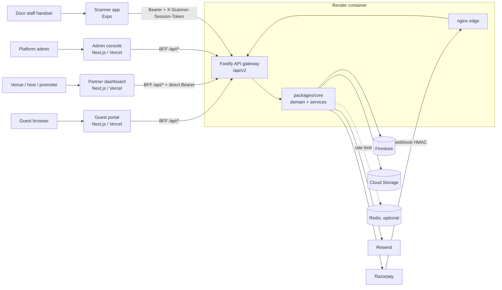
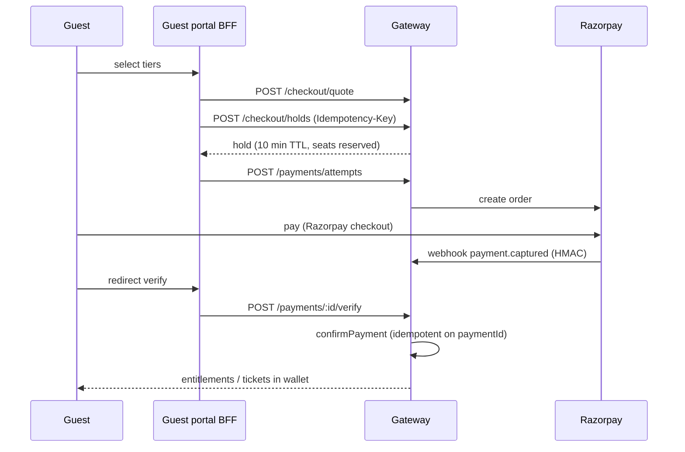
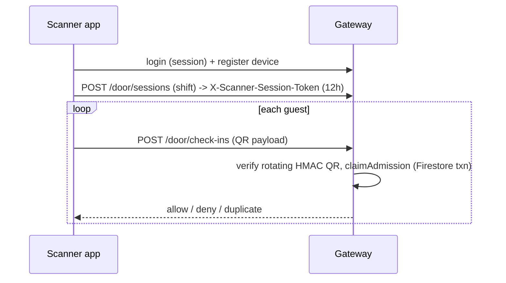

# 00. System Overview

## 1. Components

| Component | Tech | Runs on | Repo path | Port (dev) |
|---|---|---|---|---|
| Guest portal (consumers) | Next.js 16.3, React 19 | Vercel | `C1RCLE-FRONTEND/apps/guest-portal` | 3000 |
| Partner dashboard (venues, hosts, promoters) | Next.js 16.3 (webpack build), Tailwind 3 | Vercel | `.../apps/partner-dashboard` | 3001 |
| Admin console (platform ops) | Next.js 16.3, Tailwind 4 | Vercel | `.../apps/admin-console` | 3002 |
| Scanner app (door staff) | Expo SDK 55, React Native 0.83, expo-router | Handsets / web export | `.../apps/scanner-app` | Expo |
| API gateway | Fastify 5, zod 4, Better Auth | Render (Docker, nginx sidecar) | `C1RCLE-BACKEND/apps/api-gateway` | 8080 (8081 behind nginx) |
| Core domain | TypeScript library | In gateway process | `.../packages/core` | n/a |
| Contracts | zod schemas | Both repos | `.../packages/contracts` (owner) | n/a |
| Database / files | Firestore, Cloud Storage | Firebase (`c1rcle-v2`) | n/a | emulator 8081 |
| Optional cache | Redis (rate limiting only) | external | n/a | n/a |
| Payments | Razorpay | SaaS | adapter in gateway | n/a |
| Email | Resend | SaaS | adapter in gateway | n/a |
| Edge | nginx in-container; Cloudflare (staging API host only) | | | |

It is a **modular monolith**: one backend deployable, many frontends. Two repos, each its own pnpm + Turborepo workspace (root `README.md`). Do not run `pnpm install` at the root.

## 2. System context

## 3. Request lifecycle (backend)
1. nginx: host allowlist, edge rate limits, security headers, body cap 1 MB.
2. Fastify request id (trusted-proxy only), CORS (exact origins, credentials).
3. Better Auth session + `X-Organization-Id` membership lookup builds `request.actor`.
4. First-login password-rotation gate (403 `passwordChangeRequired`).
5. Per-route `preHandler`: rateLimit, validateV2 (zod), requirePermission (RBAC+ABAC), cached.
6. Thin handler: one service call (idempotent where `Idempotency-Key` required); response re-validated against zod.
7. Domain event to outbox, then in-process consumers (audit, analytics, notifications, follower fan-out).
8. Errors normalised to a flat envelope `{status, code, message, requestId, fieldErrors?}`.

Details: `../01-api-gateway/README.md`.

## 4. Key flows

### Paid checkout

Both the webhook and the redirect-verify path converge on one idempotent `confirmPayment`. See `../10-payments-and-finance/README.md`.

### Door entry

Offline mode: **not usable today**. The app denies entry when offline. The backend redesign (PR #138) and the contract mirror (PR #81) are merged on staging; the app's offline engine (PR #82) is open and not wired. See `../09-scanner-app/08-offline-design-and-status.md`.

## 5. Conventions that cut across everything
- Money is integer **paise**. Timestamps ISO-8601 (one exception: session `expiresAt` is epoch ms).
- Pagination is page-based: `page`, `pageSize`, `total`, `hasNextPage`.
- Success bodies are bare DTOs (no `{data, meta}` wrapper).
- Every mutable aggregate has `version` + `updatedAt` (optimistic locking, compare-and-set).
- Availability is **derived**, never stored: `quantity - sold - activeHolds`.
- Contracts are **backend-owned** and exported into the frontend (generated, do not hand-edit).
- Architecture rules are enforced by scripts in both repos (`check-boundaries`): single owner for env access, HTTP, design tokens, icons; no DB SDK in domain code; no deep package imports.

## 5b. The edge layer (nginx) and its target architecture
nginx sits in front of Fastify in the same container on Render (the "sidecar" topology), behind Cloudflare. What is built today, the constraints that shape it, and a staged proposal for the ideal edge (route classes, isolated webhook and scanner budgets, two accepted origin secrets, a warming state, caching ownership, pooled upstreams, resilience, defect register) are in **`NGINX-DREAM-ARCHITECTURE.md`** (browser version: `nginx-dream-architecture.html`). The "dream" parts are proposals, not decisions.

## 6. Environments and branches
`feature branch -> staging -> main`. Backend staging deploys through CI to Render (autoDeploy off, deploy API triggered after `CI OK` + `Security OK`, smoke test, auto-rollback). Frontend deploys via Vercel's git integration. Node: frontend 22.x / pnpm 10; backend 24 / pnpm 11. Details: `../11-infrastructure-and-cicd/README.md`.

## 7. Where to go next
Pick a service folder (01-11); the partner dashboard has an in-depth set in `../06-partner-dashboard/README.md`. Honest state of each: `../12-status-and-known-issues/README.md`.
