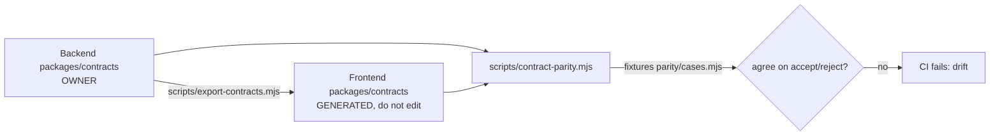

# 03. Contracts

> **Deeper page:** `../13-reference/DEEP-DIVE-OTP-RSVP-CONTRACTS.md` section 4 (file sizes, the export and parity scripts, and the finding that parity cases covered only 61 of 333 exported schemas; draft PR #145 adds hand cases for 48 more and a generated differential check over every schema, which found one real drift, `TAX_RULE_UPDATE`, frontend only).

**Owner path:** `C1RCLE-BACKEND/packages/contracts` (`@c1rcle/contracts`) · **Mirror:** `C1RCLE-FRONTEND/packages/contracts` (generated) · **Status:** Live.

## What it is
zod 4 schemas and inferred types describing every request/response on the wire. The gateway validates requests **and re-validates its own responses** with them; the frontend `api-client` validates responses with the mirrored copy.

## Contents (`src/contracts/`)
Core: `shared`, `auth`, `organization`, `event`, `partner`, `public`, `checkout`, `guest-profile`, `notifications`, `onboarding`, `social`. Door/scanner: `phase5`. Finance: `phase6`. Support/admin: `phase7`, `admin`, `admin-orders`, `admin-tickets`, `admin-promoters`, `admin-promotions`, `admin-analytics`, `admin-settings`.

Shared primitives: `opaqueIdSchema`, `idempotencyKeySchema`, `paginationQuerySchema`, `paginatedSchema`, `versionHeaderSchema`. Error envelope single-sourced: `buildV2ErrorResponse`, `zodToFieldErrors`, `errorCodeForStatus`, `ApiErrorCode` (D-004).

Entry points: `.` and `./client` (schemas only). `exports` resolve to `src` for types/import and `dist` as default; this is the only package with a build step.

## Ownership and sync

- `export-contracts.mjs` copies `src/**` into the frontend (`--frontend`, `C1RCLE_FRONTEND_PATH`, or sibling dir); every file carries a `GENERATED` header.
- `contract-parity.mjs [--frontend <path>]` parses shared fixtures with both schema sets and fails if they disagree (behavioural, not textual). Exit codes: 0 agree, 1 drift, 2 cannot check. Run by CI in both repos (frontend checks out backend at `BACKEND_REF`).
- The frontend also owns `@c1rcle/types` and `@c1rcle/api-client` (see `../06-partner-dashboard`).

## Wire conventions
Money in integer paise · page-based pagination (`page`, `pageSize`, `total`, `hasNextPage`) · ISO-8601 timestamps (session `expiresAt` is epoch ms) · bare DTO success bodies · flat error envelope `{status, code, message, requestId, fieldErrors?}` · `Idempotency-Key` header on mutations that need it.

## Gaps
- No true end-to-end test against a real gateway; parity is fixture-based (frontend audit; about 226 checks).
- `docs/api-contracts/openapi.yaml` is partial (~11 paths).
- Scanner offline manifest contract: the frontend mirror (PR #81, branch `feat/offline-manifest-contract-mirror`) is **merged** (2026-10-22); the backend side (PR #138) is on staging but not on `main` or the backend checkout used for this review.
