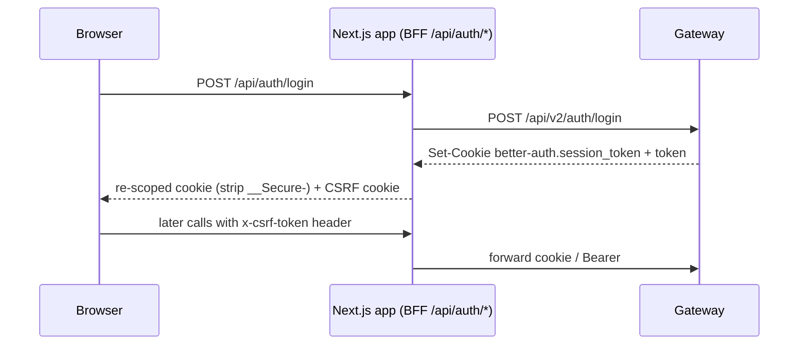

# 04. Authentication, Authorisation and RBAC

> **Deeper page:** `../13-reference/DEEP-DIVE-AUTH-INTERNALS.md` explains the request pipeline, the Better Auth settings and the frontend session store. **Correction to read this page with:** the "access token" returned by login and refresh is **the same 7-day session token as the cookie** (refresh does not rotate it), so keeping it in memory limits storage but not what a script that can read it could do.

**Status:** Live. Code: `apps/api-gateway/src/plugins/{auth,rbac}.ts`, `packages/core/.../admin-authority*`, FE `packages/auth`.

## Authentication
- **Better Auth 1.x**, email + password only (D-001, D-024). Persistence via `better-auth-firestore` in `v2_auth_users|sessions|accounts|verification_tokens`.
- Session cookie: httpOnly, `sameSite=lax`, host-only, `secure` in prod; 7-day lifetime, 1-day sliding refresh. `bearer()` plugin exposes `set-auth-token`; the browser keeps the access token **in memory only** and sends `Authorization: Bearer`.
- No JWT; no Firebase Auth for end users (Firebase is used only for phone verification).
- Platform role on the user: `guest | partner | admin`; signup forces `partner`.
- Password reset link emailed through Resend.
- **Email OTP** (`email-otp-service`): HMAC-hashed codes (`EMAIL_OTP_SECRET`), 60 s resend cooldown, 5-attempt lockout, `OTP_SEND` 5/min and `OTP_VERIFY` 10/min limits, generic responses (no account oracle).
- **Phone verification**: Firebase phone verifier through the `verification` port (used in partner onboarding).
- **Staff credentials**: `BetterAuthStaffCredentialProvisioner` creates staff accounts with a temporary password; `mustChangePassword` triggers a global 403 `passwordChangeRequired` until rotated.

## Browser flow (Next.js BFF)

- CSRF is double-submit; cookie name `<appId>.c1rcle.csrf` where `NEXT_PUBLIC_APP_ID` is `guest|partner|admin`.
- `src/proxy.ts` (Next 16 middleware) only checks cookie presence and redirects to `/login?next=`. It is UX, **not** a security boundary; the gateway re-validates every call.
- Server components use `getServerSession(cookieHeader)` from `@c1rcle/auth/server-session`.
- `admin-console/src/lib/auth-proxy.ts` is the only module allowed raw `fetch` (needs `Set-Cookie`).

## Actor resolution (gateway)
`onRequest` hook sets `request.authUser` and `request.actor`. A valid `X-Organization-Id` (regex-checked) matching a membership gives the full actor (role, capabilities); otherwise a session-only actor with empty `organizationId`.

## Organisation RBAC
- Roles: `owner`, `admin`, `manager`, `member`. Capabilities: `host`, `venue`, `promoter`.
- ~30 permissions: `organization.*`, `staff.manage`, `venue.*`, `event.*`, `slot-request.*`, `ticket.override`, `door.manage`, `finance.*` (read, orders, refunds request/approve/execute, payouts read/manage, bank_accounts, reconciliation, adjustments, audit).
- Owner/admin hold most (incl. finance-owner set); manager operational + smaller finance set; member read-only.
- **ABAC:** a `:organizationId` path param must equal `actor.organizationId`, else 403. Path is authoritative; default deny.

### Two vocabularies (common source of confusion)
| | Gateway `Permission` | Partner `PartnerPermission` |
|---|---|---|
| Keyed by | `OrganizationRole` | `PartnerRole` (OWNER/MANAGER/STAFF...) |
| Example | `venue.manage`, `event.create` | `VIEW_FINANCIALS`, `MANAGE_EVENTS` (18 values) |
| Role | **What the API enforces** | Dashboard hint only (`GET /organizations/:org/access`: permissions, `tabVisibility`, `partnerType`) |

Frontend `canDo` was hard-coded `true` (task A1); it now maps each action to a `PartnerPermission` and fails closed, **but only the unreachable legacy components call it**. The live V3 UI hides tabs from the server's `tabVisibility` and relies on the gateway for enforcement.

**Known defect (verified 2026-10-24):** `/access` for a **promoter** organisation returns `permissions: []`, because `tenancyRoleToPartnerRole` only emits OWNER/MANAGER/STAFF and the promoter matrix only defines PROMOTER/TEAM_LEAD. Several partner roles (FINANCE_ADMIN, SECURITY, DOOR, COHOST, PROMOTER, TEAM_LEAD) are unreachable via `/access`. Invitation accept also has no email-match check. Full detail: `../06-partner-dashboard/04-auth-rbac-and-access.md`.

## Platform admin authority (separate from org roles, D-017)
> In-depth treatment, including defects (settings update has no tier gate, approved proposals are re-executable, no admin-role gating in the console UI): `../07-admin-console/04-authority-dual-control-audit.md`. Note that proposal status is `pending|approved|rejected|cancelled` in code (docs say `proposed`) and `PROMOTER_*` actions are TIER2.
Roles `super | admin | ops | finance | support`, enforced in `AdminAuthorityService`.
- **Tier 1:** any admin, logged.
- **Tier 2:** `super`, `admin`, `ops`, `finance` only.
- **Tier 3:** `super` only under **dual control**: propose, a *different* super approves, execute reads its payload from the proposal. Covers admin provisioning/role change, commission adjustment, payout freeze/release, financial adjustments.
- Before/after audit in `v2_admin_audit_logs`. First admin seeded out of band (`seed:admin` script).

## Scanner / door credentials
Two credentials per scan: the Better Auth session **and** `X-Scanner-Session-Token` (minted once at `POST /door/sessions`, 12 h, only SHA-256 hash stored). Devices are their own aggregate (`v2_scanner_devices`). Door codes need `door.manage`; manual override needs `ticket.override`. See `../09-scanner-app`.

## Other actors
Razorpay webhook: fixed system actor; HMAC-SHA256 is its only auth, fails closed (503) if secret unset (D-022).

## Config names (values only in Render)
`BETTER_AUTH_SECRET`, `BETTER_AUTH_URL`, `BETTER_AUTH_TRUSTED_ORIGINS`, `ALLOWED_ORIGINS`, `CORS_ALLOWED_ORIGINS`, `EMAIL_OTP_SECRET`, `MAGIC_TICKET_SECRET`.

## Known issues
- Partner-dashboard onboarding writes now go through the BFF (audit H3 fixed in PR #77); only phone `verify-document` still calls the gateway directly with a Bearer token, and the BFF routes for it are unused.
- The open-redirect in `/change-password` (`next` not validated) and missing CSRF on support POST routes are listed in `../06-partner-dashboard/13-status-gaps-and-roadmap.md`.
- Moving apps behind one Cloudflare hostname (plan B7) is risky because of cookie scoping; not done.
