# 00. Partner dashboard: visual guide

Start here if you prefer pictures. Each diagram links back to the detailed file that explains it. Colours are consistent everywhere:

- 🟩 **green** = live against the real gateway
- 🟨 **yellow** = fixture or partial (sample data, or only part works)
- 🟥 **red** = defect or risk (see `13-status-gaps-and-roadmap.md`)
- ⬜ **grey** = infrastructure or neutral step

How to view the diagrams: GitHub, VS Code (Markdown Preview Mermaid Support), or paste a block into https://mermaid.live. A browser version is in `visual-guide.html` (needs internet for the Mermaid library).

Contents: 1 System map · 2 Studios and navigation · 3 Screen status map · 4 Sign-in and workspace flow · 5 How access is derived · 6 Who enforces what · 7 BFF vs direct requests · 8 Backend request lifecycle · 9 Onboarding · 10 Event create and publish · 11 Event lifecycle · 12 Slot requests · 13 Partnerships and promoter connections · 14 Promoter earnings chain · 15 Staff invitations · 16 Finance and payouts · 17 Data loading and failures · 18 Fixture to live roadmap · 19 Defect map

---

## 1. System map: who talks to whom
Files: `02-frontend-architecture.md`, `09-backend-api-reference.md`.
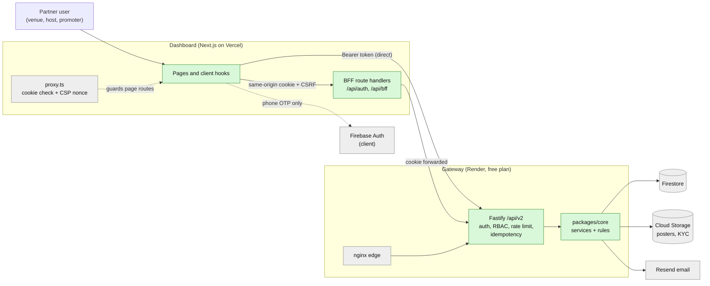

## 2. Studios and navigation
One shell, three studios. What differs is the nav and the primary action. Files: `01-product-model.md`, `03-routes-and-screens.md`.
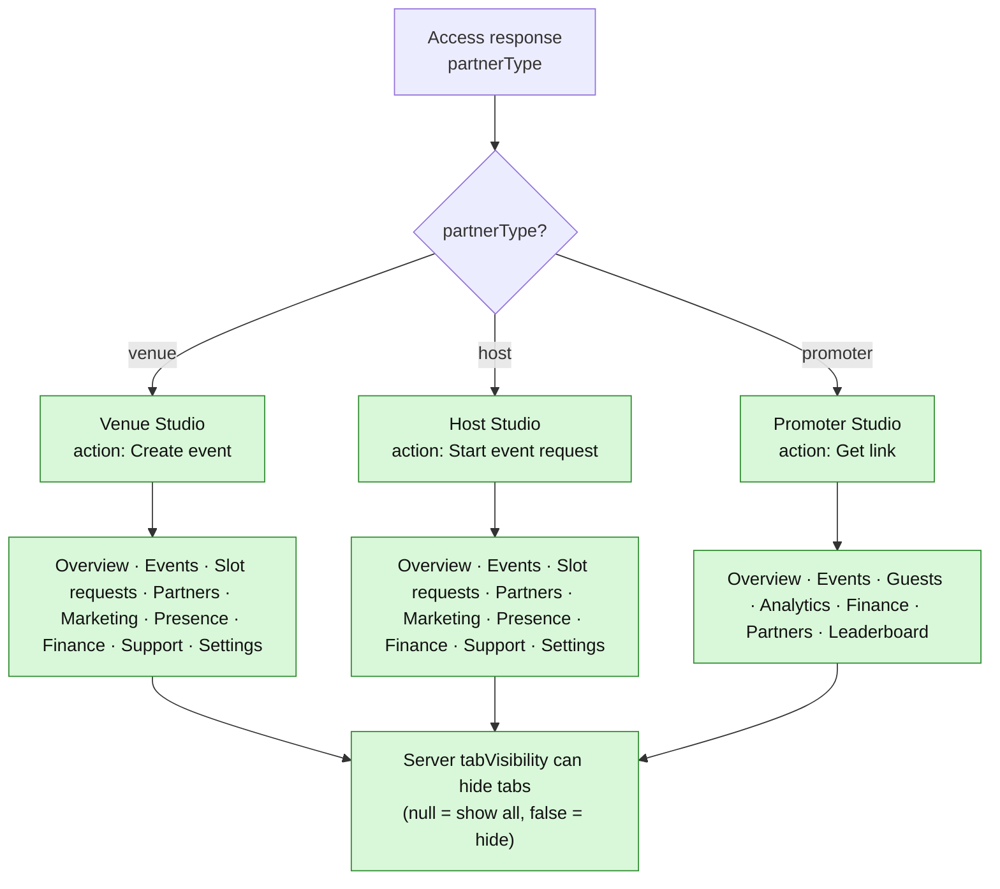
Calendar and Door are real routes that are not in the menu. "Presence" is in the menu but has no page.

## 3. Screen status map: what is real today
Files: `03-routes-and-screens.md`.
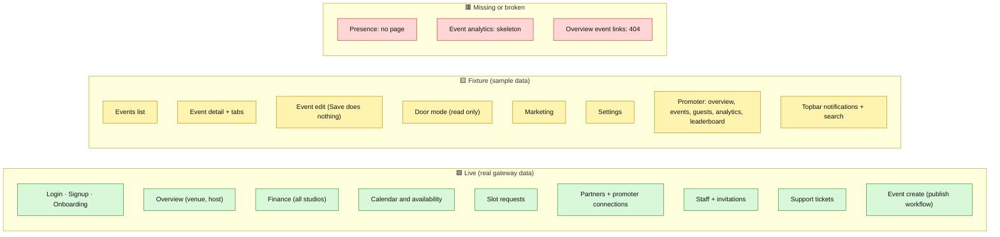
The old `/venue`, `/host`, `/promoter`, `/partner-network` pages are redirected (HTTP 307) into these screens and are dead code.

## 4. Sign-in to landing page
Files: `04-auth-rbac-and-access.md`.
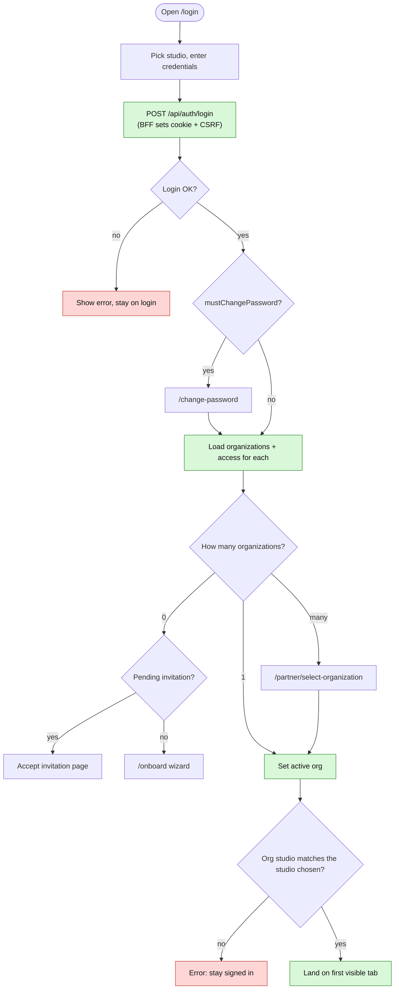
Note: if `?next=` is present the workspace match is skipped. `/change-password` does not validate its `next` parameter (open redirect).

## 5. How access is derived (and where promoters break)
Files: `04-auth-rbac-and-access.md`.
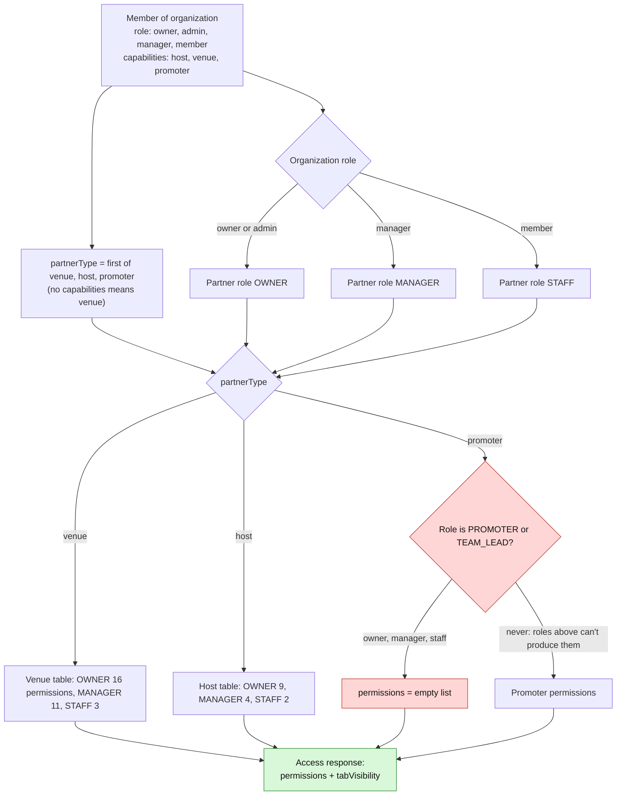
Roles FINANCE_ADMIN, SECURITY, DOOR, COHOST, PROMOTER and TEAM_LEAD cannot be produced by this path.

## 6. Who enforces what (security layers)
Files: `02-frontend-architecture.md`, `04-auth-rbac-and-access.md`.
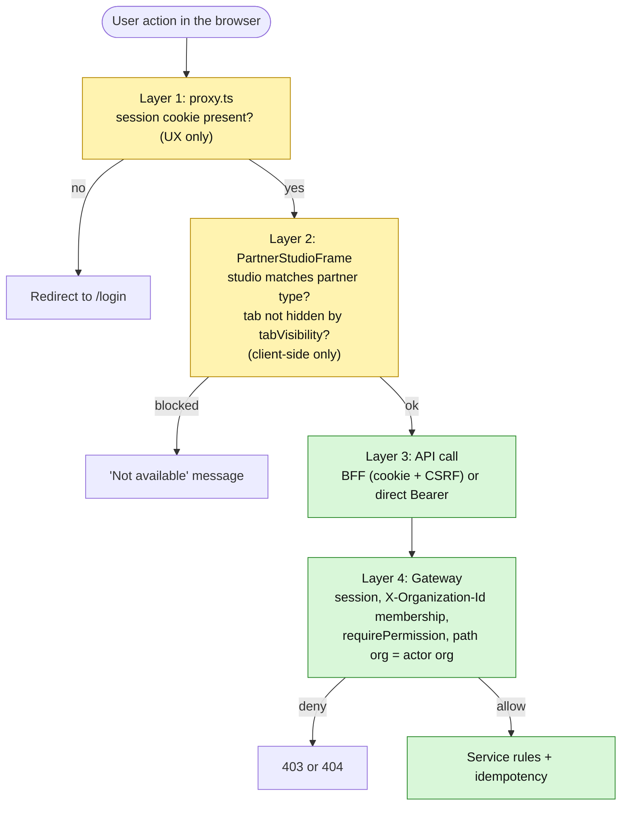
Only layer 4 is a real security boundary. Layers 1 and 2 are convenience. The payout button, for example, is not hidden by role in the UI; the gateway refuses non-owners.

## 7. BFF or direct: how a request leaves the browser
Files: `02-frontend-architecture.md`.
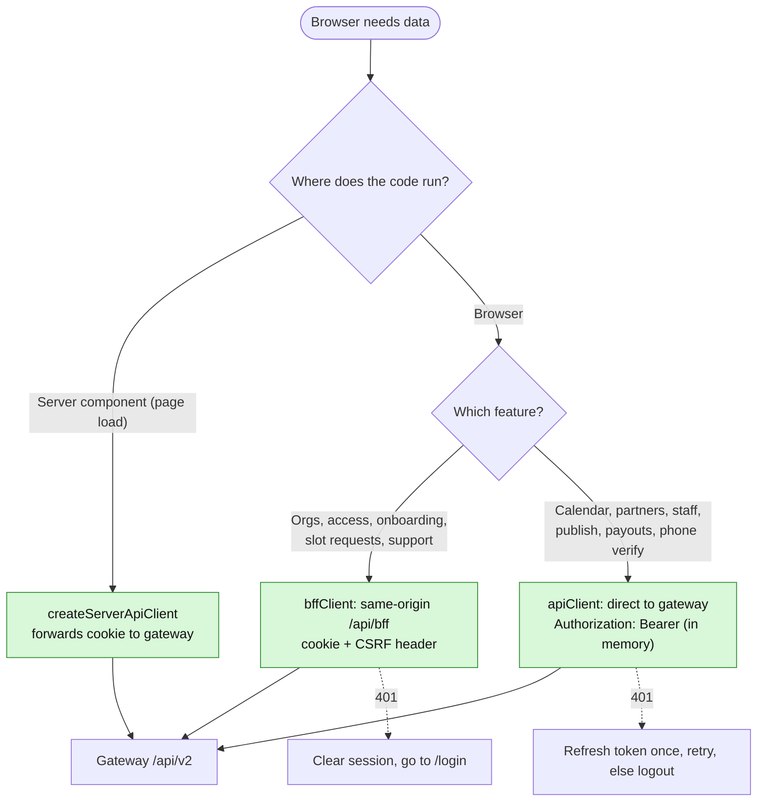
The direct path needs the gateway to allow the dashboard origin (CORS) and the page CSP to allow the gateway origin.

## 8. What happens to a request inside the gateway
Files: `09-backend-api-reference.md`.
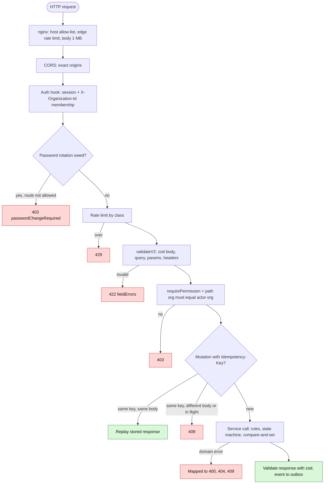

## 9. Onboarding: from application to approval
Files: `05-feature-onboarding-kyc.md`.
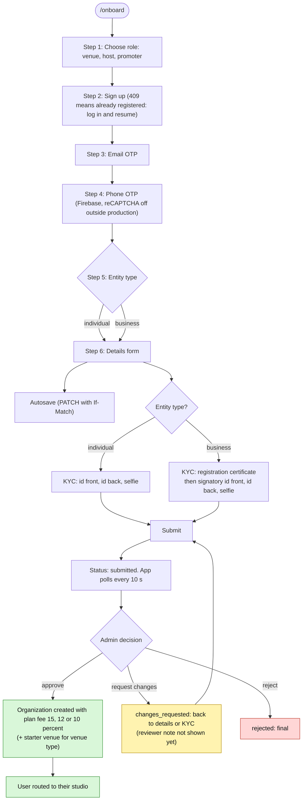
Approval is blocked unless every required document is verified by an admin. The admin side is documented in `../07-admin-console/05-flow-onboarding-kyc.md`.

## 10. Event create and publish: a chain of calls that can stop half-way
Files: `06-feature-calendar-slots-events.md`.
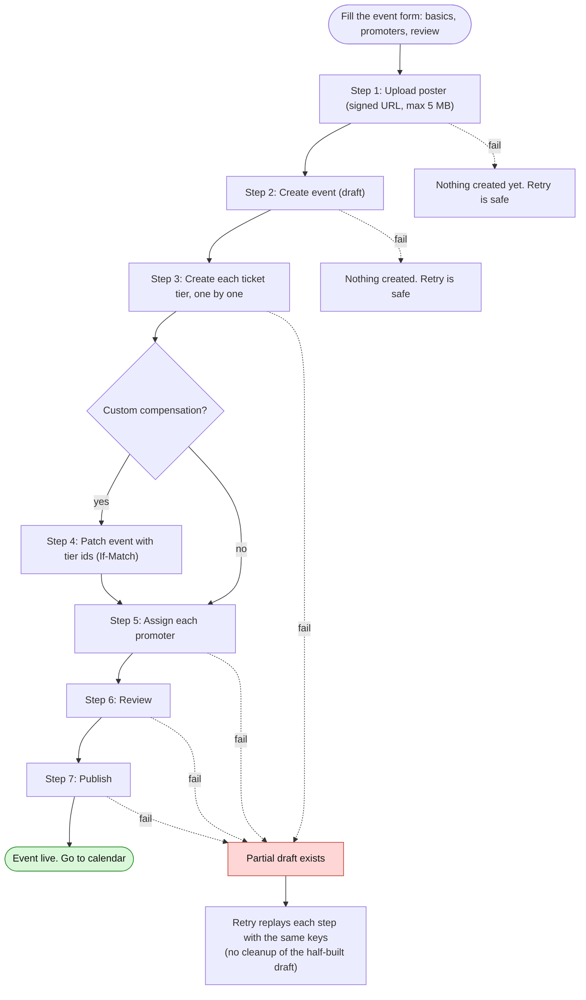
Publish rules: the event must pass review first, and compensation must be valid (standard needs a rate, salary needs an amount, custom needs a rate for every eligible tier). It does not check that a venue, a tier, a future date or a poster exist.

## 11. Event lifecycle and the gap
Files: `06-feature-calendar-slots-events.md`.
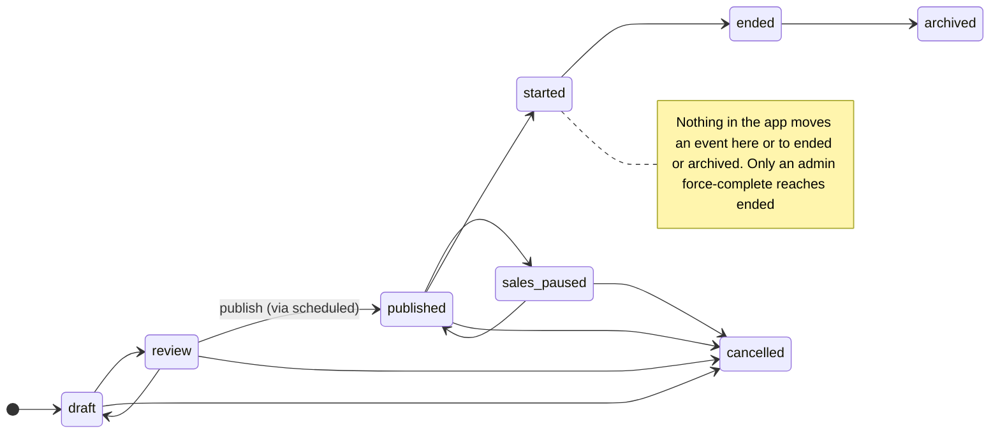

## 12. Slot request: host asks a venue for a date
Files: `06-feature-calendar-slots-events.md`.
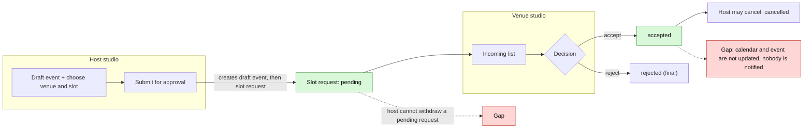
Create does not check that the venue exists, that a partnership exists, or that the event belongs to the host.

## 13. Partnerships and promoter connections
Files: `07-feature-partners-staff-promoters.md`.
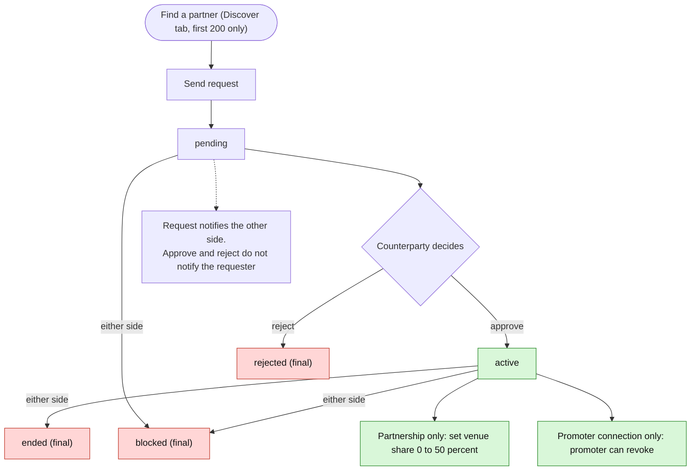
Who may answer: any member can approve or reject (permission is only organisation.read). Who may start a request: owner, admin or manager (member cannot).

## 14. Promoter earnings chain
Files: `07-feature-partners-staff-promoters.md`, `01-product-model.md`.
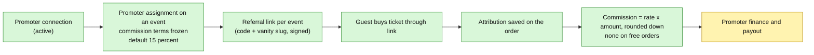
A referral link created without an assignment auto-creates a 0 percent assignment. Promoter screens in the dashboard are still on sample data.

## 15. Staff invitation
Files: `07-feature-partners-staff-promoters.md`.
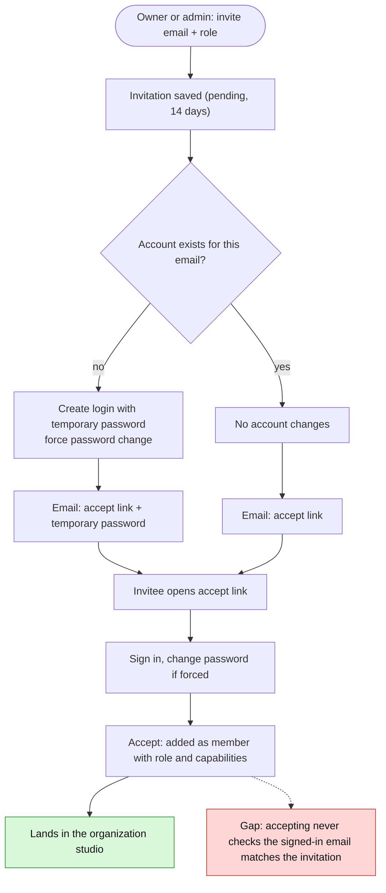

## 16. Finance: balance to payout
Files: `08-feature-finance-overview-support.md`.
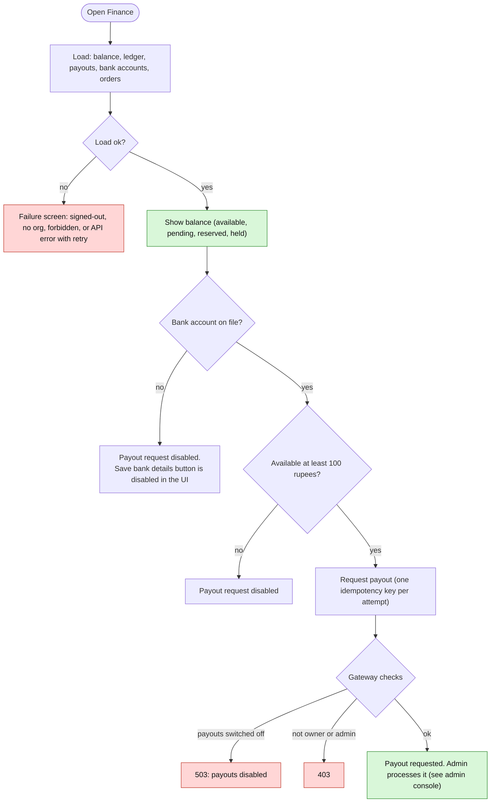

## 17. How pages load data and fail
Files: `08-feature-finance-overview-support.md`, `02-frontend-architecture.md`.
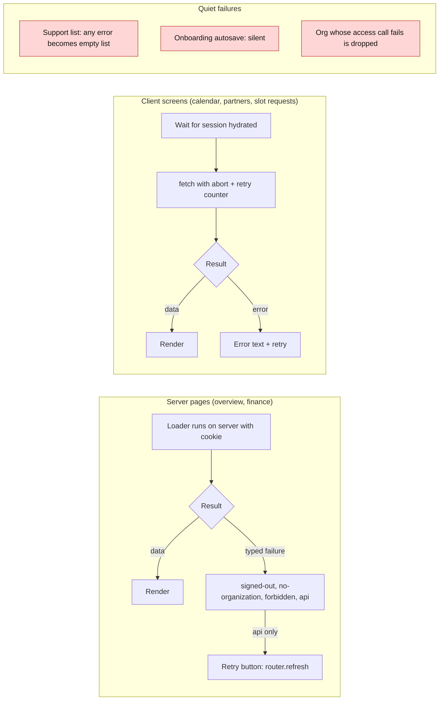

## 18. Fixture to live: suggested order
Files: `13-status-gaps-and-roadmap.md`.
```mermaid
flowchart LR
  S1["Step 1: Events list + detail<br/>from real events"] --> S2["Step 2: Event edit wired to PATCH"]
  S2 --> S3["Step 3: Fix overview links<br/>(studio prefix)"]
  S3 --> S4["Step 4: Notifications inbox<br/>(branch exists) + search"]
  S4 --> S5["Step 5: Promoter studio screens<br/>+ fix promoter access"]
  S5 --> S6["Step 6: Settings, marketing, door mode"]
  S6 --> S7["Step 7: Atomic publish<br/>(single server call)"]
  S7 --> S8["Step 8: Calendar semantics<br/>(slots on accept, UTC fix)"]
  S8 --> S9["Step 9: Delete legacy trees,<br/>add real end-to-end smoke test"]
  classDef step fill:#e8f0fe,stroke:#4a6fa5,color:#111
  class S1,S2,S3,S4,S5,S6,S7,S8,S9 step
```

## 19. Defect map: where the risk sits
Files: `13-status-gaps-and-roadmap.md`.
```mermaid
flowchart TD
  ROOT(["Partner dashboard risks"]) --> SEC["Security"]
  ROOT --> DAT["Data truthfulness"]
  ROOT --> WF["Workflow"]
  ROOT --> OPS["Operations"]
  SEC --> S1["Open redirect on change-password next"]
  SEC --> S2["Support POST routes: no CSRF"]
  SEC --> S3["Invitation accept: no email check"]
  SEC --> S4["reCAPTCHA off on preview deploys"]
  DAT --> D1["Events list and detail are fixtures"]
  DAT --> D2["Promoter /access returns no permissions"]
  DAT --> D3["Analytics up to about 10 min stale"]
  DAT --> D4["Overview links 404"]
  WF --> W1["Publish is not atomic"]
  WF --> W2["Calendar auto-creates a venue on read"]
  WF --> W3["Block times saved as UTC"]
  WF --> W4["Slot accept does not update calendar"]
  OPS --> O1["Gateway cold start 30 to 40 s"]
  OPS --> O2["Legacy trees: 40k dead lines, tests still run"]
  OPS --> O3["No real end-to-end test"]
  classDef bad fill:#ffd6d6,stroke:#c0392b,color:#111
  classDef warn fill:#fff3b0,stroke:#b58900,color:#111
  class S1,S2,S3,S4,D2 bad
  class D1,D3,D4,W1,W2,W3,W4,O1,O2,O3 warn
```
