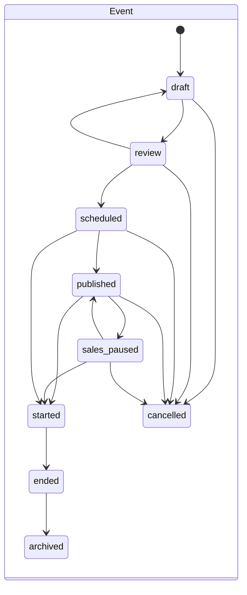
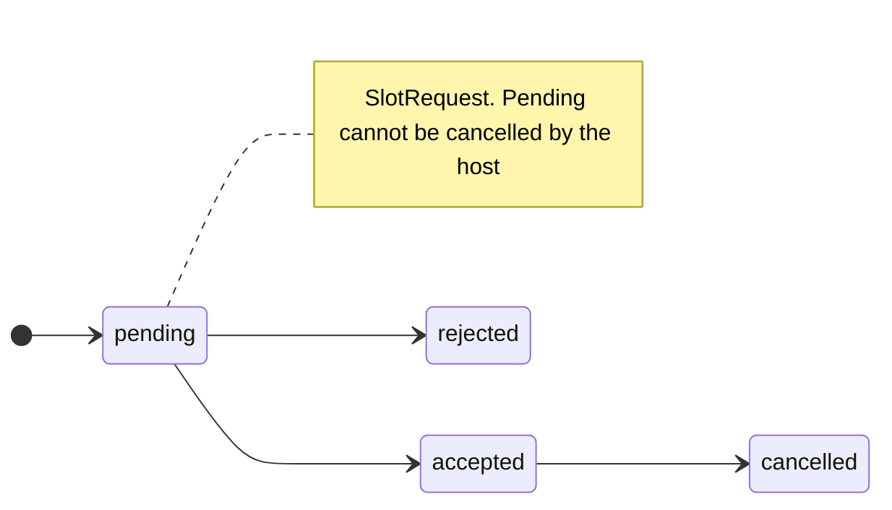
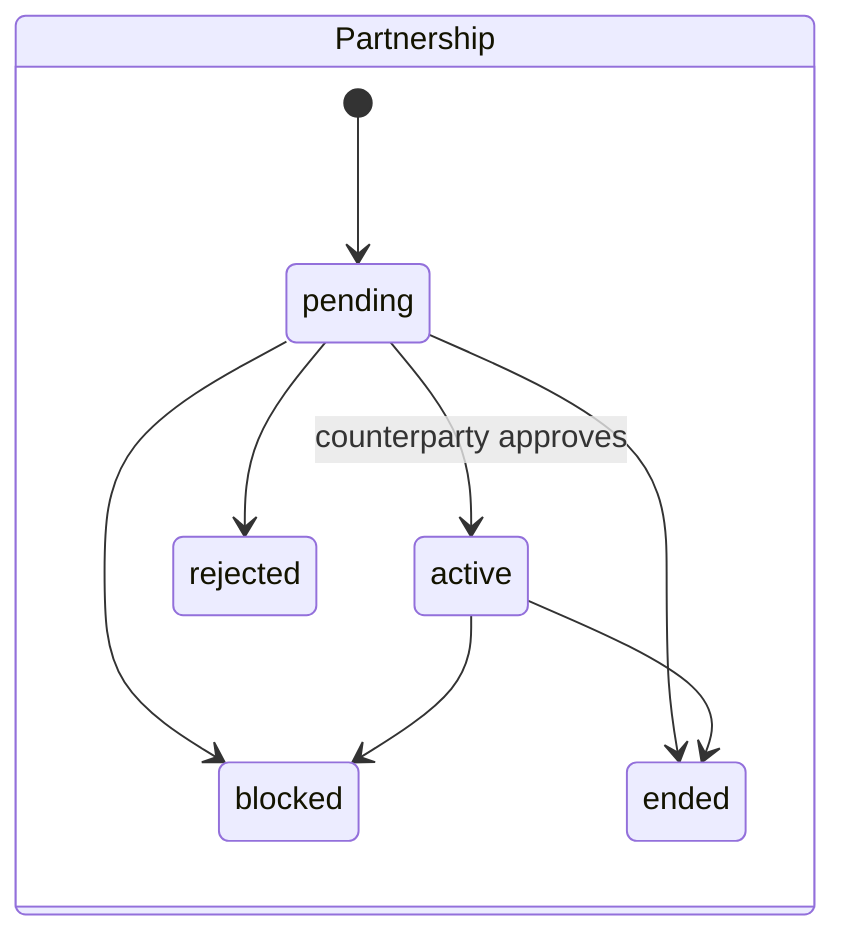
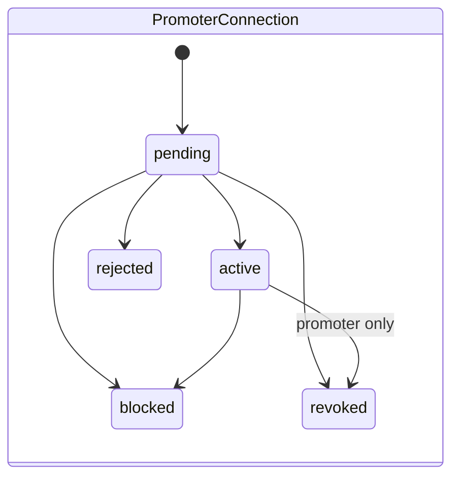
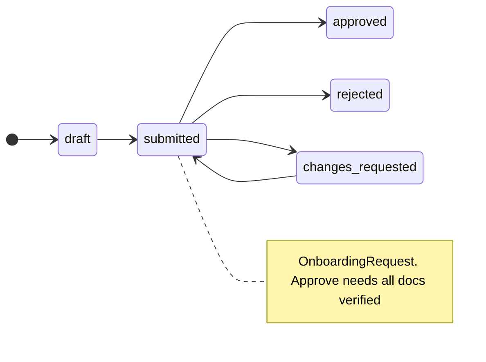

# 10. Domain model and state machines

Generic FSM helper: `packages/core/src/domain/fsm.ts` `transitionStatus(from, to, table)`. Same-state is a no-op; a transition not in the table throws `StateTransitionError` (409 `conflict`). Invitations throw `InvalidOperationError` (400) instead. Every mutable aggregate carries `version` and `updatedAt` (optimistic locking, compare-and-set).

## Aggregates (key fields)
| Aggregate (file under `packages/core/src/domain/models/`) | Fields |
|---|---|
| **Organization** (`organization.ts`) | `id, name, slug, ownerId, members[{userId, role, capabilities[], joinedAt, invitedBy?, name?, email?}], settings{name?, timezone?, defaultCurrency?}, status active|suspended|archived, platformFeePercent, version, createdAt, updatedAt` (suspend/reinstate/fee adjust are admin-only helpers; roles owner|admin|manager|member) |
| **OrganizationInvitation** | `id, organizationId, email (lower-cased), role, capabilities[], status, invitedBy, expiresAt, acceptedAt, acceptedBy, version` |
| **Venue** (`venue.ts`) | `id, organizationId, ownerId, status active|suspended, public{name, slug, description, shortDescription?, photoUrl, address{street, city, state, zip, country, lat, lng}, facilities[], capacity, menu{sections[{name, items[{name, description?, pricePaise, tags[]}]}], updatedAt}, settings{showGuestList, activityEnabled}}, private{contactEmail, contactPhone, socials{instagram, website, facebook}, internalNotes}, version` |
| **VenueSlot** | `id, venueId, label, startTime, endTime, recurring, status open|booked|blocked|cancelled, capacityFor, version` (only `blocked`/`cancelled` are ever written) |
| **SlotRequest** | `id, venueId, eventId|null, hostId (org id), status, message?, version` |
| **Event** (`event.ts`) | see `06-…`; `compensation{model standard|custom|salary, globalRatePercent, tierRates{tierId: pct}, salaryAmountPaise, salaryPeriod, salaryNotes}` |
| **TicketTier / PromoCode / TablePackage / PromoterAssignment** (`event-catalog.ts`) | see `07-…`; assignment `{id, eventId, promoterId, status active|ended|suspended, terms{version, ratePercent 0–100, flatPaise, tierRates?}, endedAt, suspendedAt}` |
| **Partnership** (`partnership.ts`) | `id, hostOrganizationId, venueOrganizationId, venueId, initiatedBy, status, message, venueShareRate, resolutionReason, resolvedAt, version` |
| **PromoterConnection** (`promoter-connection.ts`) | `id, promoterId, targetId, targetType, initiatedBy, status, message, resolutionReason, resolvedAt` |
| **ReferralLink** | `id, eventId, promoterId, organizationId, assignmentId, assignmentVersion, termsSnapshot, attributionSignature, eventTitle, campaignLabel, vanityPrefix, vanitySlug, code (4–16), label, isActive, clicks, conversions, revenuePaise, commissionPaise, version` |
| **OnboardingRequest** (`onboarding.ts`) | `id, userId, status, requestedType, plan, profile{legalName, contactPerson, phone, city, area?, website?, capacity?, instagram?, bio?, businessType?, registrationNumber?, entityType?}, documents[{label, storagePath, uploadedAt, status pending|verified|rejected, reviewedBy, reviewedAt, rejectionReason}], submittedAt, reviewedBy, reviewedAt, reviewNote, provisionedOrganizationId, version` |
| **Notification** | `id, recipientId (org id), recipientType venue|host|promoter, type, title, body, read, readAt, data, action{resourceType promoter_connection|partnership|slot_request, resourceId}|null, priority normal|high, dedupeKey, createdAt` |

## State machines

Invitation: `pending → accepted | revoked | expired` (terminal; expiry computed on read, 14-day TTL).
Admin-only extras on events: `adminPauseEvent`, `adminResumeEvent`, `adminForceCompleteEvent` (sets `adminOverride`).

## Events emitted and consumers
`organization.created|updated`, `venue.created|updated`, `event.created|updated|published|cancelled`, `partnership.requested`, `promoter_connection.requested`. Consumers: audit (memory-only), analytics projection, notification consumer, follower fan-out. Not emitted: member/invitation changes, partnership approve/reject/block/end, slot-request actions, venue menu update, event review.
