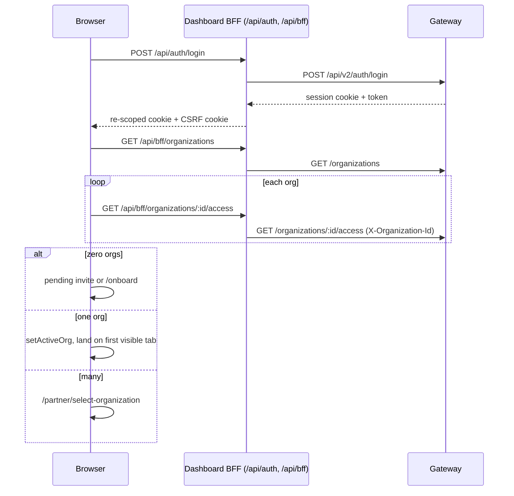
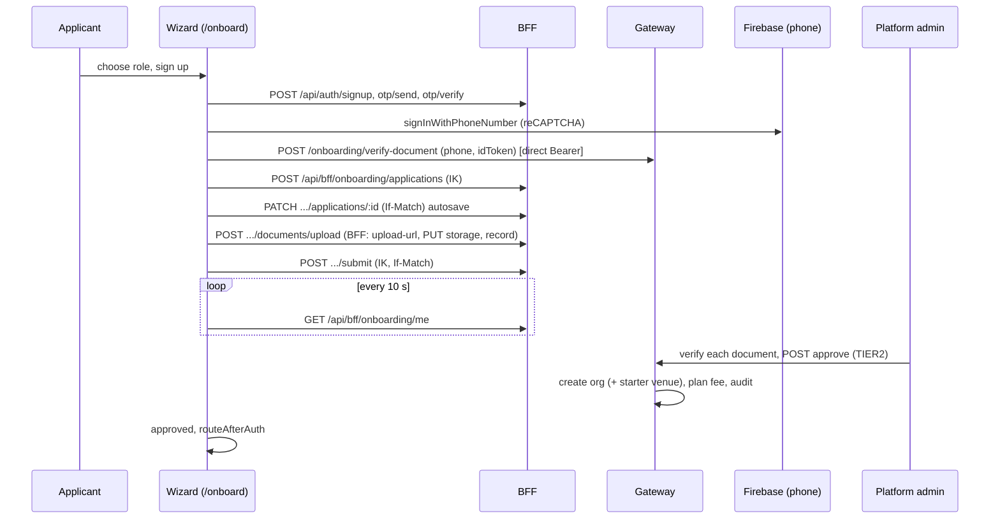
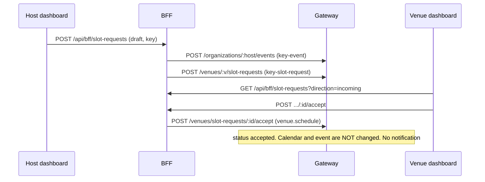
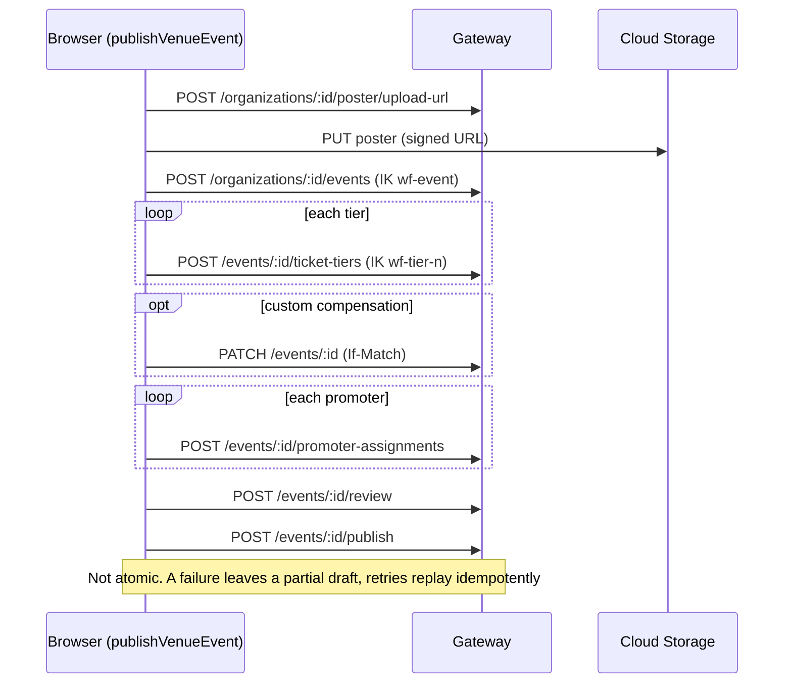
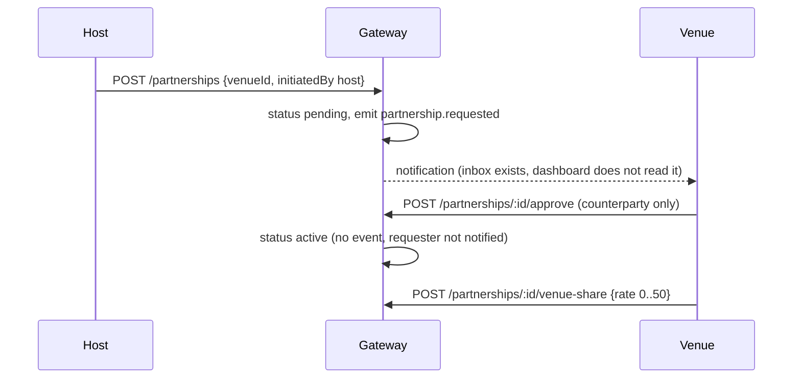
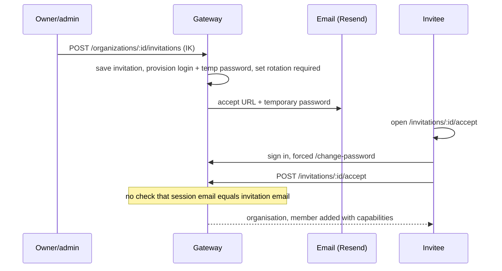
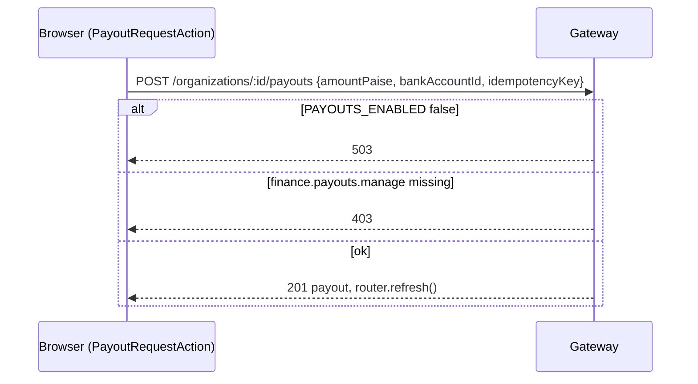

# 12. Sequence flows

## Login and workspace selection

## Onboarding to approval

## Slot request

## Event create and publish (browser-orchestrated)

## Partnership request and answer

## Staff invite and accept

## Payout request

