# 00. Admin console: visual guide

Start here if you prefer pictures. Each diagram points to the detailed file that explains it. Colours are consistent:

- 🟩 **green** = works and is enforced
- 🟨 **yellow** = partial, manual, or policy still undecided
- 🟥 **red** = defect or risk (see `14-status-gaps-and-roadmap.md`)
- ⬜ **grey** = infrastructure or neutral step

How to view: GitHub, VS Code (Markdown Preview Mermaid Support), or paste a block into https://mermaid.live. A browser version is in `visual-guide.html` (needs internet for the Mermaid library).

Contents: 1 System map · 2 Navigation map · 3 Roles and tiers · 4 How the gateway decides · 5 Dual control · 6 Onboarding review · 7 Refunds · 8 Disputes and chargebacks · 9 Payouts and the release gate · 10 Manual adjustment and commission · 11 Reconciliation · 12 Support ticket · 13 What each action really does · 14 Settings: what changes what · 15 Console sign-in and its gaps · 16 Audit trail coverage · 17 Defect map · 18 Suggested fix order

---

## 1. System map
Files: `02-frontend-architecture.md`, `11-backend-api-reference.md`.
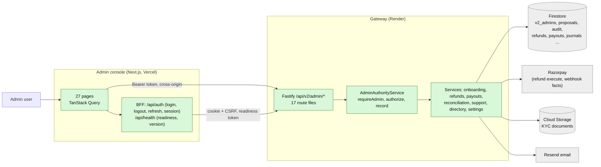
The console is thin: it holds no database access and no policy. Everything is decided at the gateway.

## 2. Navigation map: 24 desks in 6 sections
Files: `01-product-model-and-roles.md`, `03-desks-and-screens.md`.
```mermaid
flowchart TB
  NAV["Admin console menu"] --> OV["Overview"]
  NAV --> AP["Approvals"]
  NAV --> CO["Commerce"]
  NAV --> CA["Care"]
  NAV --> DI["Directory"]
  NAV --> PL["Platform"]
  OV --> o1["Overview"] & o2["Analytics"] & o3["Lookup"]
  AP --> a1["Proposals"] & a2["Onboarding"] & a3["KYC review"]
  CO --> c1["Orders"] & c2["Tickets"] & c3["Promotions"] & c4["Promoters"] & c5["Commissions"]
  CA --> k1["Support"] & k2["Refunds"] & k3["Disputes"] & k4["Chargebacks"] & k5["Payouts"] & k6["Reconciliation"] & k7["Adjustments"]
  DI --> d1["Venues"] & d2["Events"] & d3["Users"] & d4["Hosts"]
  PL --> p1["Admins"] & p2["Audit"] & p3["Health"] & p4["Settings"]
  classDef sec fill:#e8f0fe,stroke:#4a6fa5,color:#111
  class OV,AP,CO,CA,DI,PL sec
```
Every desk reads live data. The menu is the same for every signed-in user: it is not filtered by admin role.

## 3. Roles and tiers: who may do what
Files: `01-product-model-and-roles.md`, `04-authority-dual-control-audit.md`.
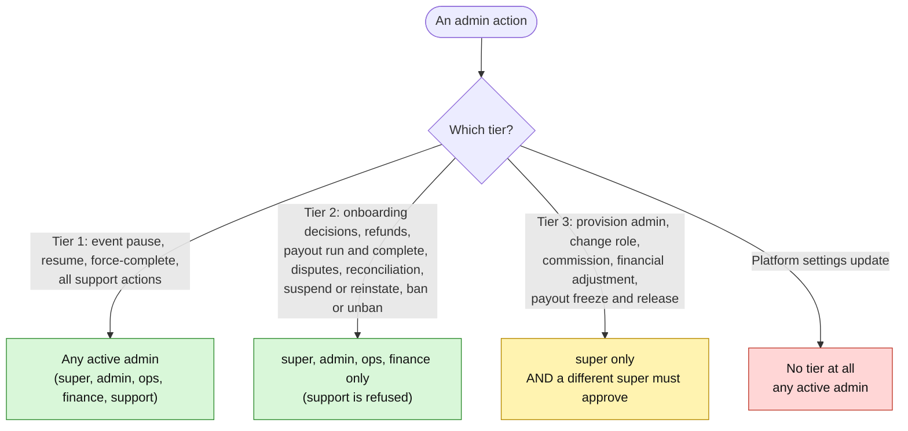

| Role | Reads | Tier 1 | Tier 2 | Tier 3 |
|---|---|---|---|---|
| super | everything | yes | yes | yes (with a second super) |
| admin | everything | yes | yes | no |
| ops | everything | yes | yes | no |
| finance | everything | yes | yes | no |
| support | everything | yes | **no** | no |

## 4. How the gateway decides on every admin request
Files: `04-authority-dual-control-audit.md`.
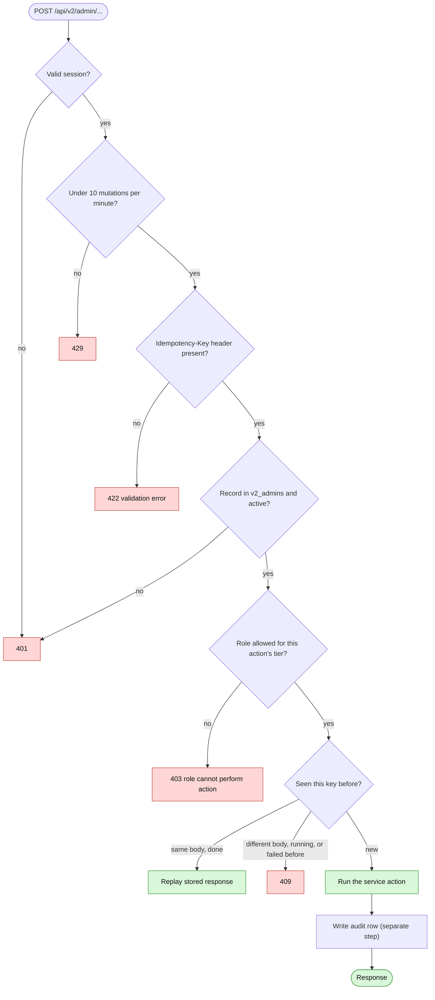
A revoked admin gets the same 401 as a non-admin. The audit row is written after the change, not in the same transaction.

## 5. Dual control (two-person rule)
Files: `04-authority-dual-control-audit.md`, `12-domain-model-and-state-machines.md`.
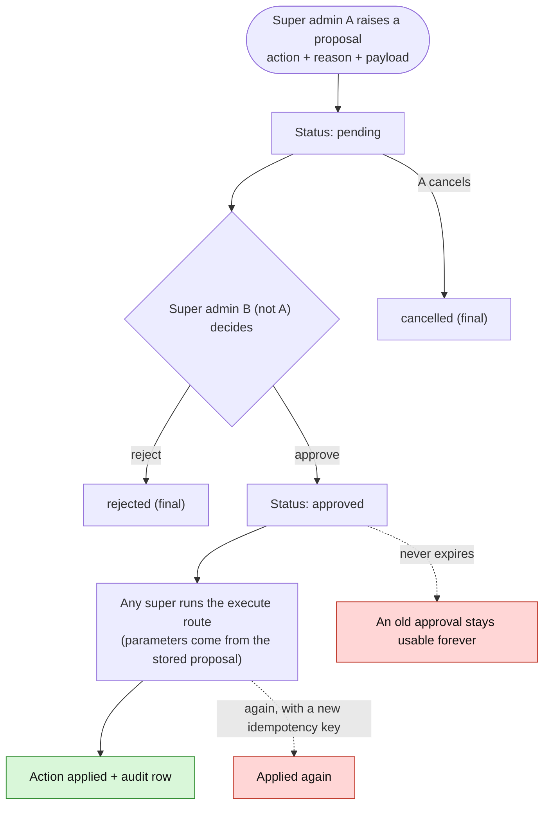
Safe design points: the approver cannot be the proposer, and execution reads the stored payload, not the request body. Gaps: no "executed" state, no expiry, and the executor can be the proposer or approver.

## 6. Onboarding review and KYC
Files: `05-flow-onboarding-kyc.md`.
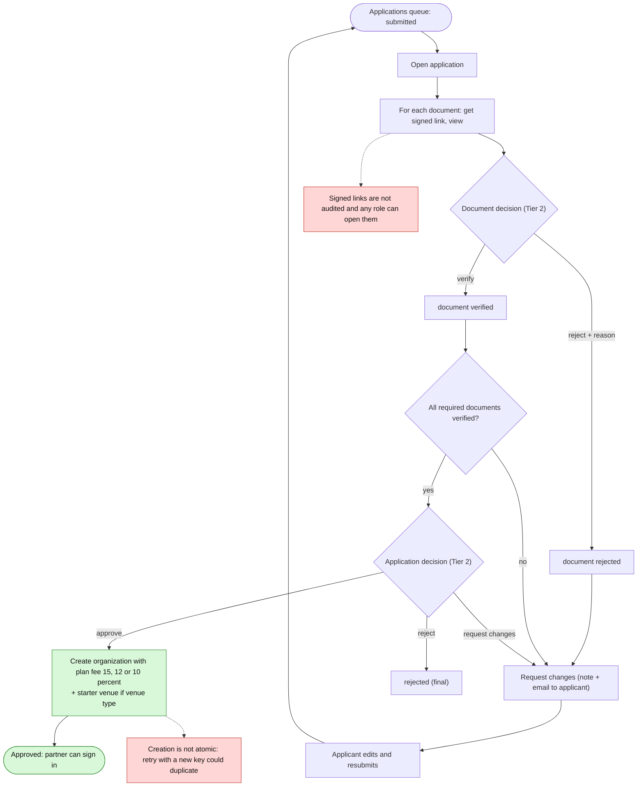
Required documents: individual = id front, id back, selfie. Business = registration certificate + signatory id front, id back, selfie.

## 7. Refund: request to settled
Files: `06-flow-refunds-chargebacks-disputes.md`.
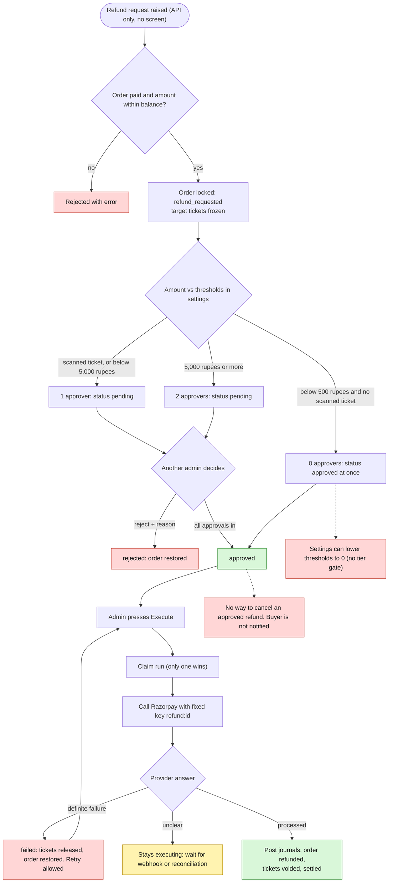
Open policy questions (finance and legal): who funds a refund of a split order, who bears the provider fee, tax on refunds, treatment if the partner was already paid.

## 8. Disputes and chargebacks are two different things
Files: `06-flow-refunds-chargebacks-disputes.md`.
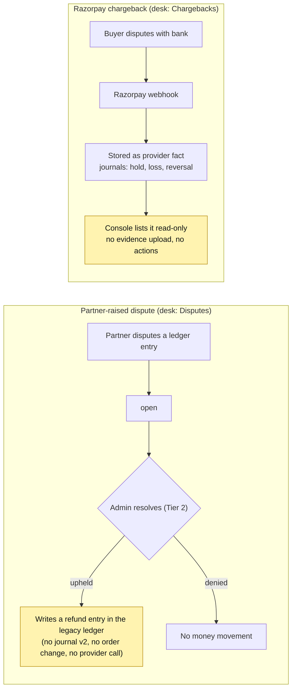
Undecided: who bears a lost chargeback and its fee, and whether payouts are held while a dispute is open.

## 9. Payouts and the production release gate
Files: `07-flow-payouts-and-adjustments.md`.
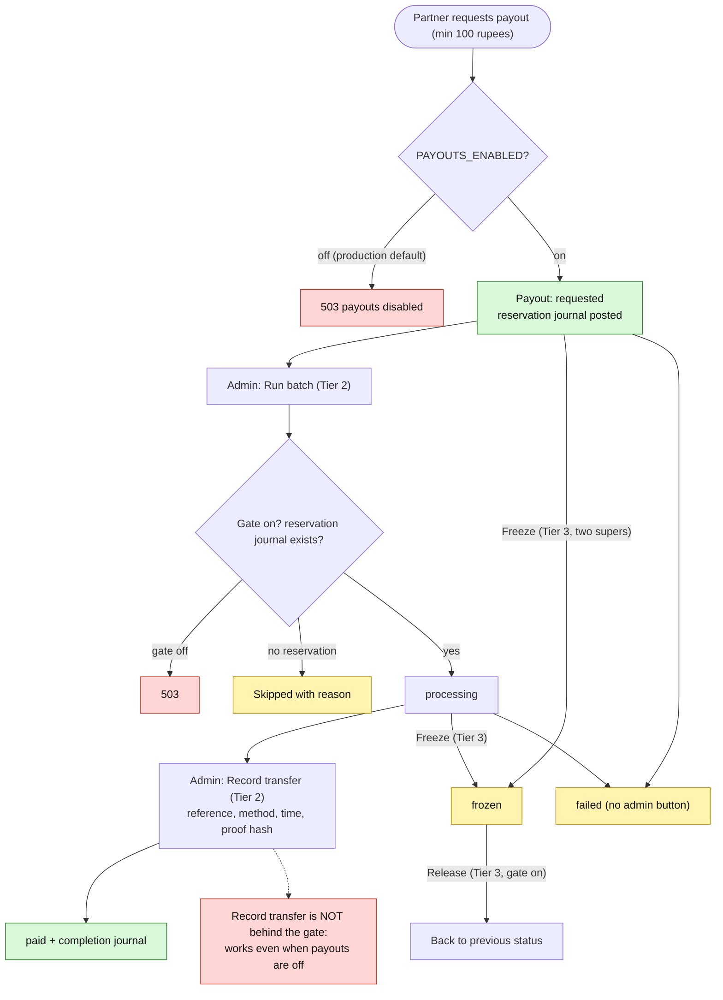
Before the gate is turned on in production: lawyer-confirmed funds flow (RBI payment aggregator), CA tax treatment (GST, TDS 194-O, TCS 52), Razorpay written approval.

## 10. Manual adjustment and commission change (both need two supers)
Files: `07-flow-payouts-and-adjustments.md`.
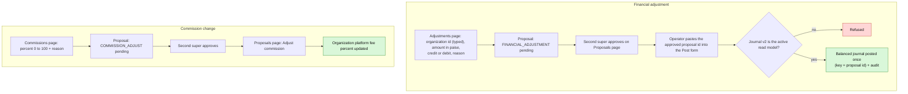
Settings also holds a fee rate as a 0 to 1 fraction, but nothing reads it. Only the per-organization percent is used.

## 11. Reconciliation
Files: `08-flow-reconciliation.md`.
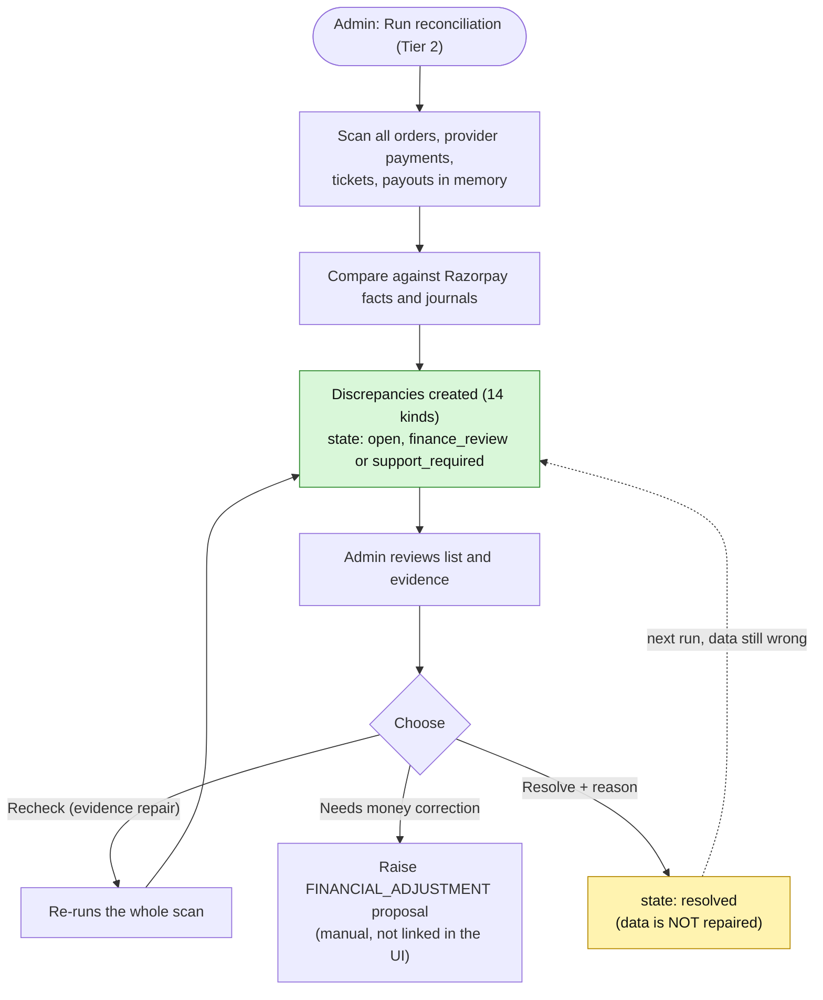
Kinds include: payment without order, paid order without payment or ticket, ticket without paid order, missing or duplicate or unbalanced journal, amount or currency mismatch, refund or chargeback mismatch, stale pending payment, payout mismatch.

## 12. Support ticket lifecycle
Files: `09-flow-support-desk.md`.
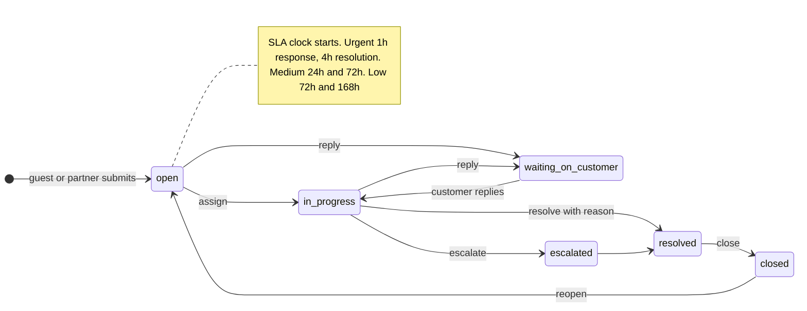
Side actions at any time: internal note, priority change (resets SLA), link order, event, venue or user, merge a duplicate into another ticket, soft delete and restore. All support actions are Tier 1, so every admin role can do them.

## 13. What each action really does (enforcement map)
Files: `10-flow-directory-and-platform-actions.md`.
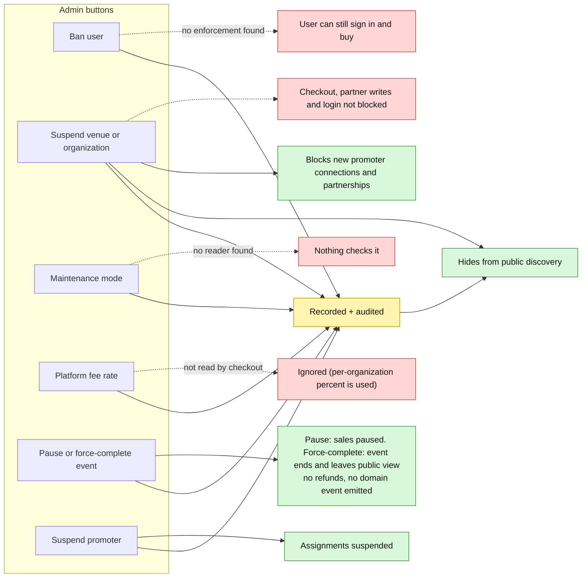

## 14. Platform settings: what each field really changes
Files: `10-flow-directory-and-platform-actions.md`.
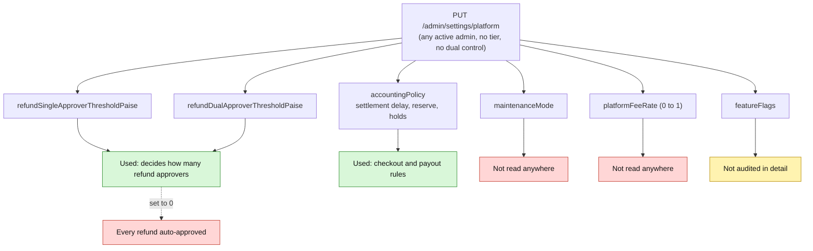

## 15. Console sign-in and its gaps
Files: `02-frontend-architecture.md`.
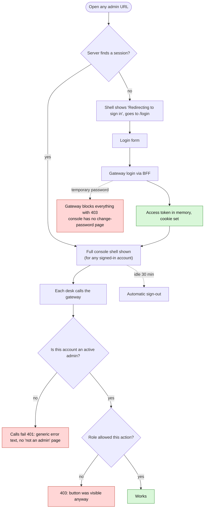

## 16. Audit trail: what is and is not recorded
Files: `04-authority-dual-control-audit.md`.
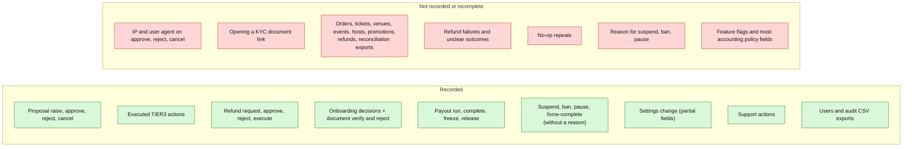
The audit row is written after the change, in a separate step. The console does not show the before and after values.

## 17. Defect map
Files: `14-status-gaps-and-roadmap.md`.
```mermaid
flowchart TD
  ROOT(["Admin console risks"]) --> SEC["Authority and security"]
  ROOT --> MON["Money"]
  ROOT --> ENF["Not enforced"]
  ROOT --> UX["Console UX"]
  SEC --> s1["Settings: no tier, can zero refund thresholds"]
  SEC --> s2["Approved proposals re-executable, no expiry"]
  SEC --> s3["Role never used in UI, no middleware"]
  SEC --> s4["Lookup shows emails to support role"]
  SEC --> s5["Health endpoints open to anyone reaching the app"]
  MON --> m1["Record transfer bypasses payouts gate"]
  MON --> m2["Zero-approver refund: one admin can do all"]
  MON --> m3["No cancel for approved refund, no fail-payout button"]
  MON --> m4["Policy undecided: refund and chargeback loss, tax"]
  ENF --> e1["Ban not enforced"]
  ENF --> e2["Maintenance mode not read"]
  ENF --> e3["Suspension only affects discovery and connections"]
  UX --> u1["Forced password change not handled"]
  UX --> u2["No pagination, 100 row cap, CSV capped too"]
  UX --> u3["No confirm on force-complete, refund approve, payout run"]
  UX --> u4["Generic errors hide the gateway reason"]
  UX --> u5["No screen to create refund or provision admin"]
  classDef bad fill:#ffd6d6,stroke:#c0392b,color:#111
  classDef warn fill:#fff3b0,stroke:#b58900,color:#111
  class s1,s2,s3,m1,m2,e1,e2,u1 bad
  class s4,s5,m3,m4,e3,u2,u3,u4,u5 warn
```

## 18. Suggested fix order
Files: `14-status-gaps-and-roadmap.md`.
```mermaid
flowchart LR
  F1["Step 1: Gate settings update<br/>(dual control) + validate thresholds"] --> F2["Step 2: Proposals: executed status,<br/>single use, expiry"]
  F2 --> F3["Step 3: Enforce or remove:<br/>ban, maintenance, suspension, fee rate"]
  F3 --> F4["Step 4: Put complete-payout behind the gate;<br/>add fail-payout and cancel-refund"]
  F4 --> F5["Step 5: Console: role in session, gate buttons,<br/>password-change page, confirms, pagination"]
  F5 --> F6["Step 6: Audit: IP on all actions, document links,<br/>exports, before and after view"]
  F6 --> F7["Step 7: Support list filters on the server"]
  F7 --> F8["Step 8: Reconciliation: schedule, de-duplicate, targeted retry"]
  F8 --> F9["Step 9: Decide policies, then consider enabling payouts"]
  classDef step fill:#e8f0fe,stroke:#4a6fa5,color:#111
  class F1,F2,F3,F4,F5,F6,F7,F8,F9 step
```
