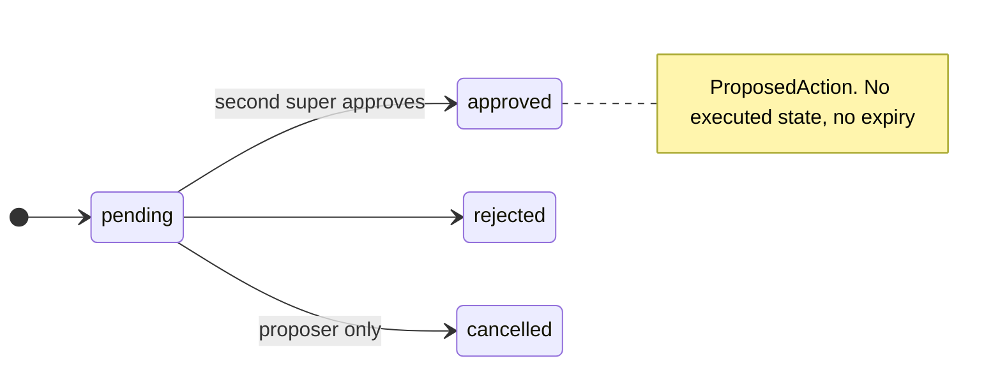
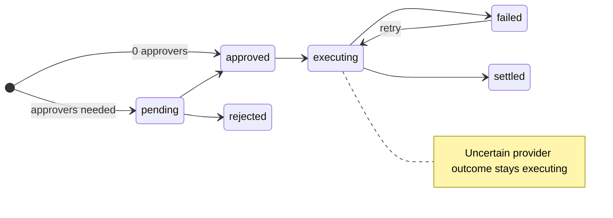
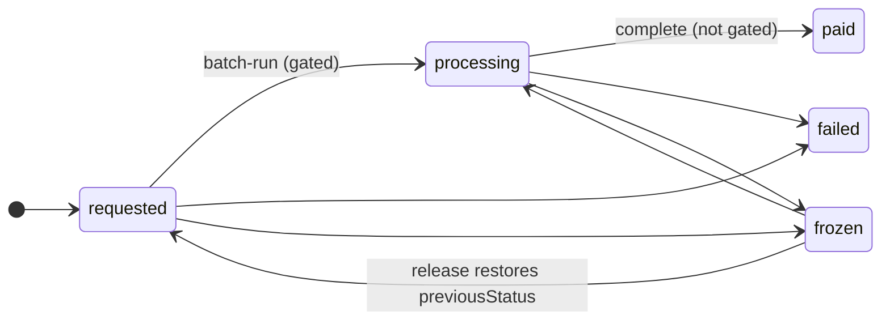
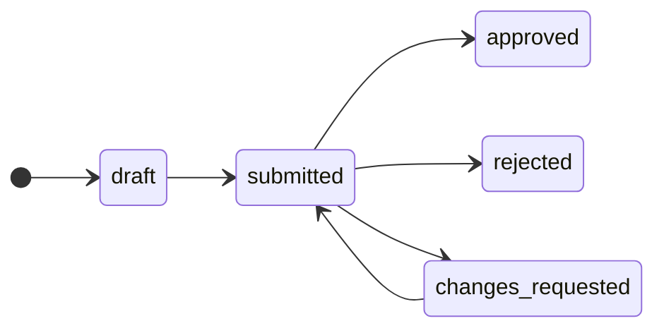
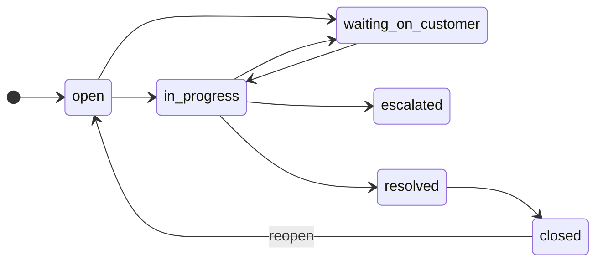

# 12. Domain models and state machines (admin)

All aggregates extend `VersionedEntity` (`id`, `version`, `createdAt`, `updatedAt` as ISO strings) except `AdminAuditRecord` (epoch ms). Source: `packages/core/src/domain/models/`.

| Aggregate | Key fields |
|---|---|
| `PlatformAdmin` (`admin-authority.ts`) | `id`, `email`, `role super\|admin\|ops\|finance\|support`, `isActive` |
| `ProposedAction` | `action`, `proposedBy`, `reason`, frozen `payload`, `status`, `resolvedBy`, `resolvedAt`, `resolutionReason`. No proposer role, no expiry, no executed marker |
| `AdminAuditRecord` (`ports/audit.ts`) | `adminId, actorId?, organizationId?, adminRole?, action?, targetType?, targetId?, before?, after?, reason?, ipAddress?, userAgent?, occurredAt` |
| `AdminRefundRequest` (`refund-request.ts`) | see `06-…` |
| `Dispute` (`dispute.ts`) | `organizationId, orderId, ledgerEntryId, raisedBy, reason, amount, status, resolutionNote, resolvedAt, resolution` |
| `Payout` (`payout.ts`) | `organizationId, bankAccountId, amount, status, failureReason, requestedBy, processedAt, transferReference, transferredAt, transferMethod, transferProof{sha256, contentType, sizeBytes}, approvedBy, previousStatus` |
| `ReconciliationRun` / `ReconciliationDiscrepancy` | see `08-…` |
| `SupportTicket` | see `09-…` |
| `PlatformSettings` | see `10-…` |
| `UserBan` (`user-ban.ts`) | `id = userId`, `isBanned`, `bannedAt`, `bannedBy`, `banReason` (single upserted record, no history) |
| Journal (`financial-journal`) | `v2_financial_journals` + lines + idempotency; admin-relevant `source.type`: `manual_adjustment`, `payout_reservation`, `payout_completion`, `refund`, `chargeback`, `chargeback_loss`, `chargeback_reversal`; transition singleton `v2_financial_journal_transition` |
| Legacy ledger | `v2_partner_ledger` (an upheld dispute writes a `refund` entry) |

## State machines

Dispute `open → under_review → resolved` (admin resolve may skip `under_review`). Reconciliation discrepancy `open | finance_review | support_required → resolved` (only transition coded). Reconciliation run `running → completed | failed`. Event admin overrides: `published|sales_paused|started → ended` (force-complete). Promoter assignment `active ↔ suspended`, `ended` terminal.

## Events emitted
Admin code emits almost nothing: `finance.refund.settled` (refund execute). Admin-ops services emit no domain events; audit rows are the record. Consumers (audit memory repository, analytics projection, notifications) therefore do not see suspensions, bans or settings changes.

## Collections used by admin
`v2_admins`, `v2_proposed_actions`, `v2_admin_audit_logs`, `v2_onboarding_requests`, `v2_verification_attempts`, `v2_organizations`, `v2_venues`, `v2_events`, `v2_orders`, `v2_entitlements`, `v2_auth_users` (read), `v2_user_bans`, `v2_refund_requests`, `v2_payouts`, `v2_bank_accounts`, `v2_disputes`, `v2_partner_ledger`, `v2_provider_payments`, `v2_financial_journals` (+`_lines`, `_idempotency`), `v2_financial_journal_transition`, `v2_reconciliation_runs`, `v2_reconciliation_discrepancies`, `v2_platform_settings`, `v2_support_tickets`, `v2_safety_reports`, `v2_event_catalog_promos`, `v2_event_catalog_promoter_assignments`, `v2_cart_reservations`, `v2_idempotency_records`.
Declared composite indexes: `onboarding_requests (status+createdAt; userId+createdAt desc)`, `proposed_actions (status+createdAt)`, `refund_requests (status+createdAt desc; orderId+createdAt desc)`, `payouts (status+createdAt desc; organizationId+createdAt desc)`, `disputes (status+createdAt desc; org variants)`, `admin_audit_logs (targetId+occurredAt desc)`, `support_tickets` (see `09-…`), `safety_reports`. Firestore rules are deny-all for clients; `scripts/check-firestore-indexes.mjs` runs in CI.
