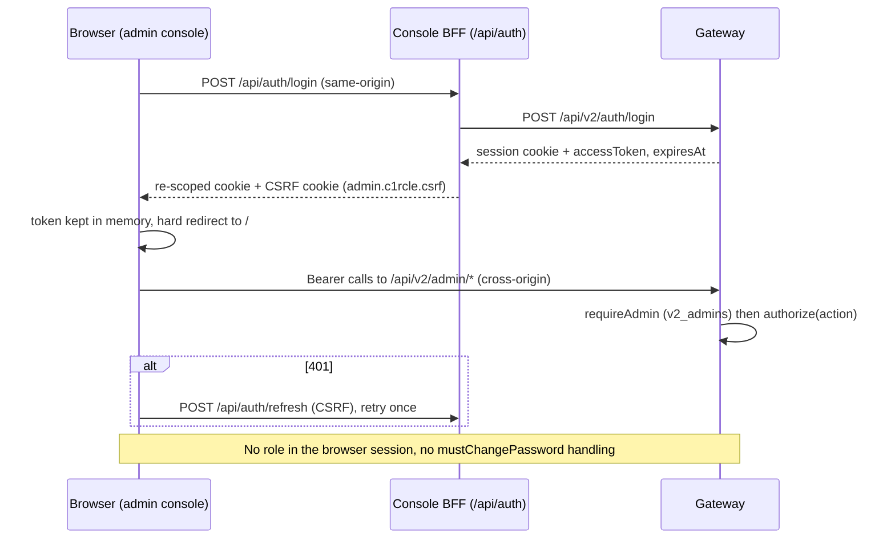
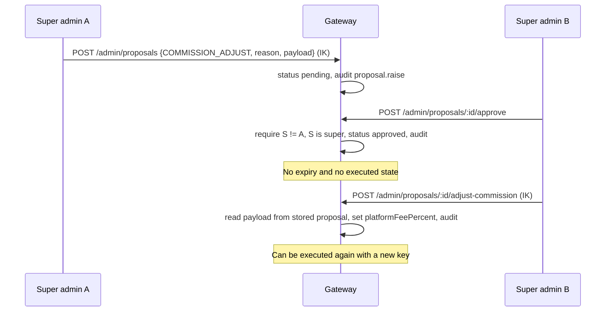
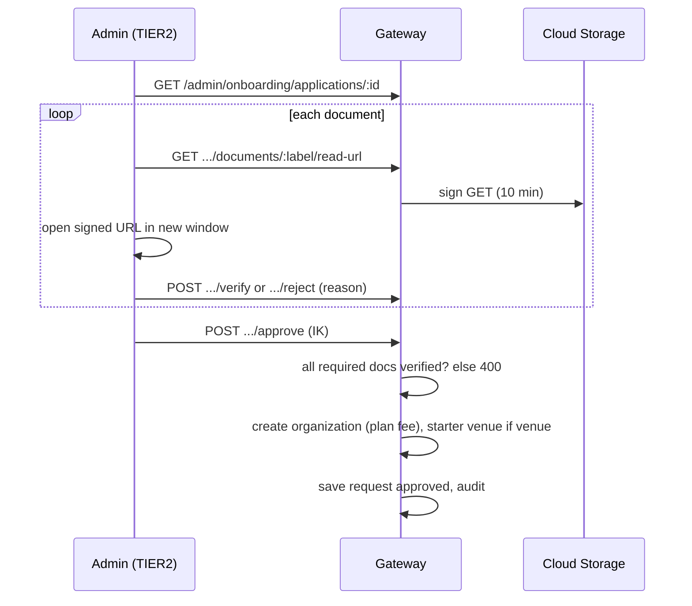
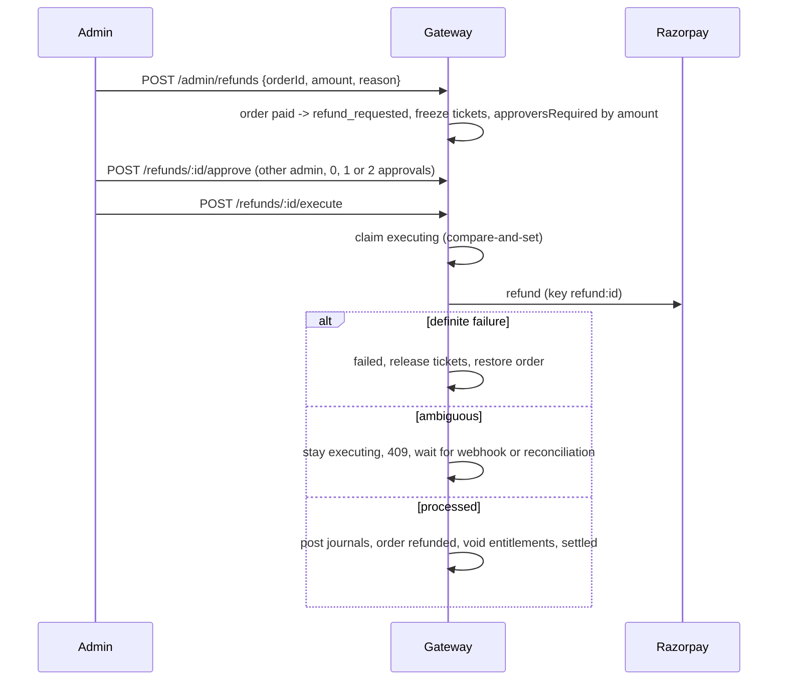
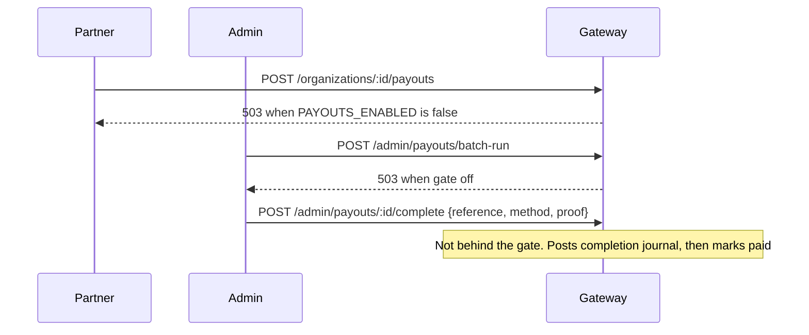
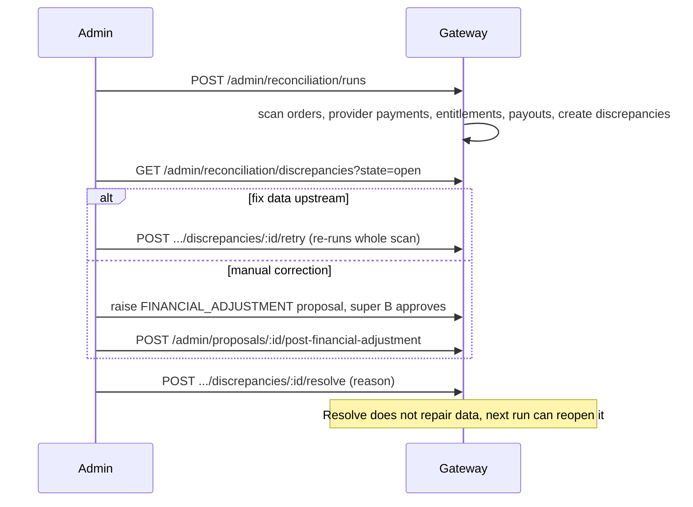
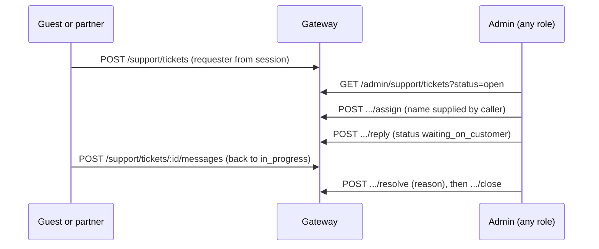

# 13. Sequence flows

## Admin sign-in and session

## Dual-control action (commission change)

## Onboarding approval

## Refund lifecycle

## Payout (with release gate)

## Reconciliation and adjustment

## Support ticket handling

