# 00. Guest portal: visual guide

Start here if you prefer pictures. Each diagram points to the file that explains it. Colours:

- 🟩 **green** = live and working
- 🟨 **yellow** = fixture, partial, blocked in production or a decision is pending
- 🟥 **red** = defect or risk (see `07-status-gaps-and-roadmap.md`)
- ⬜ **grey** = infrastructure or neutral step

How to view: GitHub, VS Code (Markdown Preview Mermaid Support), or https://mermaid.live. A browser version is in `visual-guide.html` (needs internet for the Mermaid library).

Contents: 1 System map · 2 Page map (production) · 3 Sign-in and gating · 4 The BFF path · 5 Discovery data flow · 6 RSVP · 7 Paid checkout · 8 Payment recovery · 9 Tickets and the QR · 10 Promoter link flow · 11 What the portal does not use · 12 SEO map · 13 Security findings · 14 Production vs preview · 15 Defect map · 16 Fix order

---

## 1. System map
Files: `02-architecture-auth-and-bff.md`.
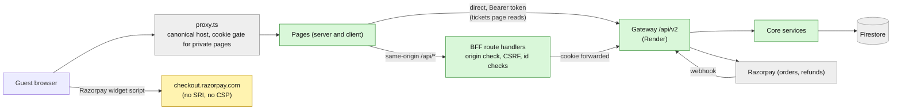

## 2. Page map (what a production visitor really gets)
Files: `01-routes-and-screens.md`.
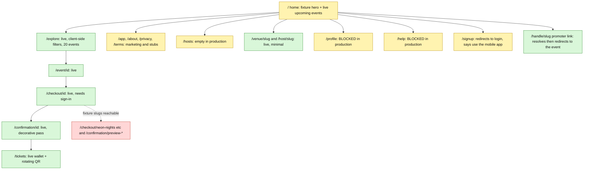

## 3. Sign-in and page gating
Files: `02-architecture-auth-and-bff.md`.
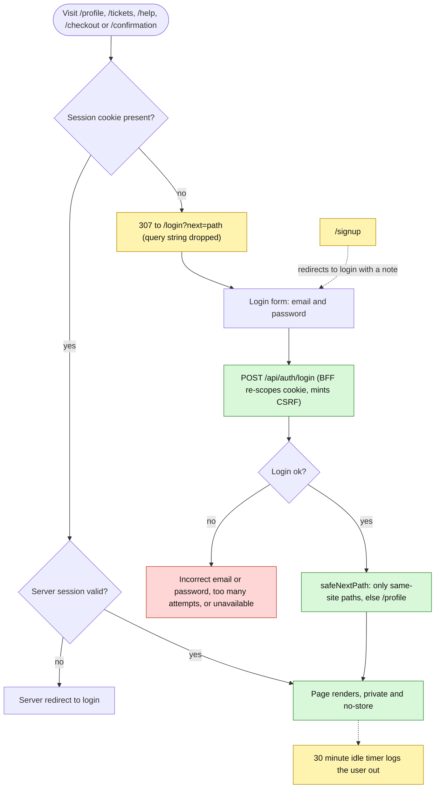
The proxy only checks that a cookie exists. The gateway reports every user as role partner, so a partner or admin can sign in here.

## 4. The BFF path and its checks
Files: `02-architecture-auth-and-bff.md`.
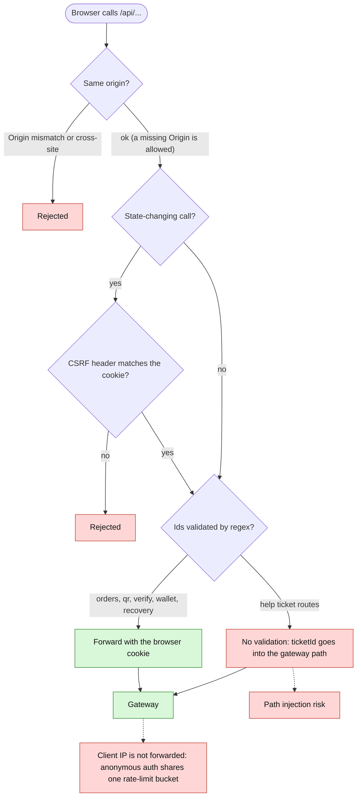
The help POST routes check origin but not CSRF, and the help GET detail route does not check origin.

## 5. Discovery data flow
Files: `03-discovery-seo-and-promoter-links.md`.
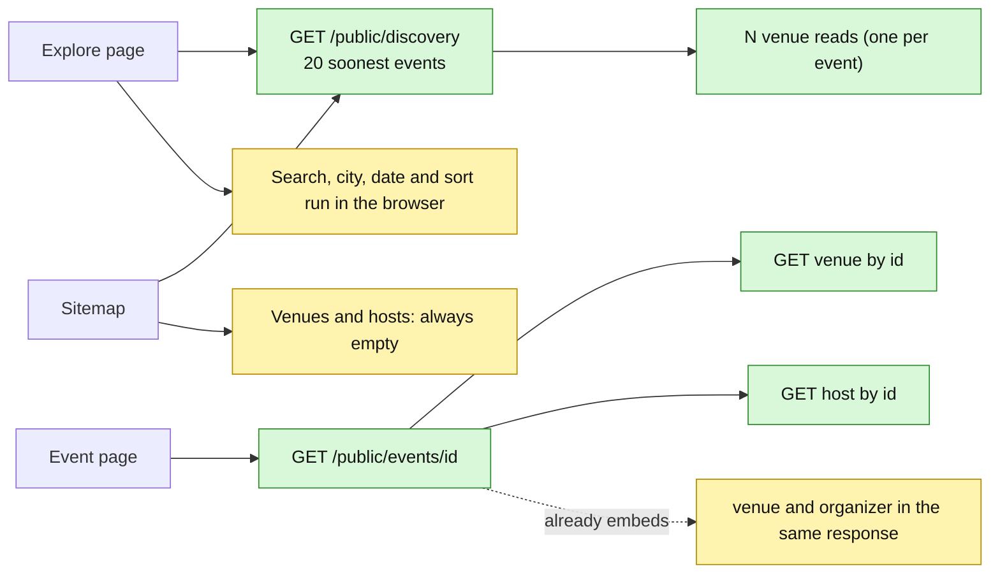
No public list endpoint exists for venues or hosts, and the gateway sends no cache headers on public reads.

## 6. Free ticket (RSVP)
Files: `04-booking-and-checkout.md`.
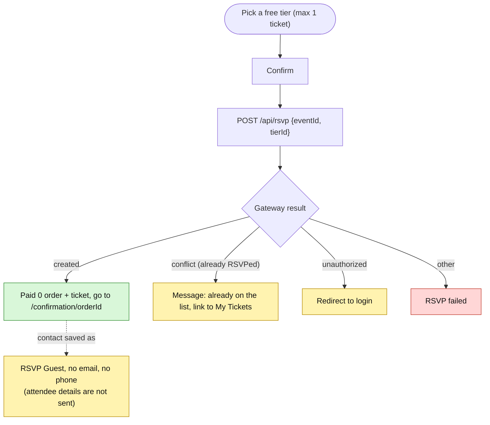

## 7. Paid checkout
Files: `04-booking-and-checkout.md`, `../10-payments-and-finance/02-checkout-and-payment-flow.md`.
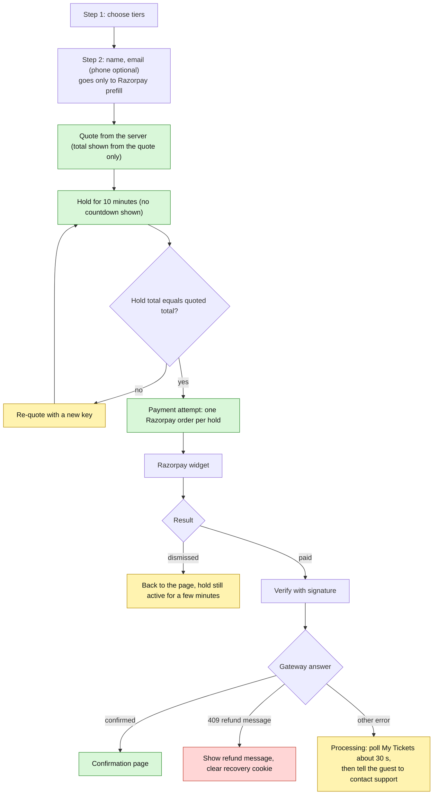
Not sent by the portal: attendee, promo code, referral code. Not shown: hold countdown, QR on the confirmation page.

## 8. Payment recovery
Files: `04-booking-and-checkout.md`.
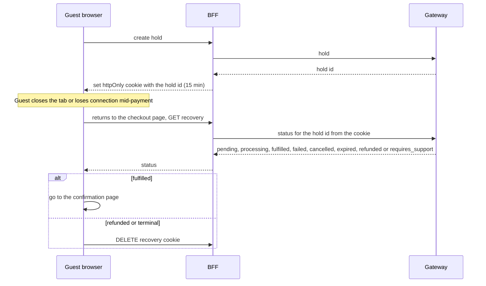

## 9. Tickets and the rotating QR
Files: `05-tickets-wallet-profile-support.md`.
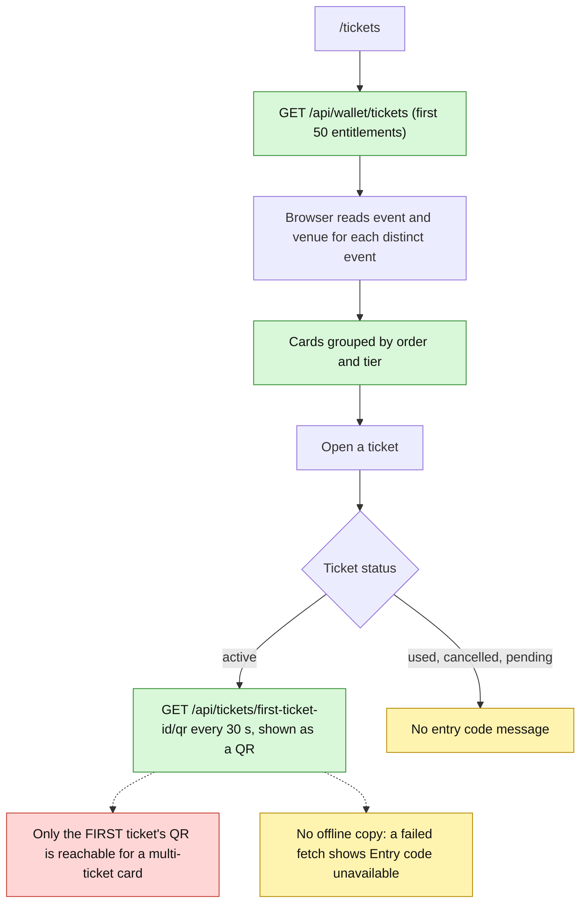

## 10. Promoter link flow (what is broken)
Files: `03-discovery-seo-and-promoter-links.md`.
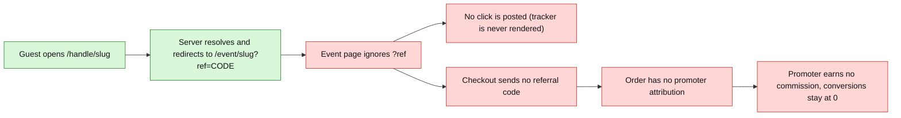

## 11. Backend features the portal does not use
Files: `05-tickets-wallet-profile-support.md`, `06-backend-public-and-guest-api.md`.
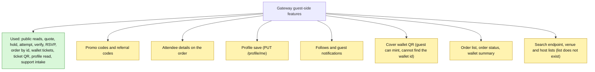

## 12. SEO map
Files: `03-discovery-seo-and-promoter-links.md`.
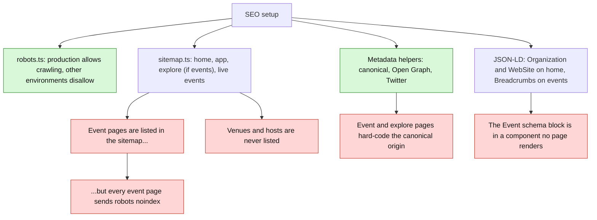

## 13. Security findings map
Files: `07-status-gaps-and-roadmap.md`.
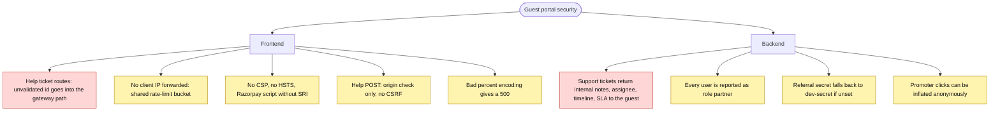

## 14. Production vs preview
Files: `01-routes-and-screens.md`.
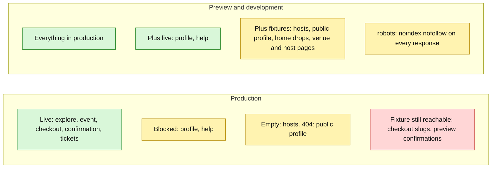

## 15. Defect map
Files: `07-status-gaps-and-roadmap.md`.
```mermaid
flowchart TD
  ROOT(["Guest portal risks"]) --> REV["Revenue and data"]
  ROOT --> TRUST["Trust and security"]
  ROOT --> REACH["Reach and SEO"]
  ROOT --> UX["Experience"]
  REV --> r1["Promoter attribution broken"]
  REV --> r2["Placeholder buyer contact on every order"]
  REV --> r3["No promo code entry"]
  TRUST --> t1["Internal support notes visible to guests"]
  TRUST --> t2["Help route path injection"]
  TRUST --> t3["No CSP or HSTS"]
  REACH --> s1["Event pages noindex"]
  REACH --> s2["No web sign-up, profile and help blocked in production"]
  REACH --> s3["Venues and hosts missing from sitemap"]
  UX --> u1["Confirmation page shows Guest and a wrong reference"]
  UX --> u2["Only first ticket's QR; profile edit does nothing"]
  UX --> u3["No hold countdown, fonts never load"]
  classDef bad fill:#ffd6d6,stroke:#c0392b,color:#111
  classDef warn fill:#fff3b0,stroke:#b58900,color:#111
  class r1,t1,t2 bad
  class r2,r3,t3,s1,s2,s3,u1,u2,u3 warn
```

## 16. Suggested fix order
Files: `07-status-gaps-and-roadmap.md`.
```mermaid
flowchart LR
  F1["Step 1: Redact internal support fields,<br/>validate help route ids, add CSRF"] --> F2["Step 2: Forward client IP from the BFF"]
  F2 --> F3["Step 3: Send attendee, promo and referral codes,<br/>wire the click tracker"]
  F3 --> F4["Step 4: Decide guest role and web sign-up"]
  F4 --> F5["Step 5: Fix event SEO and sitemap"]
  F5 --> F6["Step 6: Enable profile and help in production, add profile save"]
  F6 --> F7["Step 7: Per-ticket QR, wallet pagination, order history"]
  F7 --> F8["Step 8: CSP, HSTS, SRI, remove fixture routes and dead code"]
  classDef step fill:#e8f0fe,stroke:#4a6fa5,color:#111
  class F1,F2,F3,F4,F5,F6,F7,F8 step
```
