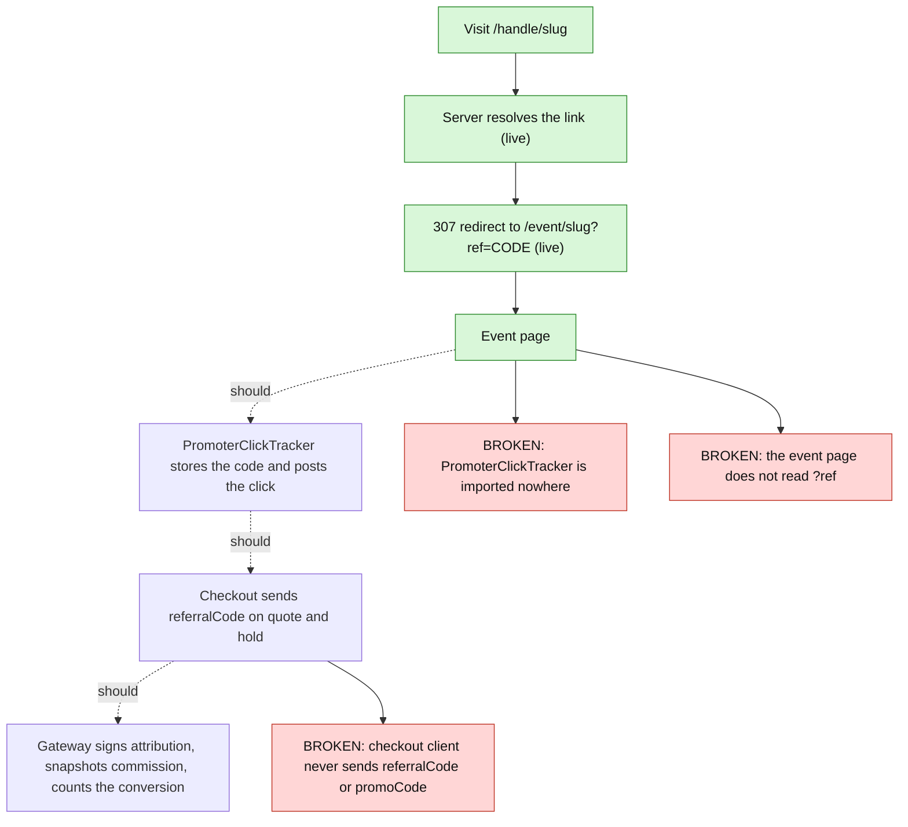

# 03. Discovery, SEO and promoter links

## Public endpoints the portal depends on (`routes/v2/public/discovery.ts`, prefix `/public`)
Rate limit `PUBLIC_READ` 120/min per IP; **no `Cache-Control` is set by the gateway**, so there is no CDN caching of discovery; responses validated with `validateV2Response`.
| Endpoint | Params | Notes |
|---|---|---|
| `GET /discovery` | none | `{items}`: soonest-first published events, **cap 20**, no editorial or featured concept (`public-service.ts:~161`) |
| `GET /events` | `limit`, `cursor` | listing; the portal does not call it |
| `GET /events/:idOrSlug` | `^[A-Za-z0-9][A-Za-z0-9_-]*$`, max 80 | `EventDto` plus embedded `venue` and `organizer`; a draft or non-public event returns the **same 404** as a missing one. The portal ignores the embedded venue and organiser and makes 2 extra round trips |
| `GET /events/:idOrSlug/tiers` | | active tiers with `availableQuantity = quantity − sold − activeHolds` |
| `GET /venues/by-id/:venueId`, `/venues/:slug` | slug `^[a-z0-9][a-z0-9-]*$` max 60 | by-id registered first; 404 if suspended |
| `GET /hosts/by-id/:organizationId`, `/hosts/:slug` | | `{id,name,slug}` only; active organisations only |
| `GET /search` | `q` 1–200, `limit`, `cursor` | naive substring scan over the first 100 public events; **not used** (explore search is client-side over the 20-item feed) |
| `GET /promoter-links/:handle/:slug` | each 1–60 | `{eventSlug, code}` or 404; requires an active link with a valid HMAC attribution and a public event |
| `POST /promoter-links/click` | strict `{eventSlug 1-80, code 4-16}` | `{tracked}`; increments `clicks`; **anonymous, no dedupe**: any caller can inflate clicks (limit 120/min/IP) |
There is **no public venue or host list endpoint**, which is why `/hosts` is empty in production and the sitemap omits venues and hosts.

## Explore and event pages
`/explore` makes 1 + N venue reads (fan-out); filters run client-side over at most 20 events; any API error shows the empty state. `/event/*` makes 3 reads (event, then venue and host in parallel) although the event response already embeds them. Event pages link tiers with the event slug and a derived tier id `general-admission` that is **not a real tier** (checkout silently falls back to the first tier); the selector label reads "Continue to checkout preview" even for live events (misleading).

## SEO
- `layout.tsx`: `metadataBase` from `getMetadataBase()`, default title "THE C1RCLE | Discover Life Offline", `publicRobots()` (index only in production SEO), manifest, viewport `themeColor #000`, skip link `#main`.
- `lib/seo/site.ts`: `isProductionSeo()` is `VERCEL_ENV=production`, else `NEXT_PUBLIC_ENVIRONMENT`; origin from `SITE_URL`, else `https://thec1rcle.com` in production, else `VERCEL_URL`, else localhost.
- `lib/seo/metadata.ts`: `buildPublicMetadata` (canonical with query and hash stripped, OG, Twitter, locale `en_IN`), `buildPrivateMetadata` (noindex, follow).
- `robots.ts`: non-production Disallow `/`; production Allow `/` plus sitemap and host. `sitemap.ts` (`revalidate=300`): `/`, `/app`, `/explore` (only when there are events) plus eligible events from `/discovery`; **venues and hosts are always empty** (`isEligiblePublicVenue/Host` hard-code `false`, `public-data.ts:52-59`).
- JSON-LD: `lib/seo/json-ld.tsx` escapes `<` (tested); Organization and WebSite on `/` are live; Breadcrumbs via `EventDetailView`; **the Event schema.org block lives in `AuthoritativeEventView.tsx`, which no page renders**.
- **Bugs:** `/event/[eventId]/page.tsx:72` always emits `robots: { index:false, follow:false }`, so the sitemap lists events that are told not to be indexed and no Event JSON-LD ships; event and explore metadata hard-code `https://thec1rcle.com` instead of using `buildPublicMetadata`.

## Promoter vanity links: designed flow vs reality

Verified: `PromoterClickTracker` appears only in its own file and test; no code reads `sessionStorage['c1rcle-promoter-referral-code']`; `checkout-api.ts` and the paid-checkout deps send neither field. Result: **no clicks are tracked and no order is ever attributed to a promoter from the guest portal.** Backend side (`referral-link-service.ts` ≈L267–298): resolves a signed attribution, snapshots commission terms onto the hold and order, increments conversions at settlement; the verification falls back to the literal secret `'dev-secret'` when `magicTicketSecret` is empty (production is meant to refuse to boot without it). Any unknown two-segment URL also costs one gateway call before a 404.
