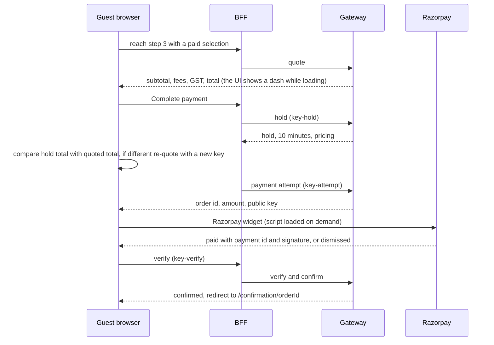
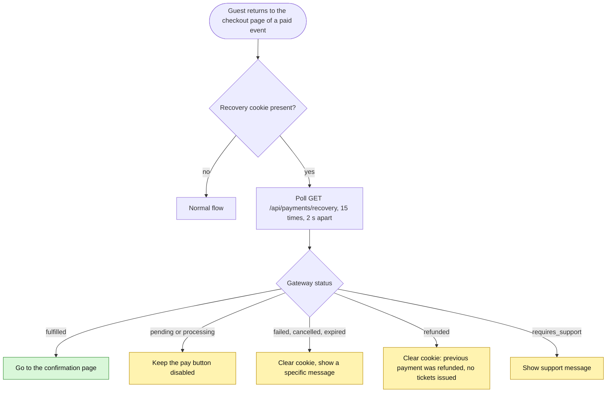

# 04. Booking and checkout (guest side)

Backend mechanics, state machines and money are in `../10-payments-and-finance/02-…` and `03-…`. This page is the portal's behaviour.

## Free tickets (RSVP)
`isFreeBooking` = every selected line has price 0; only **one** ticket is allowed (the stepper caps free tiers at `min(1, available)`). Confirm POSTs `/api/rsvp {eventId, tierId}` with the CSRF header read from `document.cookie`, then goes to `/confirmation/<order.id>`. `conflict` shows "already on the list" with a link to `/tickets`; other errors show "RSVP failed"; `unauthorized` redirects to login. The gateway creates a paid ₹0 order with a deterministic id (second RSVP → 409), entitlements, **contact `{RSVP Guest, '', ''}`** and no settlement. **The attendee details entered in step 2 are not sent.**

## Paid checkout
Steps: 1 select tiers, 2 attendee (name and email required, phone optional), 3 pay. The attendee data goes **only to Razorpay's `prefill`**; the backend supports `attendee`, `promoCode` and `referralCode` on the hold and the frontend sends **none** of them, so every order carries the placeholder contact and there is no promo-code UI (only a "Discount" row if the quote returns one).

- **Quote** (`checkout-routes.ts:48-89`): login required; `assertOnSale`; `pricing.calculate`; rejects totals under ₹1.
- **Hold** (`:93-174`, Idempotency-Key required, scoped per buyer): re-quotes, checks inventory and the per-user cap, creates `HOLD-<scopedKey>` with a **10-minute** TTL, runs the race-safe overbooking check. The UI keeps one idempotency key per `quoteKey` (`event|lines|requoteCount`) in a ref and suffixes `-hold`, `-attempt`, `-verify`.
- **No hold countdown UI.** `expiresAt` is ignored; a cancelled payment shows "Your tickets are held for a few minutes" with no timer.
- **Price-change guard** (`paid-checkout.ts:69-135`): a hold total different from the quoted total returns `price_changed` and the UI re-quotes with a new key.
- **Payment attempt:** one Razorpay order per hold (first writer wins); returns `{paymentIntentId, amountPaise, keyId}`; a missing `keyId` becomes `unavailable`.
- **Razorpay widget** (`razorpay-checkout.ts`): loads `https://checkout.razorpay.com/v1/checkout.js` on demand (**no SRI, and no CSP exists**), theme `#111111`, INR; `handler` resolves `paid {paymentId, orderId, signature}`, `ondismiss` resolves `dismissed` (carrying a `payment.failed` description if any). Card, UPI and bank details never touch the app.
- **Verify:** signature checked against the order id **stored on the hold**, never the browser's; confirm is idempotent and shared with the webhook. Outcomes: `confirmed` → confirmation page; a 409 whose message matches `/refund/i` → `refunded` (message shown, recovery cookie cleared); any other failure → `processing`, which **polls `/api/wallet/tickets` 15 × 2 s (about 30 s)** for a ticket for the event and then goes to `/tickets`, otherwise shows "Checkout in progress… tickets should appear in My Tickets within a few minutes. If not, contact support and quote your Razorpay confirmation".
- **Errors handled:** 503 → "Online payments are not available"; 409 or `conflict` → "tickets no longer available"; quote failure → "could not price your order. Check you are signed in". There is no inline login prompt (`/checkout` is proxy-gated).

## Payment recovery (browser)

The holds and attempts BFF routes set the httpOnly cookie `c1rcle.payment-recovery-hold` (15 min). The gateway status (`GET /payments/attempts/:holdId/status`, owner-only) is `pending | processing | fulfilled | failed | cancelled | expired | refunded | requires_support`. Initial `payState` is `processing` for paid events until recovery resolves.

## Confirmation page (`confirmation/[id]/page.tsx`)
Renders a decorative "digital pass" (`ConfirmationView`). **`attendeeName` is hard-coded `'Guest'` and the reference label is `RSVP-<first 8 chars of order id>` even for paid orders** (≈L89-96); only the **first order line's** tier is shown (a multi-tier order is misrepresented); it links to `/tickets` and `/explore` and **does not show the QR**.

## Preview (non-purchasable) path
If tiers failed to load, step 3 says "Preview only" and "Complete Payment" links to `/confirmation/preview-<slug>`, which resolves only for fixture slugs: on a live event this would 404.

## Known gaps vs the backend
Promo code input; attendee capture to the order; referral code on quote and hold; hold countdown; multi-ticket confirmation; a visible QR on confirmation; an inline login prompt; order history list; refund status display.
