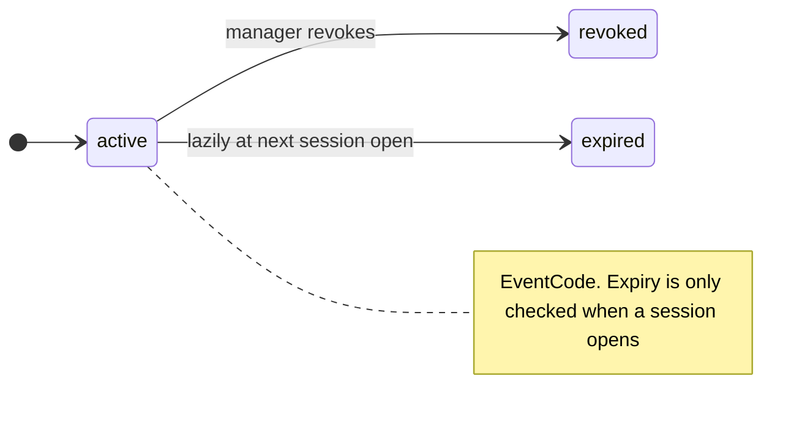
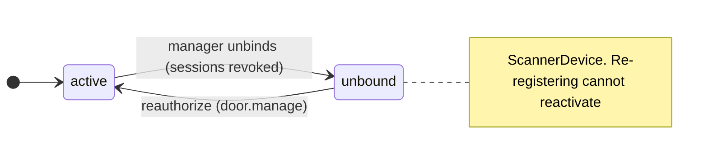
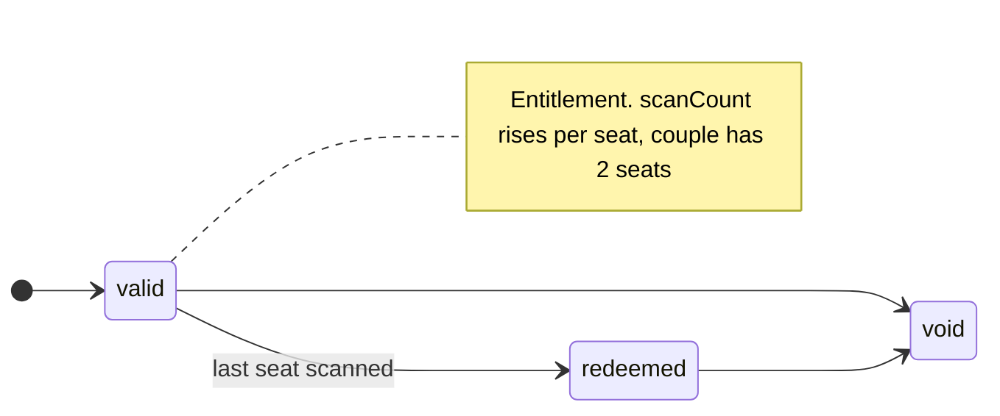
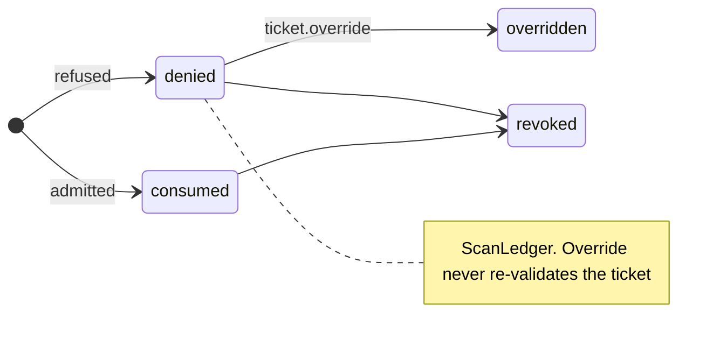
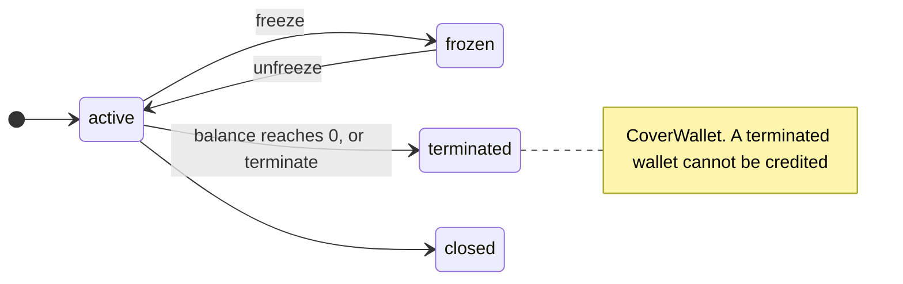

# 10. Domain model and state machines (door and scanner)

Sources under `packages/core/src/domain/models/`. All aggregates extend `VersionedEntity` unless noted.

| Aggregate | Collection | Key fields |
|---|---|---|
| `EventCode` | `v2_event_codes` | `code, type full|scan_only|charge, gate, maxDevices, allowReuse, expiresAt, status active|revoked|expired, revokedAt, revokedReason, stats{scansCount, doorEntriesCount, doorRevenue, lastUsedAt, activeSessions}` |
| `ScannerSession` | `v2_scanner_sessions` (+ `v2_scanner_session_tokens` doc id = token SHA-256) | `codeId, eventId, organizationId, venueId, type, deviceId, deviceName, expiresAt, lastUsedAt, revokedAt, revokedReason, permissions{canScan, canDoorEntry, canWalkIn, canCharge}, createdBy, createdByName` (token never stored) |
| `ScannerDevice` | `v2_scanner_devices` | `deviceId, deviceName, status active|unbound, boundBy, boundAt, unboundAt, unboundReason, lastSeenAt, lastEventId, lastGate, scanCount, lastScanAt, lastScanResult` |
| `Entitlement` | `v2_entitlements` | `orderId, eventId, organizationId, tierId, tierName, userId, holderName, status, scanCountAllowed, scanCount, scannedAt[], refundLock` |
| `ScanLedgerEntry` | `v2_scan_ledger` | see `05-…`; `status pending|consumed|denied|cancelled|revoked|expired|overridden` |
| `DoorSale` | `v2_door_sales` (+ `v2_door_sale_idempotency`) | see `06-…` |
| `CoverWallet`, `CoverWalletTxn` | `v2_cover_wallets`, `v2_cover_wallet_txns`, `v2_cover_wallet_idempotency`, `v2_cover_wallet_reconciliations` | see `06-…` |

## State machines

DoorSale: `active → voided | refunded` (no HTTP route). Scanner session status is derived (active, expired, revoked), never stored.

## Events and consumers
The door area emits audit records (`door.check-in`, `door_sale.create`, `door.ticket_sale`, scan and code actions) but **no domain events** for scans, so analytics, notifications and follower fan-out do not see door activity; dashboards read the ledger and aggregates directly.

## Collections and indexes
Door collections listed above plus `v2_idempotency_records`; order, event, tier and catalog collections are used indirectly. `firestore.indexes.json` (77 indexes) covers the traced door queries: the `v2_scan_ledger` set (including `(eventId, admittedCount)` and `(eventId, tierName, admittedCount)` on staging), `v2_scanner_sessions (codeId, revokedAt, expiresAt)` and `(revokedAt, expiresAt)`, `v2_scanner_devices (organizationId, lastSeenAt desc)`, `v2_event_codes (eventId, createdAt desc)` and `(organizationId, createdAt desc)`, `v2_door_sales`. Firestore rules deny all client access. Two `v2_scan_ledger` indexes were missing during the E2E run and were added.
