# 00. Payments and finance: visual guide

Start here if you prefer pictures. Each diagram points to the file that explains it. Colours:

- 🟩 **green** = works and is enforced
- 🟨 **yellow** = partial, manual, or a decision is pending
- 🟥 **red** = defect or risk (see `09-status-prs-and-open-decisions.md`)
- ⬜ **grey** = infrastructure or neutral step

How to view: GitHub, VS Code (Markdown Preview Mermaid Support), or https://mermaid.live. A browser version is in `visual-guide.html` (needs internet for the Mermaid library).

Contents: 1 Where the money goes · 2 Price the guest pays · 3 Checkout sequence · 4 Hold and order states · 5 Confirming a payment · 6 Webhook handling · 7 Settlement split · 8 Two ledgers · 9 Journal postings · 10 How balances are computed · 11 Paying partners · 12 Refund paths · 13 Chargebacks · 14 What runs automatically · 15 Failure cases · 16 What is merged where · 17 Defect map · 18 Fix order

---

## 1. Where the money goes
Files: `01-money-model-and-pricing.md`, `04-ledger-and-journal.md`.
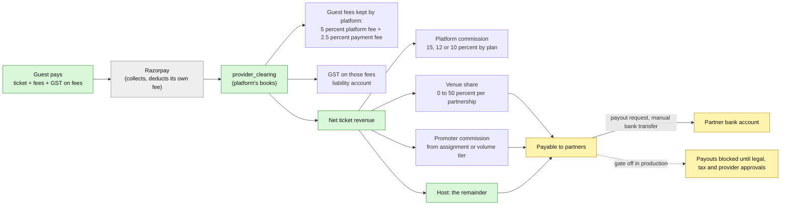

## 2. The price the guest pays (example)
Files: `01-money-model-and-pricing.md`.
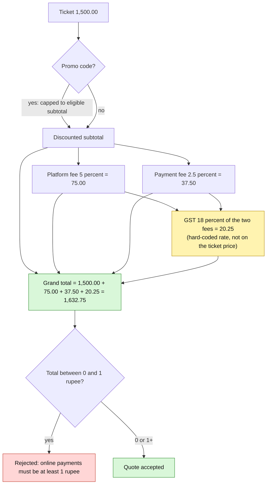

## 3. Checkout, step by step
Files: `02-checkout-and-payment-flow.md`.
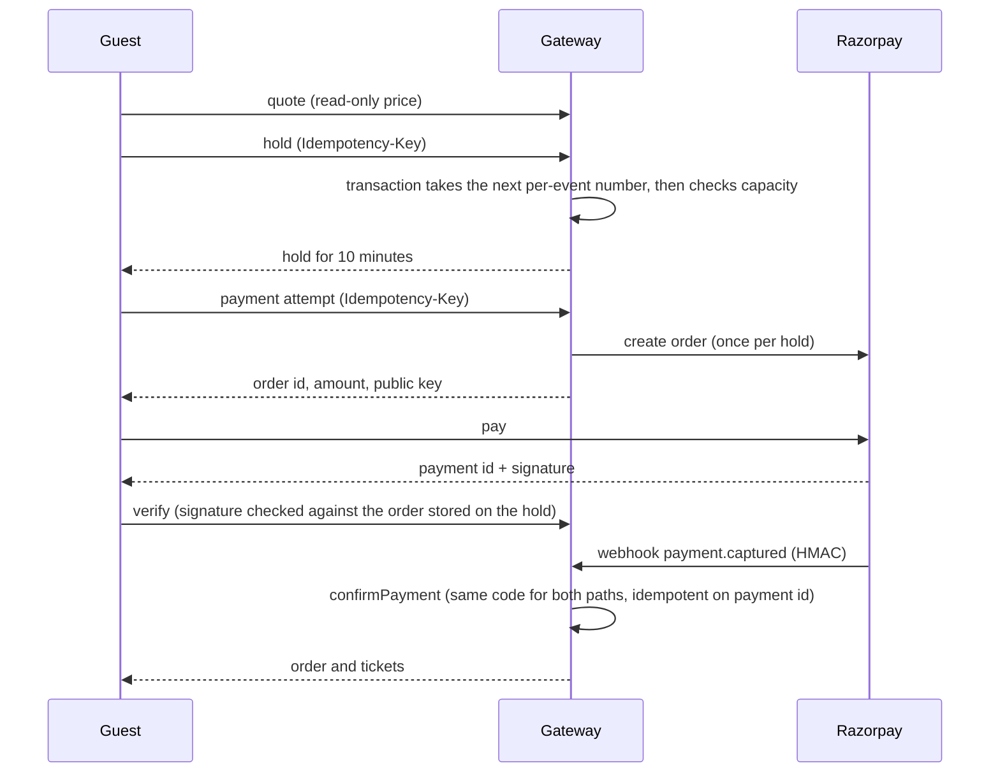

## 4. Hold and order states
Files: `03-order-hold-inventory.md`.
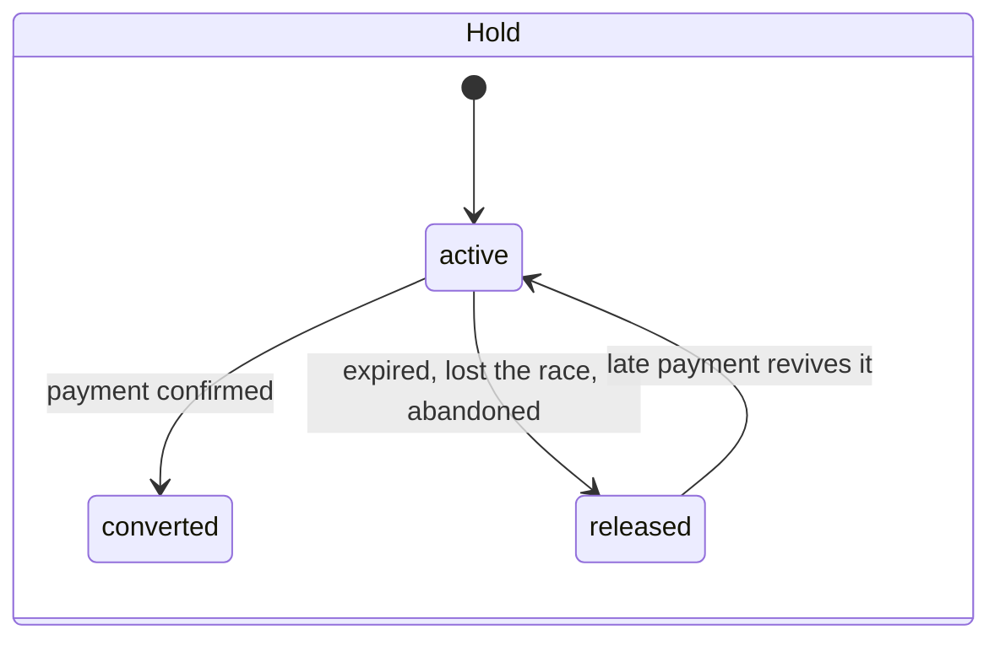
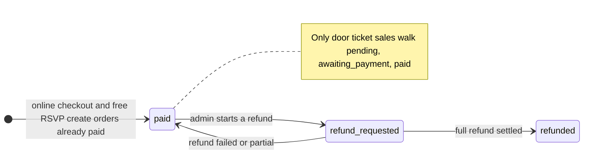

## 5. Confirming a payment (decision tree)
Files: `02-checkout-and-payment-flow.md`.
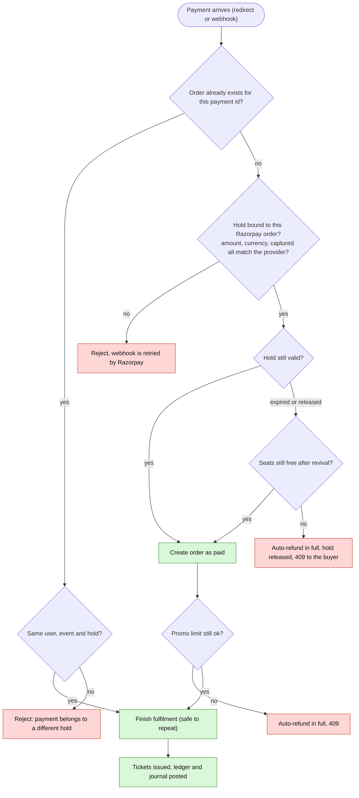
Not covered: a second payment against a hold that is already converted is captured with no order and no refund.

## 6. Webhook handling
Files: `02-checkout-and-payment-flow.md`, `05-razorpay-and-provider-facts.md`.
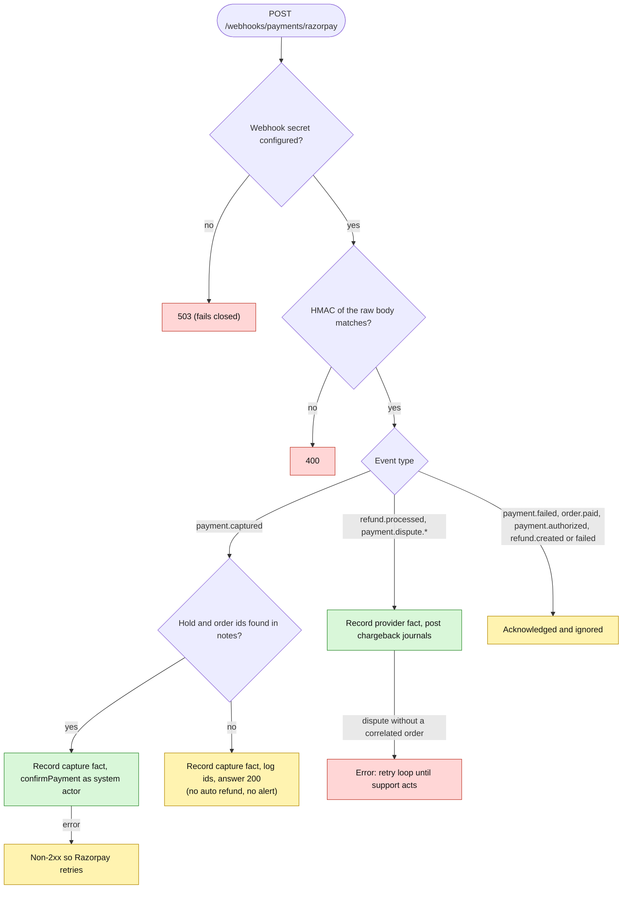
No rate limit on this route and no replay window.

## 7. Settlement split
Files: `01-money-model-and-pricing.md`.
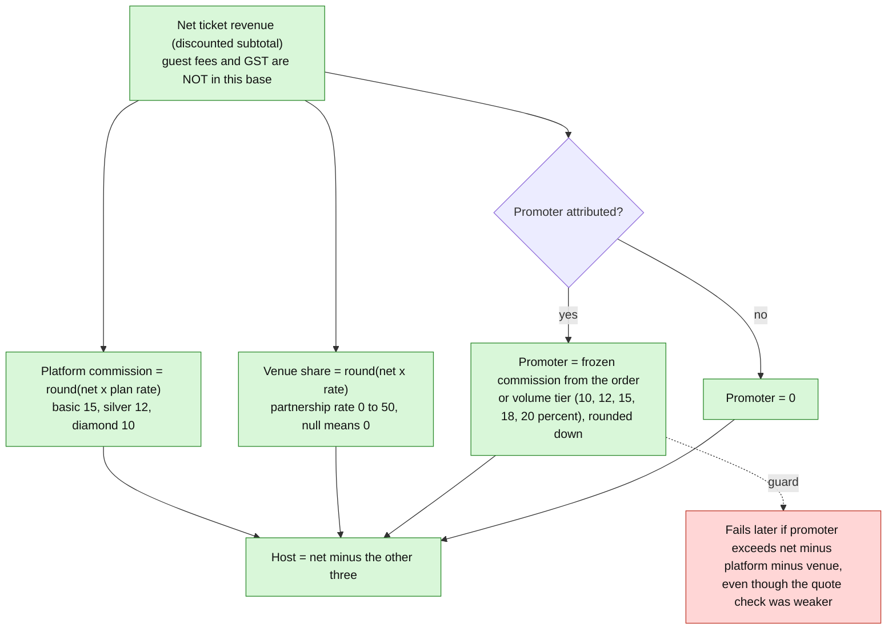
Example: net 1,500 with plan basic, venue 20 percent and promoter 10 percent gives platform 225, venue 300, promoter 150, host 825.

## 8. Two ledgers (and why partners cannot withdraw yet)
Files: `04-ledger-and-journal.md`.
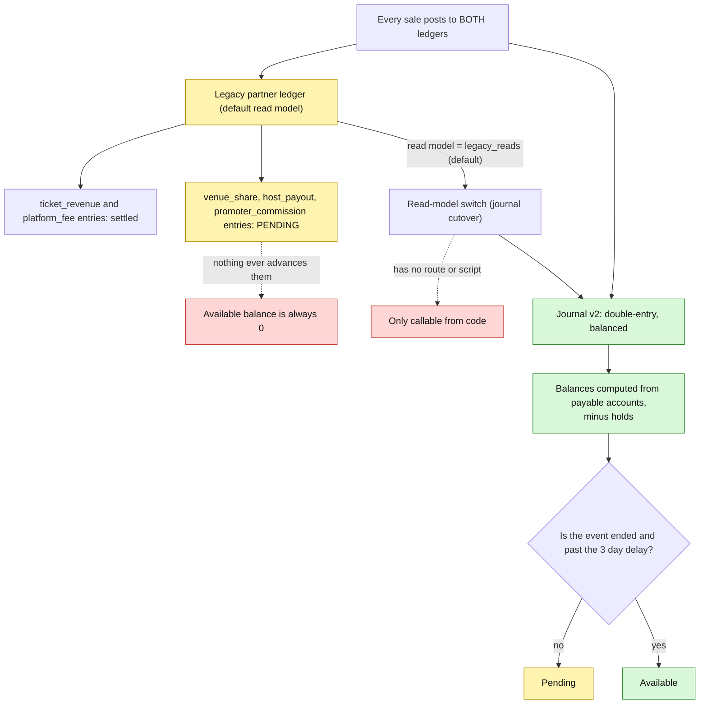
The app reads one model or the other, never the sum. Events only reach `ended` through an admin force-complete, so even the journal model keeps money pending.

## 9. Journal postings by event
Files: `04-ledger-and-journal.md`.
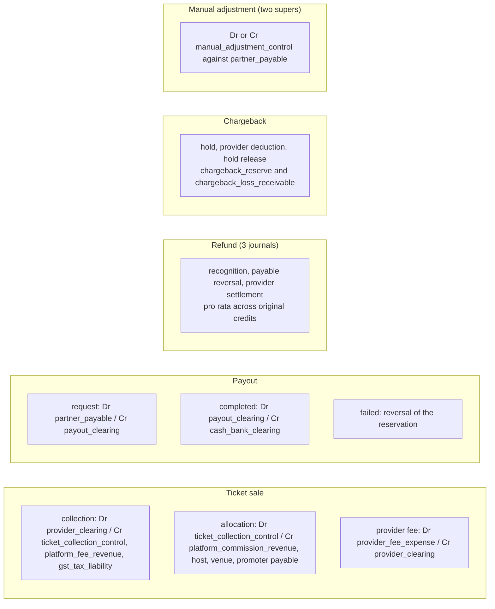

## 10. How the available balance is computed (journal model)
Files: `04-ledger-and-journal.md`.
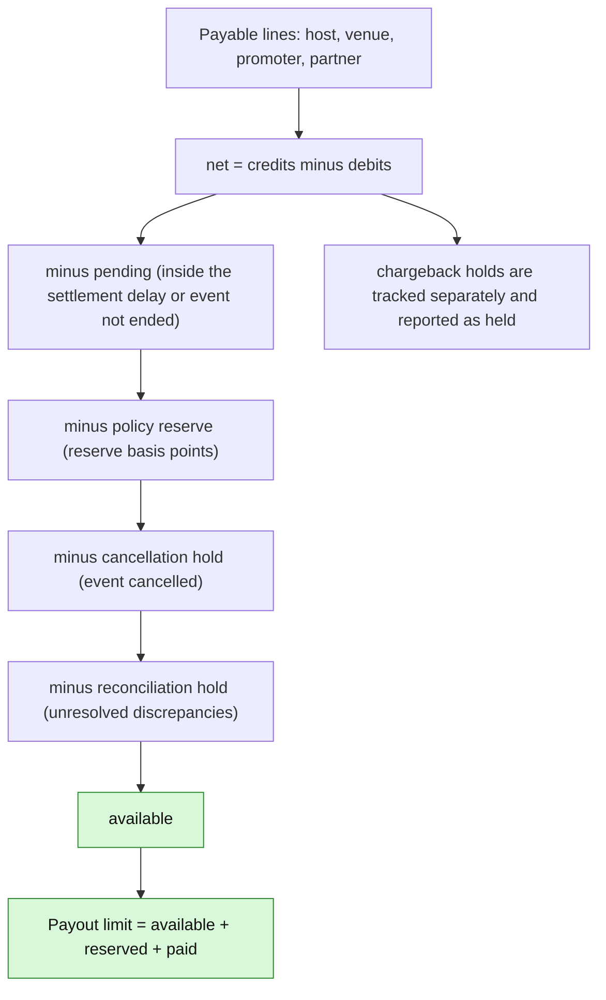

## 11. Paying partners
Files: `06-payouts-refunds-disputes.md`.
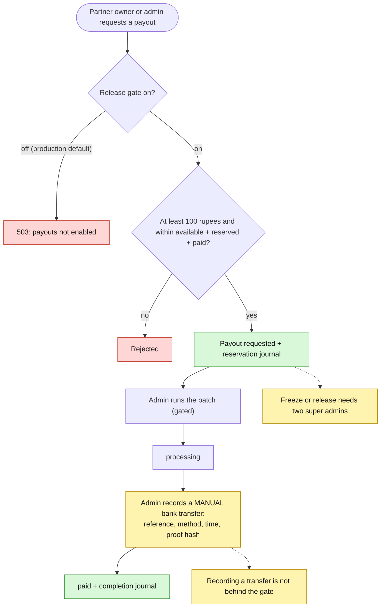
No payout API is ever called: payouts are evidence of a manual transfer.

## 12. Refund paths
Files: `06-payouts-refunds-disputes.md`.
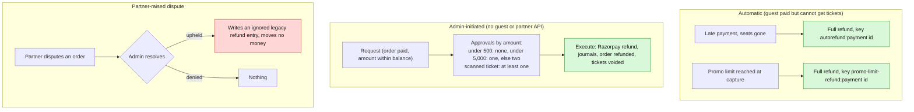

## 13. Chargebacks
Files: `06-payouts-refunds-disputes.md`.
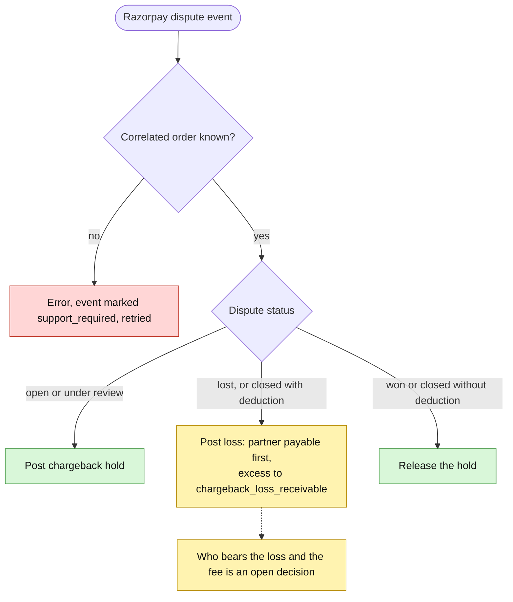

## 14. What runs automatically (and what does not)
Files: `07-reconciliation-repair-scheduling.md`.
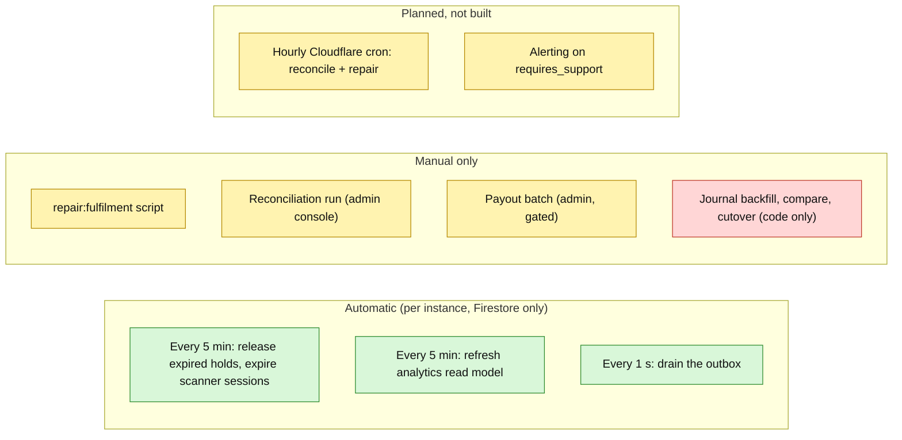

## 15. Failure cases at a glance
Files: `08-failure-and-edge-cases.md`.
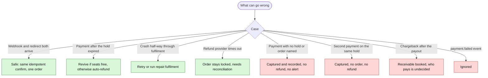

## 16. What is merged where (corrected)
Files: `09-status-prs-and-open-decisions.md`.
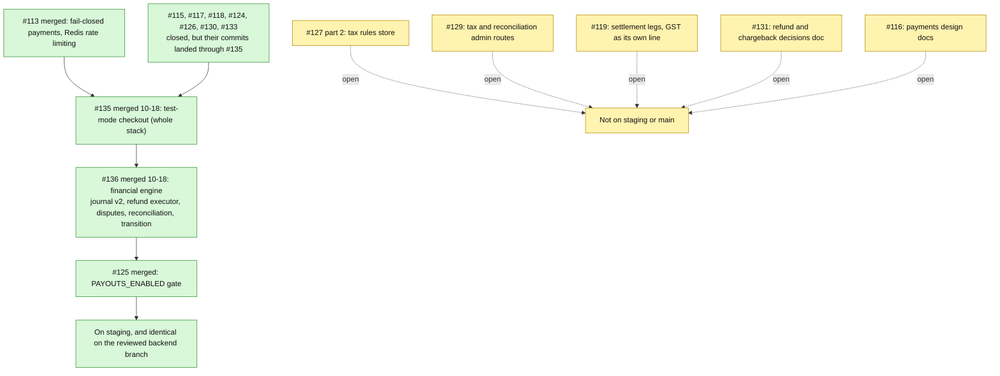

## 17. Defect map
Files: `09-status-prs-and-open-decisions.md`.
```mermaid
flowchart TD
  ROOT(["Payments risks"]) --> PAYQ["Getting partners paid"]
  ROOT --> ORPH["Orphan money"]
  ROOT --> HARD["Hardening"]
  ROOT --> TAXQ["Tax and legal"]
  PAYQ --> a1["Legacy ledger never advances: available is always 0"]
  PAYQ --> a2["Journal cutover has no route or script"]
  PAYQ --> a3["Events never end, so money stays pending"]
  ORPH --> b1["Second payment on a converted hold: no order, no refund"]
  ORPH --> b2["Capture with no hold named: no refund, no alert"]
  ORPH --> b3["payment.failed ignored, no scheduled repair"]
  HARD --> c1["Webhook: no rate limit, no replay window"]
  HARD --> c2["Adapter: no fetch timeout"]
  HARD --> c3["Promoter guard weaker than settlement"]
  HARD --> c4["Placeholder buyer contact"]
  TAXQ --> d1["GST on fees only, hard-coded 18 percent"]
  TAXQ --> d2["No TDS or TCS"]
  TAXQ --> d3["Funds flow undecided (RBI question)"]
  TAXQ --> d4["Refund and chargeback loss rules undecided"]
  classDef bad fill:#ffd6d6,stroke:#c0392b,color:#111
  classDef warn fill:#fff3b0,stroke:#b58900,color:#111
  class a1,a2,b1,d3 bad
  class a3,b2,b3,c1,c2,c3,c4,d1,d2,d4 warn
```

## 18. Suggested fix order
Files: `09-status-prs-and-open-decisions.md`.
```mermaid
flowchart LR
  F1["Step 1: Give the journal cutover an operator path<br/>(or retire the legacy model)"] --> F2["Step 2: Let events end<br/>so money can become available"]
  F2 --> F3["Step 3: Close orphan-capture gaps,<br/>handle payment.failed"]
  F3 --> F4["Step 4: Schedule repair and reconciliation, add alerts"]
  F4 --> F5["Step 5: Harden webhook and adapter"]
  F5 --> F6["Step 6: Fix promoter guard, send attendee details"]
  F6 --> F7["Step 7: Decide tax, funds flow, refund and chargeback rules"]
  F7 --> F8["Step 8: Only then consider enabling payouts"]
  classDef step fill:#e8f0fe,stroke:#4a6fa5,color:#111
  class F1,F2,F3,F4,F5,F6,F7,F8 step
```
