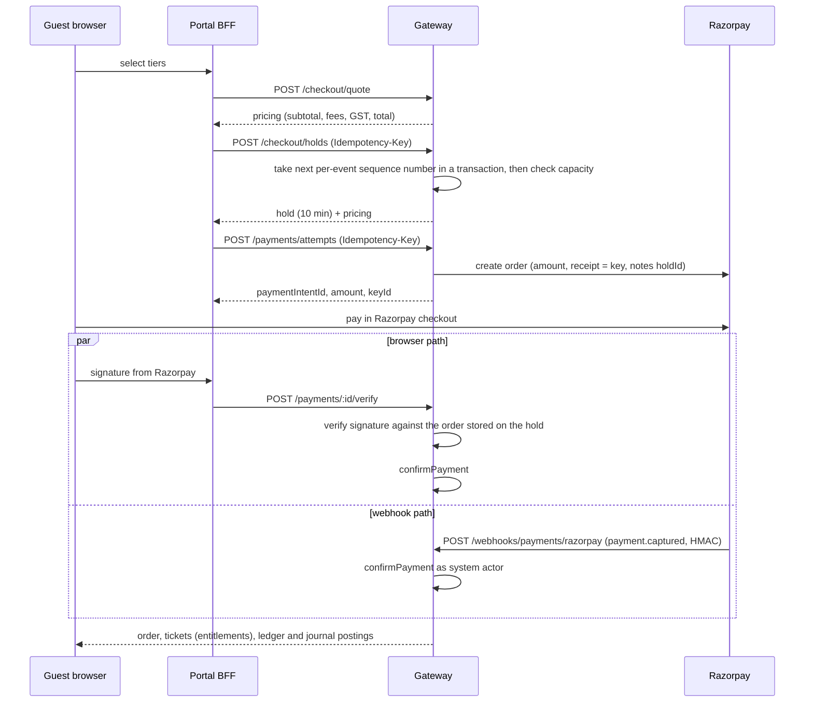
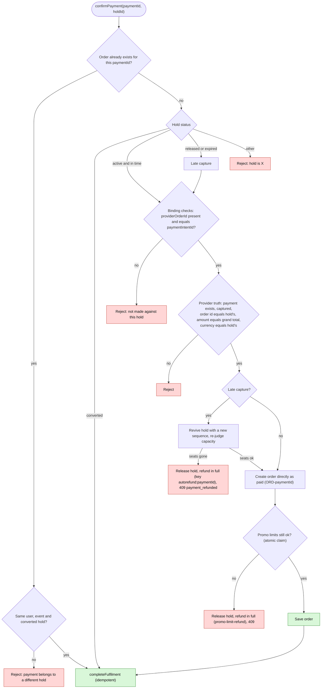

# 02. Checkout and payment flow

Code: `packages/core/src/application/checkout/checkout-service.ts` (1,271 lines), `apps/api-gateway/src/routes/v2/checkout/{checkout-routes,payment-routes,webhook-routes}.ts`, `routes/v2/rsvp/rsvp-routes.ts`, `lib/razorpay-webhook.ts`. **All checkout routes require an authenticated, non-system user**: there is no anonymous guest checkout despite the name.

## Routes
| Route | Rate | Idempotency | Notes |
|---|---|---|---|
| `POST /checkout/quote` | STANDARD_COMMAND | none | prices the cart (read-only) |
| `POST /checkout/holds` | STANDARD_COMMAND | **required**, command `checkout.hold` | re-quotes then `createHold`; 201 |
| `POST /payments/attempts` | STANDARD_COMMAND | **required**, `payment.attempt` | creates or returns the Razorpay order; 201 `{paymentIntentId, amountPaise, keyId}` (`keyId` is the publishable `RAZORPAY_KEY_ID`) |
| `POST /payments/:id/verify` | STANDARD_COMMAND | optional, `payment.verify` | the browser-redirect confirmation path |
| `GET /payments/attempts/:holdId/status` | AUTH_READ | none | owner-scoped recovery status |
| `POST /webhooks/payments/razorpay` | **none** | by `paymentId` | HMAC-authenticated provider callback |
| `POST /rsvp` | STANDARD_COMMAND | optional | free tickets |
| `GET /orders`, `/orders/:id`, `/orders/:id/status` | AUTH_READ | n/a | buyer-scoped reads |

## Sequence

## `quote()`
1. `assertOnSale` (event `published`). 2. `pricing.calculate`. 3. A discount without a funding owner → `InvalidOperationError`. 4. Promo limits (`assertPromoWithinLimits`). 5. Minimum ₹1 (see `01-…`). 6. Referral code: `ReferralLinkService.resolveAttribution` signs the promoter attribution with `magicTicketSecret` (`signPromoterAttribution`); note the verification falls back to the literal `'dev-secret'` when the secret is empty (`referral-link-service.ts:~294`). **The guest portal never sends `promoCode` or `referralCode`** (verified), so neither feature is reachable from the live UI.

## `createHold()` (≈L234–354)
- **TTL:** `DEFAULT_HOLD_TTL_MS = 10 minutes` (a business decision, overridable via `reservationTtlMs`).
- **Idempotency is buyer-scoped:** `scopedKey = sha256(buyerId + "\n" + key)` truncated to 40 characters; `holdId = HOLD-{scopedKey}`; a replay returns the existing hold (fixes the audit item "another buyer's hold").
- **Early checks:** inventory per line; per-user tier cap `tier.maxPerUser` (live holds + paid orders).
- **Write:** `cartReservations.create` is a Firestore transaction that increments `v2_hold_sequences/{eventId}.last` and stores it as `hold.sequence` (the strict per-event order).
- **After the write:** `inventory.firstOverbookedTier(stored)` checks that sold + live holds with sequence ≤ mine fits capacity; if not the hold is released and the call fails with "Insufficient inventory". `firstTierOverUserCap` does the same for per-user caps. This post-commit judgment makes concurrent buyers safe (proven on the Firestore emulator with 12-, 20- and 60-buyer races).
- A background sweep releases expired holds every 5 minutes (Firestore driver only).

## `createPaymentIntent()` (≈L547)
Hold must be owned by the actor, `active` and not expired (an expired hold is released and rejected); the event must still be published. If `hold.providerOrderId` exists it returns **that same order with no new Razorpay call**; otherwise it calls `paymentProvider.createOrder({amountPaise, currency, idempotencyKey, metadata:{holdId,eventId,organizationId}})` (the adapter sends `receipt = idempotencyKey` and the metadata as `notes`). `bindProviderOrder` is **first writer wins**: the loser's Razorpay order is never paid. The #121 race test for this is not on staging.

## `verifyCheckoutCallback()` (≈L617)
Loads the hold (ownership enforced), takes `serverOrderId = hold.providerOrderId` (error "No payment attempt has been started" if absent). A browser-sent `clientOrderId` is only compared with the stored one, **never used for verification**. The provider verifies the HMAC of `order_id|payment_id` under the key secret and requires the payment to be `captured`. Then `confirmPayment`.

## `confirmPayment()` (≈L660–834): the heart

Details: order id is deterministic `ORD-{paymentId}`; a concurrent save race returns `VersionConflictError` and the loser converges on the winner. A tier that no longer exists counts as overbooked; any other inventory error propagates and is **not** turned into a refund. `contact = hold.attendee ?? {name:'Guest', email:'guest@example.com', phone:''}`: the placeholder is a data-quality issue, and **the guest portal sends no attendee** (verified), so every portal order carries the placeholder. There is no `pending`/`awaiting_payment` step online: orders are created `paid`.

## `completeFulfilment()` (≈L1002–1038): each step is an idempotent "ensure"
1. `convertToOrder(hold)` if not converted. 2. `claimPromoRedemption(..., false)`. 3. `issueEntitlements` for missing units only (ids `ENT-{orderId}-{tierId}-{index}`, deterministic). 4. `recordSettlement` (legacy ledger, journal v2, referral link sale, leaderboard commission, each idempotent). `admitsPerUnit` comes from the tier (`guestCount ?? (entryType==='couple' ? 2 : 1)`): one entitlement per unit, a couple ticket is one entitlement admitting 2.

## Free tickets: `createRsvp()` (≈L370–490)
Requires a real user, a published free event, an active price-0 tier. Order id `RSVP-<sha256(rsvp:eventId:userId)[0:32]>`; created directly `paid` with total 0, `paymentId = orderId`, contact `{RSVP Guest, '', ''}`. A second RSVP → `ConflictError`; a concurrent double tap converges. Entitlements are issued, then an evidence-only zero journal `m2:free_ticket:{orderId}` (not settled to the partner ledger). The attendee details entered in the UI are **not sent**.

## Webhook (`webhook-routes.ts`)
1. A content-type parser scoped to this plugin stores `request.rawBody` (malformed JSON becomes `{}`). 2. Reads `RAZORPAY_WEBHOOK_SECRET` directly; unset → **503** (fails closed). 3. HMAC-SHA256 over the raw body with `timingSafeEqual`; missing header or bad signature → 400. 4. `webhookPayloadSchema` (`notes` may be object, array or null); a parse failure is a **200** `{received:true}` with a log of ids only. 5. Ingestion: `providerEventId` from `x-razorpay-event-id`, `payloadHash = hash(rawBody)`, trust `signature_verified`. 6. Events:
- `payment.captured`: correlate `notes.holdId` and `order_id`, record the provider capture fact, call `confirmPayment` as `WEBHOOK_ACTOR` (idempotency key = payment id), then re-record the capture with our order id.
- `refund.processed`, `payment.dispute.*` (created, action_required, under_review, won, lost, closed): recorded via `providerPayments.recordEvent` (dispute events post chargeback journals), then 200.
- **Ignored (200):** `payment.failed`, `order.paid`, `payment.authorized`, `refund.created/failed`.
7. An uncorrelated capture (no hold or order id) is recorded, logged with ids only and answered **200** (avoids retry storms). 8. A `confirmPayment` failure returns a non-2xx so Razorpay retries; `PaymentRefundedError` is a 409, so redelivery re-runs `reactivate` and the auto-refund with the same key (a second real refund call would be rejected by Razorpay because the payment is already refunded).
**Gaps:** the route has **no rate limit** (the nginx general zone applies, see the nginx doc), no timestamp or replay window (idempotent processing mitigates replays), and no handling of `payment.failed`.

## Recovery (browser side)
`GET /payments/attempts/:holdId/status` returns `pending | processing | fulfilled | failed | cancelled | expired | refunded | requires_support`, derived from the order status, `assessFulfilment` gaps and the provider payment `processingState` (`checkout-service.ts` ≈L837). The guest portal stores the hold id in an httpOnly cookie and polls this endpoint (see `08-guest-portal/04-…`).
