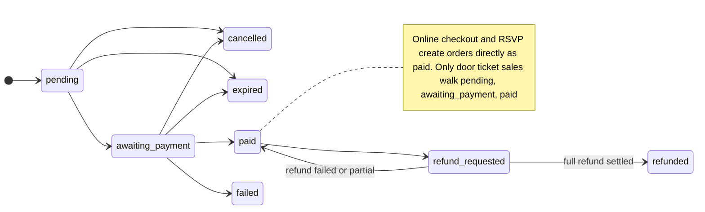
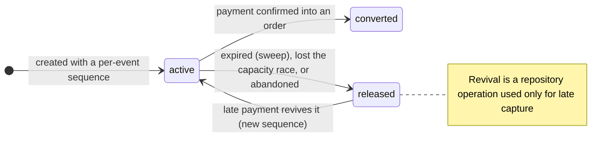

# 03. Orders, holds and inventory

Code: `domain/models/order.ts` (FSM ≈L58–70), `domain/models/cart-reservation.ts`, `application/inventory/inventory-service.ts`, `infrastructure/firestore/firestore-cart-reservation-repository.ts`.

## Order state machine

Helpers: `markPaid` (a repeat with the same `paymentId` is a no-op; a different `paymentId` throws), `markFailed`, `cancelOrder`, `expireOrder`, `lockOrderForRefund` (idempotent), `restoreOrderAfterRefundFailure` (only back to `paid`), `applyOrderRefund` (idempotent via `appliedRefundRequestIds`; `refundedPaise === grandTotalPaise` → `refunded`, a smaller amount returns to `paid`). `expired`, `cancelled`, `failed` and `refunded` are terminal.

## Hold (cart reservation) state machine

## Availability (derived, never stored)
`effective = tier.quantity − sold − activeHolds`. **Sold** counts orders with status `paid` **or** `refund_requested` (a seat awaiting a refund is not resold; only `refunded` returns it). `listSeatClaims` is a single streamed read of each order's status and lines: 6,000 orders now take about 0.2 s (about 14× faster than the old full-document paging). A running counter was deliberately **not** added (a drifting counter would bring overselling back); revisit above about 20,000 orders per event. Availability for the public tiers endpoint adds `status === 'active'` filtering.

## Oversell protection (the strict-order protocol)
1. Each hold takes the next number from `v2_hold_sequences/{eventId}` **inside a Firestore transaction** (`cartReservations.create`).
2. After the transaction commits, the hold keeps its seats only if `sold + live holds ordered at or before it` fits capacity (`firstOverbookedTier`); otherwise it is released.
3. The same protocol covers per-user caps (`firstTierOverUserCap`) and **late payments** (a revived hold takes a new number and is re-judged, so a late payer and a new buyer racing for the last seat cannot both win).
4. Proven on the Firestore emulator (12 buyers for 1 seat, 20 for 5, 60-buyer stress: exactly capacity, never above). Memory-driver tests cannot prove this.
5. Limit to load-test: one hot sequence document per event is a write-contention ceiling of about 1 write per second per document (plan item A5.2; `deploy/staging/baselines/` is empty, so no measured ceiling exists).

## Other inventory facts
- Door ticket sales check availability with a **read** (not the protocol above), so concurrent door sales can oversell.
- `cleanupExpired` (every 5 min) queries active + expired holds and batch-writes `released` from a stale read: a hold converted between the read and the commit could be overwritten back to `released`. The window is small and it is not transactional. Firestore also caps a batch at 500 operations (chunking is plan item A3.4, open).
- Cart FSM sweep runs per instance (no leader election).
