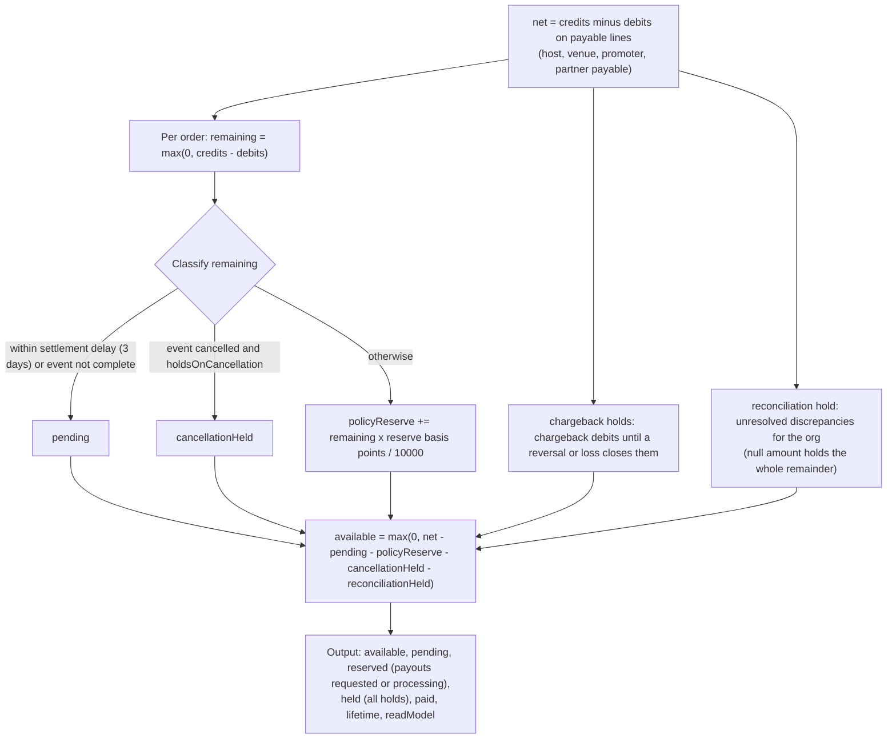

# 04. Ledger, journal and balances

There are **two finance read models** in the code. The application reads exactly one at a time (`journalTransition.readModel`) and never sums both. Default is the **legacy** ledger.

## Model 1: legacy partner ledger (`v2_partner_ledger`)
`LedgerEntryType = ticket_revenue | platform_fee | venue_share | host_payout | promoter_commission | refund`; status `pending | settled | paid_out`. One idempotency key per entry (`{orderId}:{entryType}:{orgId}`); id `led-{orderId}-{type}-{org}` or `led-{sha256[0:24]}` when longer than 64 characters.
Written per sale (4 or 5 entries): `ticket_revenue` (host org, **settled**, amount = gross), `platform_fee` (host org, **settled**), `venue_share` (venue org, **pending**), `host_payout` (**pending**), `promoter_commission` (**pending**, only if > 0).
**Critical finding (verified by grep):** nothing in the code ever moves a `pending` entry to `settled` or `paid_out`. The only `settled` writers are the `ticket_revenue` and `platform_fee` legs (`finance-service.ts` ≈L151, 162) and the admin dispute "upheld" refund entry. In legacy mode `getBalances` computes `available = settled(host_payout + venue_share + promoter) − paidOut − reserved − paid`, which is **always 0**. So with the default read model every partner sees all money as pending and **cannot withdraw**. The admin dispute "upheld" also writes a `refund` ledger entry that the balance code ignores and that moves no money.

## Model 2: financial journal v2 (`v2_financial_journals`, `_lines`, `_idempotency`)
Double-entry. `createPostedJournal` requires at least 2 lines, a non-empty idempotency key and policy version, integer paise on every line, **debits equal credits**, and a total > 0 unless the journal is `evidenceOnly`. Ids are deterministic: `jnl-{sha256(idemKey)[0:32]}`, lines `jln-{sha256(idemKey:idx)[0:32]}`. `createReversalJournal` flips sides and sets `reversalOfJournalId`. `postBatch` is idempotent: an exact retry returns the same journals and reusing a key with different content is rejected.
**Accounts (18):** `provider_clearing`, `cash_bank_clearing`, `customer_refund_liability`, `gst_tax_liability`, `venue_payable`, `host_payable`, `promoter_payable`, `partner_payable`, `platform_fee_revenue`, `platform_commission_revenue`, `ticket_collection_control`, `provider_fee_expense`, `refund_clearing`, `chargeback_loss_receivable`, `chargeback_reserve`, `payout_clearing`, `rounding_adjustment`, `manual_adjustment_control`.
**Source types (18):** `online_payment_capture`, `free_ticket`, `door_cash_sale`, `door_electronic_sale`, `promo_discount`, `complimentary_ticket`, `void`, `refund`, `chargeback`, `chargeback_loss`, `chargeback_reversal`, `reserve`, `reserve_release`, `payout_reservation`, `payout_completion`, `payout_failure_reversal`, `manual_adjustment`, `legacy_backfill`.
**Component breakdown (17 fields):** ticket face value, discount, discount funding owner, net ticket revenue, GST, platform fee, payment fee, provider fee, platform/host/venue/promoter allocations, refund, chargeback, reserve, payout, rounding adjustment. `assertFinancialComponents` requires `face − discount = net`, and a discount needs a funding owner (`platform|venue|host|promoter|shared`).

### Ticket sale postings (`buildTicketSaleJournals`, keys `m2:ticket-sale:{orderId}:{part}`)

```mermaid
flowchart LR
  subgraph COL["collection"]
    C1["Dr provider_clearing<br/>(cash_bank_clearing for door cash)<br/>= net + GST + platform fee + payment fee"]
    C2["Cr ticket_collection_control = net"]
    C3["Cr platform_fee_revenue = platform fee + payment fee"]
    C4["Cr gst_tax_liability = GST"]
  end
  subgraph ALL["allocation"]
    A1["Dr ticket_collection_control = net"]
    A2["Cr platform_commission_revenue"]
    A3["Cr host_payable"]
    A4["Cr venue_payable"]
    A5["Cr promoter_payable"]
    A6["rounding_adjustment line if needed"]
  end
  subgraph PF["provider-fee (only if greater than 0)"]
    P1["Dr provider_fee_expense"]
    P2["Cr provider_clearing"]
  end
  COL --> ALL
  PF -.fed by the webhook capture fee + tax on fee.-> COL
```

Guards: an online sale needs `providerConfirmed` and a payment id; an electronic door sale needs `providerConfirmed`. If the webhook arrives **after** the redirect confirmation, the provider fee is not posted until the next `postTicketSale` (a redirect-only fulfilment has no provider fee yet).

### Other postings (`financial-posting-service.ts`)
- **Payout reservation:** `m2:payout:{id}:reservation` Dr `partner_payable` / Cr `payout_clearing`. **Completion:** `…:completion` Dr `payout_clearing` / Cr `cash_bank_clearing` ("Manual bank transfer completed"). **Failure reversal:** `…:failure-reversal`.
- **Refund:** three journals per request: `m2:refund:{reqId}:recognition`, `…:payable-reversal`, `…:provider-settlement`; pro-rata allocation (`allocateProRata`) across the original collection credits, cumulative across partial refunds; touches `customer_refund_liability`.
- **Chargeback:** `m2:chargeback:{disputeId}:hold`, `…:provider-deduction`, `…:hold-release` using `chargeback_reserve` and `chargeback_loss_receivable`; partial provider deductions throw "require reconciliation".
- **Manual adjustment:** `m2:manual-adjustment:{proposalId}` against `manual_adjustment_control` / `partner_payable`, reason required.
- **Free ticket:** `m2:free_ticket:{orderId}`, an evidence-only zero journal.

## Balances in the journal model (`finance-service.getBalances`, ≈L213)

"Event complete" means status `ended` or `archived` when `requiresEventCompletion` is on. **Nothing in the app moves an event to `ended` except an admin force-complete** (see `06-partner-dashboard/06-…`), so with the default policy a partner's money can stay `pending` indefinitely even in the journal model. Payout limit: `available + reserved + paid` is enforced atomically inside `payouts.createWithinLimit` (which also posts the reservation journal).

## Journal transition (`journal-transition-service.ts`)
Phases `legacy_reads → backfill → comparison → journal_reads`; default `legacy_reads`.
- `backfillNextBatch` (25 organisations at a time): posts deterministic `legacy_backfill` journals `m2:legacy-backfill:{ledgerEntryId}` (Dr `ticket_collection_control` / Cr `{host|venue|promoter}_payable`); skips `paid_out` rows and orders already represented by a live journal; backfills payout reservations and completions; checkpoints the last organisation.
- `compare()`: per organisation `legacyPayable = Σ(pending+settled) − paid − reserved` against `journalPayable`; stores discrepancies. `cutover()` requires a completed comparison with **zero** discrepancies. `rollback()` returns to `legacy_reads` (a read-model switch, no data deletion).
- **There is no HTTP route or CLI script for backfill, compare, cutover or rollback** (verified: no caller outside tests; `JournalTransitionService` is only constructed in `v2-services.ts` and read by `admin/reconciliation.ts`). Docs say not to run it on staging or production until the Milestone 2 approval gate authorises it.
**Consequence:** to let partners withdraw, someone must run a cutover with code, and until then balances read zero (legacy) or sit pending (journal, with the event-completion gap). Settlement is therefore not operationally complete.
