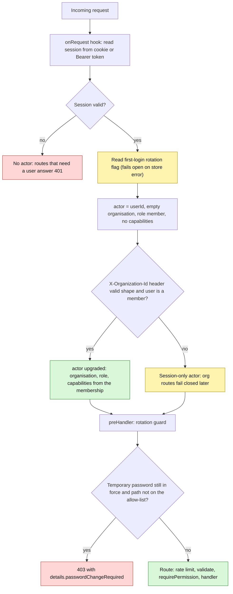
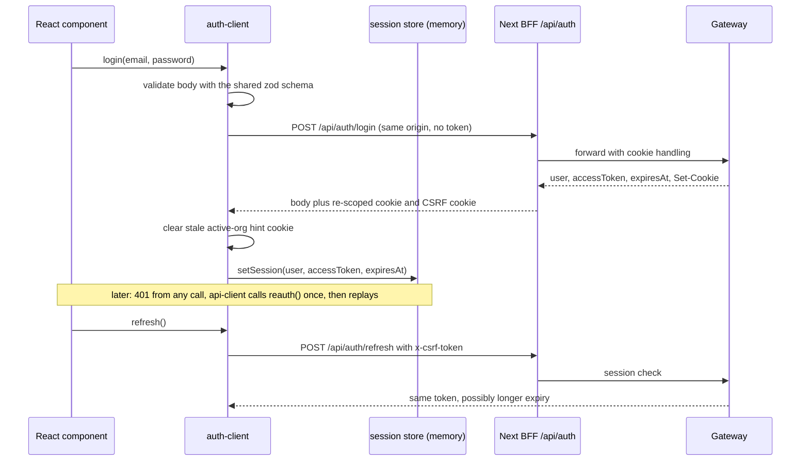

# Deep dive: authentication internals (backend and frontend)

Sources read on 2026-10-24: `apps/api-gateway/src/plugins/auth.ts`, `routes/v2/auth/index.ts`, `FE/packages/auth/src/{auth-client,session-store}.ts`, `FE/packages/api-client/src/client.ts`, `FE/packages/config/src/env.ts`. Overview and RBAC tables stay in `../04-auth-and-rbac/README.md`; this page explains **how the pieces actually behave** and what that means.

**One-paragraph explanation for a new engineer.** A person logs in at a Next.js app. That app's own server (the BFF) forwards the login to the gateway, where Better Auth checks the password and creates a session. The browser receives an httpOnly cookie (via the BFF) and the JavaScript receives the same session token as an "access token" kept only in memory. Every later gateway request is authenticated by a global hook that turns the session into an `actor`, optionally upgraded by an `X-Organization-Id` header when that user is a member of that organisation.

## 1. The request pipeline on the gateway

- The header shape is checked in the hook (`^[A-Za-z0-9][A-Za-z0-9_-]*$`) because the hook runs **before** route validation and a `/` in an id would be treated as a Firestore path separator and throw a 500. Membership lookup errors are logged and treated as "not a member".
- Rotation allow-list: login, signup, refresh, session, logout, change-password, OTP send and verify. Everything else 403s until the temporary password is replaced.
- On the memory storage driver there is **no auth at all**: the plugin returns immediately and the auth routes answer 503; the dev actor comes from headers (see `SECURITY-AND-PRIVACY.md` SP-5).

## 2. Better Auth configuration (what is explicit and what is default)
| Setting | Value | Source |
|---|---|---|
| Storage | Firestore adapter, collections `v2_auth_users`, `v2_auth_sessions`, `v2_auth_accounts`, `v2_auth_verification_tokens` | explicit |
| Methods | email and password only; **no social login, no MFA, no passkeys** | explicit |
| Extra user field | `role` (string); written by signup, never client-supplied | explicit |
| Cookie | httpOnly, SameSite=Lax, path `/`, no Domain; `Secure` only when `NODE_ENV=production` | default plus explicit flag |
| Session life | 7 days, extended in place after 1 day of use, **token string never rotates** | default, recorded in a code comment |
| Bearer plugin | enabled: the session token can also be sent as `Authorization: Bearer` | explicit |
| Trusted origins | union of the env-driven list and the CORS allow-list | explicit |
| Reset email | link with a single-use token, valid 1 hour; sent through Resend, or printed to the log when no key is set | callback |
No password-policy, lockout or breach-check settings are configured beyond Better Auth defaults and the gateway rate limit (10 per minute per IP and user bucket).

## 3. The "access token" is the session token (important)
`/login`, `/signup` and `/refresh` return `accessToken: session.token` (or the `set-auth-token` header). That is **the same secret as the cookie**, valid for up to 7 days, and `/refresh` does not mint a new one: it only re-reads the session and returns it.
- Consequence 1: the frontend design "access token in memory only" protects the token from being **stored**, but any script that can read the in-memory value (an XSS bug, a compromised dependency) obtains a full 7-day credential that works against the gateway directly with `Authorization: Bearer`.
- Consequence 2: "refresh" is a session check, not a rotation; there is no short-lived token and no refresh-token reuse detection.
- Consequence 3: the guest portal's browser-side reads (tickets page) send this bearer to the gateway, which therefore must allow the portal's origin in CORS.
- Mitigations available: shorten `expiresIn`, drop the bearer plugin where the BFF cookie path suffices, add a CSP (the guest portal has none), keep the BFF as the only caller where possible.

## 4. Login, signup and the account-existence question
| Flow | Behaviour | Oracle risk |
|---|---|---|
| Login | Every 4xx becomes the constant message "Authentication failed"; 401 and 422 status preserved; 5xx becomes 500 | none (by design, D-024) |
| Forgot password | Better Auth answers identically for unknown emails | none |
| **Signup** | Better Auth's own error message is passed through (`sendAuthError` with no generic override) | **reported:** an existing email likely produces a distinguishable error, so signup can reveal whether an address is registered; limited to 10 per minute |
| Change password | 4xx messages passed through ("Current password is incorrect"); on success revokes **all** sessions, clears the rotation flag, signs in again and returns a fresh session | n/a |
Role handling: signup always writes `role: 'partner'` and `toUserDto` always returns `'partner'`, so the guest/partner distinction does not exist in auth data. `platformRole` on the request is `user.role ?? 'guest'`, so it is `partner` for everybody. Platform **admin** authority is unrelated: it comes from `v2_admins` (`AdminAuthorityService`).

## 5. Frontend half (`@c1rcle/auth`, `@c1rcle/api-client`, `@c1rcle/config`)

- **Session store:** a hand-written external store (`useSyncExternalStore`) holding `{session, accessToken, expiresAt, status unknown|authenticated|anonymous, hydrated}`. It lives in module memory, so each browser tab has its own copy and a reload starts at `unknown` until the provider bootstraps with `refresh()`. `hydrated` is a one-way flag so a request can wait for the first bootstrap without blocking forever if a later refresh fails.
- **Refresh stampede guard:** concurrent `refresh()` calls share one in-flight promise; any failure clears the session and the org hint and resolves `false`.
- **CSRF cookie name:** `<NEXT_PUBLIC_APP_ID>.c1rcle.csrf` (e.g. `guest.c1rcle.csrf`), so the three apps do not overwrite each other on `localhost` (cookies are keyed by host, not port). It must match each app's BFF constant; nothing enforces that at build time.
- **Active-org hint:** `c1rcle.active-org` is cleared on every login, signup, logout and failed refresh, with `Secure` mirrored in production so Chrome actually replaces it. This prevents Account B inheriting Account A's organisation id and getting a 403 on the first `/access` call.
- **login()** converts any 400 or 401 into the same generic `Error`, so the UI cannot become an oracle even if a different path leaked a message.

### `ApiClient` behaviour (the only code allowed to call `fetch`)
| Concern | Behaviour |
|---|---|
| Timeout | 60 s default per request (`AbortSignal.timeout`), combined with the caller's signal |
| Retries | **GET only, at most 1 retry** (`min(maxRetries, 1)`; the default `maxRetries` of 2 is never fully used); POST, PUT, PATCH and DELETE are never replayed implicitly. Retryable errors: `network`, `timeout`, `rate_limited`, `server` except 501 |
| Backoff | `250 ms × 2^n` plus up to 250 ms jitter; `Retry-After` honoured and capped at 30 s |
| Auth | `Authorization: Bearer <in-memory token>` when present; on 401 it calls `reauth()` once and replays; if that does not recover, `onUnauthorized()` runs and the error is thrown |
| Org header | `x-organization-id` is **derived by regex from the path** (`organizations/<id>`); calls whose path has no such segment send none, and a path that merely contains the text would send a wrong id; explicit `headers` win over it |
| Correlation | A fresh UUID `x-request-id` per call; the server's echoed id is used in errors and timing callbacks |
| Validation | Every JSON response is parsed with the caller's zod schema; a mismatch throws `parse` with the message "frontend and backend are out of sync" |
| Extras | `fetchText` (CSV downloads, same auth and retry), `openEventStream` (SSE: no retry, caller owns reconnect, bare comment frames dropped, only `\n\n` frame separators and the last `data:` line of a frame are understood) |
**Findings:** on a schema mismatch the client does `console.error('[API CLIENT ZOD ERROR]', error, payload)`, which writes the **whole response body to the browser console** (personal data such as emails and order contacts included) in production too; the `org` regex could attach the wrong id for unusual paths; CRLF-framed SSE would never emit.

### `@c1rcle/config`
The only module that reads `process.env`. Client keys are listed literally (Next only inlines literal `process.env.NEXT_PUBLIC_*` expressions): `NEXT_PUBLIC_API_BASE_URL`, `NEXT_PUBLIC_GUEST_PORTAL_URL`, `NEXT_PUBLIC_APP_NAME`, `NEXT_PUBLIC_ENVIRONMENT`, `NEXT_PUBLIC_APP_ID`, `NEXT_PUBLIC_SENTRY_DSN` (no SDK behind it), four Firebase names and a **`NEXT_PUBLIC_FIREBASE_TEST_PHONE`** variable (a test-phone hook shipped to the browser bundle by design; make sure it is unset in production). Server keys: `NODE_ENV`, `SITE_URL`, `VERCEL_ENV`, `VERCEL_URL`, `ANALYZE`, `GATEWAY_READINESS_TOKEN`. Validation runs on **first access** (`getClientEnv()`), throwing a clear list of problems so a bad deployment fails at start-up; `getServerEnv()` throws if called in the browser.

## 6. Summary of findings from this page
| # | Sev | Finding | Status |
|---|---|---|---|
| AU-1 | Med–High | The "access token" is the 7-day session token (no rotation, no short-lived token); in-memory storage only limits persistence | verified in code |
| AU-2 | Low–Med | Signup passes through Better Auth's error text, a likely account-existence oracle | reported |
| AU-3 | Low | Rotation flag and membership lookups fail open on store errors (documented trade-off) | verified |
| AU-4 | Low–Med | `ApiClient` logs full response bodies to the console on a contract mismatch | verified |
| AU-5 | Low | `x-organization-id` derived by regex from the URL path | verified |
| AU-6 | Info | No MFA, social login, passkeys, lockout or password policy beyond defaults | verified |
| AU-7 | Info | All users are role `partner` (see `../08-guest-portal/07-…` G-B2) | verified |
| AU-8 | Info | CSRF cookie names must match between package and each BFF by convention only | reported |

## 7. Better Auth tables and cookies (verified against better-auth 1.6.26)
**Collections** (configured in `buildBetterAuth`): `v2_auth_users`, `v2_auth_sessions`, `v2_auth_accounts`, `v2_auth_verification_tokens`. Fields come from Better Auth's core schema plus one extra user field.
| Table | Fields (required unless marked) | Notes |
|---|---|---|
| user | `id`, `name`, `email` (unique), `emailVerified` (default false), `image` (optional), `createdAt`, `updatedAt`, plus our `role` | `emailVerified` is never set true by any code found (see `DEEP-DIVE-OTP-RSVP-CONTRACTS.md`); `role` is always `partner` at signup |
| session | `id`, `token` (unique), `expiresAt`, `createdAt`, `updatedAt`, `userId`, `ipAddress` (optional), `userAgent` (optional) | **stores the visitor's IP address and user agent**; the `token` is the credential also returned as the "access token". No cleanup job for expired sessions was found in the repo (reported) |
| account | `id`, `accountId`, `providerId`, `userId`, `accessToken`, `refreshToken`, `idToken`, `accessTokenExpiresAt`, `refreshTokenExpiresAt`, `scope`, `password`, `createdAt`, `updatedAt` | the password **hash** lives in `password` on the credential account; OAuth token fields are unused because there is no social login |
| verification | `id`, `identifier`, `value`, `expiresAt`, `createdAt`, `updatedAt` | holds the single-use password-reset token (1 hour) |
Better Auth also defines a `rateLimit` table (`key`, `count`, `lastRequest`); it is **not configured here**: rate limiting is the gateway's own plugin. The gateway also calls `auth.api.*` directly instead of mounting Better Auth's HTTP handler, so Better Auth's built-in endpoint limiter never sits in front of these routes.

**Cookies (all environments)**
| Cookie | Set by | Attributes | When |
|---|---|---|---|
| `better-auth.session_token` (name gets a `__Secure-` prefix when secure cookies are on) | Better Auth via the gateway; re-scoped by each Next BFF | httpOnly, SameSite=Lax, path `/`, no Domain, lifetime 7 days; `Secure` only when `NODE_ENV=production` | after login or signup |
| `session_data`, `account_data` | Better Auth cookie cache | 5-minute | **not issued**: cookie caching is not enabled in our config |
| `dont_remember` | Better Auth | session | only for "do not remember me" sign-ins; the gateway never passes that option |
| `<app>.c1rcle.csrf` (`guest`, `partner`, `admin` as `NEXT_PUBLIC_APP_ID`) | each Next BFF | readable by JavaScript, SameSite=Strict, Secure in production, 32 random bytes | login, signup, session read |
| `c1rcle.active-org` | partner dashboard | SameSite=Lax, Secure in production; an organisation-id hint, not a credential | cleared on every account change |
| `c1rcle.payment-recovery-hold` | guest portal BFF | httpOnly, 15 minutes, Lax | during paid checkout |
| `localStorage c1rcle-theme` | theme store | not a cookie | explicit theme choice only |
Per environment: local development (http) runs without `Secure`; staging and production set it (production-gated by `NODE_ENV`), and the BFFs set it by their own production flag. Because cookies are keyed by host and not port, the three apps would overwrite each other on `localhost` without the per-app CSRF cookie name.
