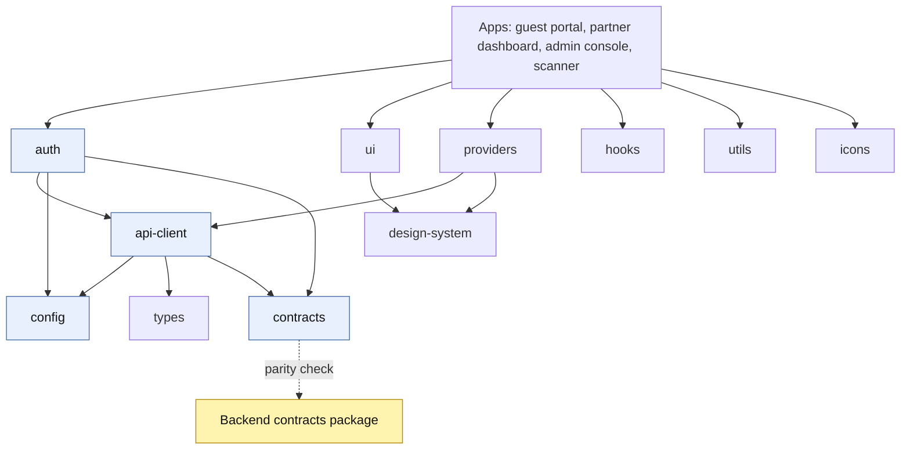

# Deep dive: the 14 shared frontend packages

`C1RCLE-FRONTEND/packages/*`. These are compiled workspace packages (`tsc -b`, `exports` point at `dist/`), so a change in a package needs a rebuild before apps see it. Sizes are non-test source lines at 2026-10-24. Read in full for the logic packages; the UI kit and the ESLint config were read at outline level only.

| Package | Lines | Role in one sentence | Used by |
|---|---|---|---|
| `@c1rcle/api-client` | 752 | The **only** code that calls `fetch`: auth header, timeout, retries, request ids, zod validation, CSV and SSE | all apps, `auth`, `providers` |
| `@c1rcle/auth` | 450 | Browser session store, login/signup/refresh/logout/change-password/reset calls, server-side session read | all apps |
| `@c1rcle/config` | 223 | The **only** reader of `process.env`; zod-validated client and server env | all |
| `@c1rcle/contracts` | 5,744 | Frontend copy of the backend wire schemas (generated, parity-checked) | all |
| `@c1rcle/types` | 90 | Shared primitives (branded ids, `RequestId`, `ApiErrorCode`, identity types) | `api-client`, apps |
| `@c1rcle/providers` | 206 | App provider stack: TanStack Query client, theme provider and store | admin console (mounts it), others partly |
| `@c1rcle/ui` | 314 | Small component kit: `Button`, `TextField`, `Card`, and the empty/error/loading state components | all |
| `@c1rcle/design-system` | 58 | TypeScript names of the design tokens and the theme storage key; values live in `tailwind-config` CSS | `ui`, `providers` |
| `@c1rcle/tailwind-config` | 0 TS (CSS only) | The Tailwind theme CSS, the single source of token values | apps |
| `@c1rcle/icons` | 139 | The single re-export point for icons (one owner by the boundary rules) | apps |
| `@c1rcle/hooks` | 73 | `useMediaQuery`, `useDebouncedValue`, `useMounted` | apps |
| `@c1rcle/utils` | 86 | `cn` (class names), format helpers, `Result` type | apps |
| `@c1rcle/eslint-config` | 816 | Shared lint and **boundary** rules | tooling |
| `@c1rcle/tsconfig` | 0 | Shared TypeScript base configs | tooling |

The rules (`pnpm boundaries`, from the shared ESLint config): apps are leaves (no app imports another app), a package's public surface equals its `exports` map, no import cycles, and **single owners** for HTTP (`api-client`), environment (`config`), tokens (`auth`) and icons (`icons`).

## `@c1rcle/api-client` and `@c1rcle/auth` and `@c1rcle/config`
Fully explained, with a sequence diagram and a behaviour table, in `DEEP-DIVE-AUTH-INTERNALS.md` section 5. Headline facts: 60 s timeout; GET retried at most once, writes never; one automatic re-authentication on a 401; `x-organization-id` inferred from the URL path; zod-validated responses; **a contract mismatch logs the whole response body to the console**; config reads `process.env` only here, validates on first access, and exposes a browser-visible `NEXT_PUBLIC_FIREBASE_TEST_PHONE` setting.

## `@c1rcle/providers`
- **Query provider:** creates a TanStack `QueryClient` in component state (never at module level, so one user's cache cannot leak to another during server render). Defaults: data fresh for 1 minute, kept 5 minutes, no refetch on window focus, up to 2 retries but **none for errors the API client marks non-retryable** (404, 403 and similar), mutations never retried.
- **Where it is used:** the admin console mounts `AppProviders` and its pages use `useQuery`; the partner dashboard and guest portal were verified in earlier passes to load data through server loaders, the BFF client and hooks rather than TanStack Query (so the guest portal's declared `@tanstack/react-query` dependency is unused).
- **Theme:** the theme is stored in `localStorage` (`c1rcle-theme`) and on `<html data-theme>`, not in React state, so an inline script can apply it **before first paint** and avoid a flash. The server always renders `system`, and a `useSyncExternalStore` store reconciles server and client snapshots at hydration. Storage failures (private mode) degrade silently to `system`.
- **Implication for CSP:** `themeInitScript` is the one deliberate inline script in the repository; a Content-Security-Policy needs a nonce or hash for it (the partner dashboard has a nonce-based CSP, the guest portal has none yet).

## `@c1rcle/ui`, `@c1rcle/design-system`, `@c1rcle/icons`, `@c1rcle/hooks`, `@c1rcle/utils`, `@c1rcle/types`
- **Design tokens:** names only in TypeScript (19 semantic colours such as `background`, `primary`, `destructive`, `success`, `warning`, `urgent`; six radii `xs`–`2xl`; themes `light|dark|system`); values live in the Tailwind theme CSS, so charts and canvases use `var(--color-<token>)` rather than hex values. Note the guest portal hard-codes `#111111` and `#000` in places (Razorpay theme, viewport colour) instead of using tokens.
- **UI kit:** intentionally tiny (button, text field, card and shared loading, empty and error states). Most screens in the partner and admin apps carry their own components; there is no shared table, modal, toast or form library, which is why behaviour such as focus handling differs per screen (see the guest portal's ticket modal without a focus trap).
- **Hooks:** `useMediaQuery`, `useDebouncedValue`, `useMounted` (hydration guard).
- **Utils:** `formatCurrency` divides by 100 and takes an **explicit locale** (a deliberate hydration-safety rule: no ambient locale), `formatDate`, `formatNumber`, `truncate` (word-boundary), the `Result<T,E>` type with `ok`/`err`/`unwrapOr` for expected failures, and `cn`.
- **Types:** branded primitives and the error-code union (`ApiErrorCode`), the same twelve codes described in `ERROR-CODES.md`.

## `@c1rcle/contracts` (frontend copy)
23 files, 5,744 lines: the zod schemas for every wire shape. **Backend-owned**: the backend package is the source and the frontend copy is checked for parity in CI by fixture comparison (`contract-parity` job), not by sharing a package. Practical effects: a backend schema change must be mirrored by a PR here (examples: #74 admin tax-rule mirror, #70 checkout attendee mirror, #81 scanner mirror); when the two drift the browser sees a `parse` error from `api-client` ("frontend and backend are out of sync"). The parity job tests fixture cases, so it does not prove every route response matches its schema.

## What to tell a new engineer
1. Need to call the API? Use `@c1rcle/api-client` through `@c1rcle/auth`'s token, never `fetch`.
2. Need an environment value? Add it to the zod schema in `config` and read it through `getClientEnv()` / `getServerEnv()`; remember Next only inlines **literal** `process.env.NEXT_PUBLIC_*` references.
3. Need a colour? Use a semantic token; add values in the Tailwind theme CSS, names in `design-system`.
4. Changed a backend schema? Update `contracts` here in the same release, or the apps will throw parse errors.
5. Do not bump Expo-pinned native dependencies by hand (scanner app); use `npx expo install`.

## Findings from this pass
| # | Sev | Finding |
|---|---|---|
| FP-1 | Low–Med | `api-client` logs full response bodies on a schema mismatch (privacy) |
| FP-2 | Low | The guest portal declares TanStack Query and React Hook Form but uses neither; the provider is mounted only in the admin console |
| FP-3 | Low | The UI kit is minimal, so accessibility and behaviour are re-implemented per screen |
| FP-4 | Low | A browser-visible `NEXT_PUBLIC_FIREBASE_TEST_PHONE` setting exists; it must stay unset in production |
| FP-5 | Info | The theme init inline script constrains any future CSP |
| FP-6 | Info | `contracts` parity covered 61 of 333 exported schemas; PR #145 (open) adds a generated differential check over all of them and found one real drift (`TAX_RULE_UPDATE`, frontend only) |

## UI kit and lint rules in detail (read 2026-10-25)
**`@c1rcle/ui`** (built on `class-variance-authority` and the design tokens):
- `Button`: variants `primary`, `secondary`, `outline`, `ghost`, `destructive`; sizes `sm`, `md`, `lg`; `fullWidth`. Loading state keeps the button in the DOM, sets `aria-busy`, disables it, shows a spinner and an `sr-only` label (default "Loading") so screen readers announce the change; visible `focus-visible` outline from the `ring` token; disabled drops opacity and pointer events.
- State components (`LoadingState`, `EmptyState`, `ErrorState`): the stated rule is that every data-driven screen handles loading, empty and error identically across the three apps. `LoadingState` is `role="status"` (polite), `ErrorState` is `role="alert"`, offers an optional retry button and prints a small **Reference: requestId** so support can correlate with backend logs. Its documentation says never to pass a raw exception message, only text translated from the error `code`.
- `TextField` and `Card` complete the kit. Everything else (tables, dialogs, toasts, forms, tabs) is app-local, which is why the guest portal's ticket dialog has no focus trap while the shared kit sets a good accessibility baseline.

**`@c1rcle/eslint-config`** (831 lines: `base`, `react`, `next`, `react-native`, `library`, `constants`). The base preset is deliberately strict because the repository is expected to be edited by many people and coding agents:
| Group | Rules |
|---|---|
| TypeScript | `strictTypeChecked` plus stylistic; no `any`, no unsafe assignment, member access, call, return or argument; no non-null assertion; `@ts-ignore` and `@ts-nocheck` banned; `@ts-expect-error` allowed only with a description of at least 20 characters; consistent type imports and exports; no floating or misused promises; exhaustive `switch` |
| Dead code | unused imports and variables are errors (leading `_` allowed); unused disable directives are errors |
| Module graph | no import cycles (unlimited depth), no self import, no relative package imports, **no default exports** (relaxed only for Next pages and config files, React Native `app/` routes, and `*.config.*`), enforced import order |
| Architecture | **applications are leaves** (nothing may import `@c1rcle/app-*`); **no deep imports** (`@c1rcle/*/src/*`, `/dist/*`, `@c1rcle/*/*/*`); other HTTP clients (axios, got, node-fetch, superagent, ky) banned; **backend SDKs and database clients banned** (firebase, firebase-admin, pg, mysql2, mongodb, prisma); `fetch` and `XMLHttpRequest` banned except in `api-client`; `process.env` banned except in `config` |
| Security | `packages/auth` may not touch `localStorage` or `sessionStorage` (access token stays in memory) |
| Hygiene | `no-console`, `no-debugger`, `no-alert`, `no-var`, `prefer-const`, `eqeqeq`, `curly`, `object-shorthand`, `no-implicit-coercion`, Turborepo `no-undeclared-env-vars` |
| React presets | hooks rules and exhaustive deps as errors in the React and React Native presets; `jsx-a11y` is loaded in the React preset (whether the Next preset inherits it was not checked) |
**Notes and exceptions:** the partner dashboard has a **sanctioned exception** to the firebase ban for its phone-verification files (`src/lib/firebase/*`), explained in its own `eslint.config.ts`, although the base message says Firebase "is being removed"; a `PageClient.tsx` also imports a Firebase **type**. The rule text and the web-storage ban document the intent behind several findings elsewhere: `console.error` in `api-client` is allowed by an inline disable, which is how full response bodies reach the console (FP-1). Lint cannot catch behavioural gaps such as missing focus traps or CSRF checks on individual routes.
