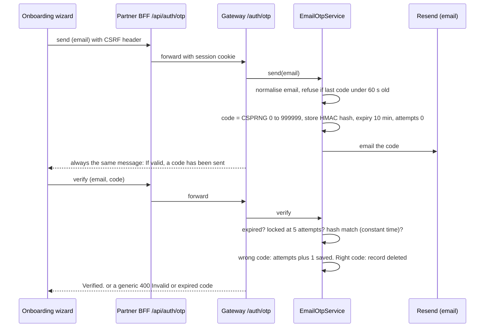
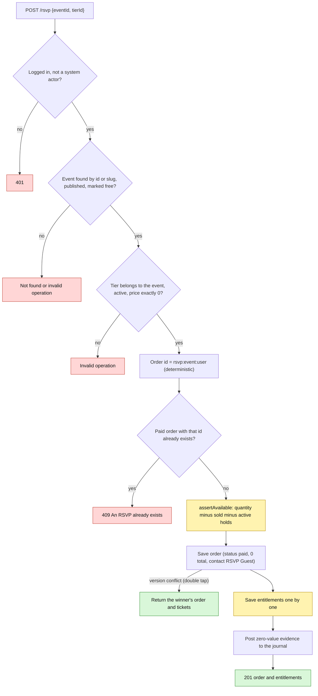
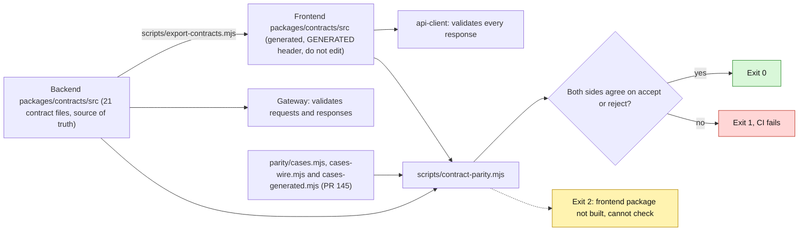

# Deep dive: email OTP, free-ticket RSVP, analytics backfill, contracts and parity

Sources read 2026-10-25: `routes/v2/auth/otp-routes.ts`, `application/auth/email-otp-service.ts`, `domain/models/email-otp.ts`, `routes/v2/rsvp/rsvp-routes.ts`, `checkout-service.ts` (`createRsvp`), `inventory-service.ts`, `scripts/backfill-analytics.ts`, `packages/contracts/*`, `scripts/{contract-parity,export-contracts}.mjs`, FE `partner-dashboard/src/lib/onboarding/otp.ts`. Findings are "verified" when the code path was read end to end, "reasoned" when derived from reading and not reproduced.

## 1. Email OTP
**Explain it as:** a 6-digit code emailed to an address, used by the partner onboarding wizard to "verify" the email step. It is a standalone mini-service, not part of the sign-up itself.

**Design strengths:** CSPRNG code; stored only as an HMAC-SHA256 keyed by `EMAIL_OTP_SECRET` (a 6-digit code would fall to an offline brute force if stored as a bare hash); constant-time compare; 10-minute expiry; 60 s resend cooldown; 5-attempt lockout; single use; one document per normalised email; every failure and the cooldown collapse into one generic response each so the endpoints cannot enumerate addresses; limits `OTP_SEND` 5 per minute and `OTP_VERIFY` 10 per minute plus the domain-level cooldown and lockout.
**Findings**
1. **Verified, High for trust, Low for security: the verification is not enforced anywhere.** `verify` deletes the record and answers `Verified.`; nothing stores a "verified" flag. The sign-up route never consults OTP, no onboarding or other route checks it, and no code path was found that sets Better Auth's `emailVerified` to true (admin screens only display it, and one admin-ops path writes `false`). The wizard's email step is therefore a **client-side gate only**: anyone who calls signup or onboarding endpoints directly skips it. Decide whether email verification is a real requirement; if yes, the server must record it and the onboarding submit must check it.
2. The frontend comment calls the OTP route "session-scoped", but the gateway routes need **no session** (the route comment says pre-session). The BFF requires the session cookie and CSRF; a direct gateway call needs neither.
3. **Third-party email sending:** any address can be targeted (no ownership proof is the point of the feature). Per-address cooldown is 60 s and the per-IP limit is 5 sends a minute, so an attacker can still send roughly 300 code emails an hour to different people from one IP; the sender identity is the product's.
4. **Reasoned, Low:** the attempt counter is read, incremented and saved without a transaction, so parallel wrong guesses can exceed five; the 10-per-minute verify limit bounds the effect. A fresh `send` after the cooldown resets attempts to zero, so the lockout is a **rate** (5 guesses per code, a new code at most once a minute), not a permanent block.
5. Expired and locked records are never deleted (no TTL or sweep), so hashed rows accumulate; they contain an email address and need a retention rule.
6. The guest portal has BFF routes for OTP but no UI uses them (dead).
7. The OTP limiters are keyed by IP, user and organisation like every limiter; the portal BFF does not forward the visitor's IP (see the guest portal status page), so anonymous callers behind one server share one bucket.

## 2. Free-ticket RSVP (`POST /api/v2/rsvp`)
**Explain it as:** one call that books a free ticket. It skips quote, hold and payment. One RSVP per person per event.

**What is solid:** deterministic order id means a retry collides with itself instead of minting a second ticket; a concurrent double tap converges on the winner; `Idempotency-Key` is optional because of that; ids and slugs both resolve to one RSVP; only zero-price tiers on free events are allowed; quantity is fixed at 1.
**Findings**
1. **Reasoned, High for capacity-limited free events: oversell race.** Availability is a check (`assertAvailable`, derived from orders and holds) followed by a write. It does not use the ordered-hold transaction that fixed overselling for paid tickets (audit item 7), so two people taking the **last** seat at the same moment can both succeed.
2. **Reasoned, Medium: a crash strands the guest.** The order is saved first (status `paid`), then each entitlement separately. If the process stops in between, a retry finds a paid order and answers **409 "already exists"** with no ticket. Only the fulfilment repair job can mend it, and that job needs a Render cron that is not configured (`../10-payments-and-finance/07-…`).
3. The contact is the placeholder `RSVP Guest`, empty email and phone, so organisers see no attendee identity for RSVPs (also `../08-guest-portal/04-…`).
4. Timestamps use `new Date()` rather than the injected clock, and no waitlist or guest-side cancel-RSVP exists.
5. Revenue side effect: a zero-value journal evidence entry is posted for every RSVP so counts reconcile.

## 3. Analytics backfill script
`pnpm --filter api-gateway backfill:analytics` runs `refreshAnalyticsReadModel` once over **every organisation and every event**, recomputing and upserting each read-model row, then prints how many rows it wrote and how many failed.
- **When to use:** a database that predates the projection, or right after changing what a row contains. In normal operation the live gateway already refreshes a row on event lifecycle changes and sweeps everything **every 5 minutes** (Firestore driver).
- **Safety:** reads are pure and writes are upserts, so it is safe to re-run and to run against a live database; concurrent requests keep using their compute fallback until a row exists.
- **Guards:** refuses the memory driver (it would "succeed" against a store that dies with the process); sets exit code 1 if any row failed so an operator or CI notices, although successful rows stay committed.
- **Limits (reasoned):** a single sequential pass with no batching, progress output or resume point, so a very large dataset restarts from the beginning after a failure; it needs real Firestore credentials, which is why it is not part of the seed flow.

## 4. Contracts package and the parity check
**Explain it as:** the backend owns the wire contract as zod schemas in `packages/contracts`; the frontend gets a generated copy and CI checks that both copies still accept and reject the same things.

- **Files (backend, lines):** `phase5` door and scanner 873, `phase6` finance 447, `partner` 441, `event` 425, `onboarding` 397, `checkout` 366, `organization` 305, `phase7` support and admin 210, `shared` 198 (pagination, ids, the error envelope), `auth` 125, `social` 100, then smaller admin, public, notifications and guest-profile files; `client.ts` (783) and `index.ts` (553) re-export everything. Two entry points: `.` and `./client`.
- **Sync model:** `export-contracts.mjs` copies the backend `src/**/*.ts` (tests excluded) into the frontend package with a `GENERATED` header and never touches the frontend scaffolding. Both sides are built, then `contract-parity.mjs` loads **both builds with the same zod build** (it redirects the bare `zod` import) so any disagreement is a real constraint difference, never a version artefact.
- **Parity is behavioural, not textual:** a formatting change cannot fail it; a changed constraint does. Exit codes: 0 agree, 1 drift, 2 cannot check.
**Findings**
1. **Coverage was thin, and is being closed.** A text scan found **175 parity cases over 61 distinct schemas**, against **333 schemas exported** (363 defined), with nearly all of **checkout, payments, offline manifest and sync, door, finance, admin dispute, follows and notifications, OTP and guest profile** untested, which are the areas where the last frontend mirrors (#70 attendee, #74 admin finance, #81 scanner) were needed. **Update 2026-10-25: draft PR #145 (open, not merged; it replaces #144, whose commit messages failed the footer-length lint) adds two things.** (a) 231 hand-written checks over 48 schemas on the money, admission and identity paths. (b) A **generated differential check over every exported schema**: 334 schemas, about 215,000 variants (field removed, wrong type, unknown key, lengths and numbers at bound−1, bound and bound+1 taken from both copies, array sizes, enum members from both copies, and a parsed-output comparison), about 8 seconds. Every schema is therefore now compared, not only the hand-picked ones; 2 schemas cannot be seeded and are listed as skipped (`createVenueBlockSchema`, `organizationCalendarDtoSchema`). Mutation tests, each caught: a limit loosened by 50 and by exactly 1, a removed `.strict()`, a widened enum, a stale known-drift entry. The first version of the generator had two defects (a de-duplication key that merged long strings, and fixed lengths that missed off-by-one limits) that only those mutation tests exposed, which is why they were run.
2. **Real drift found by the differential check (new):** the frontend's `adminActionSchema` accepts **`TAX_RULE_UPDATE`**, the backend's does not. The frontend mirror (#74, merged) lists it; the backend defines it only in the open tax-rule PRs (#127 part 2, #129). Until those merge, the admin console could submit an action the gateway rejects (also affects `proposeActionSchema` and `proposedActionDtoSchema`). The PR records it in a small `KNOWN_DRIFT` list that prints a warning on every run and **fails the run if the drift disappears**, so the entry cannot go stale. All other schemas agree. (The hand-written cases never touched this enum, so only the generated check could see it.) Lesson for the process: a frontend mirror PR should not merge before the backend schema it mirrors.
3. Because the frontend copy is generated and the parity run needs the **frontend built**, a drift is visible only when both repos' CI jobs run; each repo's PR runs the check against the **other repo's target branch**, so two PRs that each pass alone could still conflict after both merge (reasoned from the CI wiring, not observed).
4. The legacy `buildErrorResponse` (`{success:false, error:{…}}`) is still exported next to the flat envelope used on the wire (D-009), so a caller can pick the wrong builder.
5. Two schemas names to know: `versionHeaderSchema` is exported to the frontend as `IfMatchVersion`, and `phase5ErrorCodeSchema` lists codes the gateway never emits.
6. Contracts are the only shared code between the repos, yet there is no versioning, changelog or deprecation process for them (`version: 0.1.0`, private).

## 5. Next step if you want certainty
PR #145 adds hand-written cases for checkout, payments, offline sync, door, finance and sign-in, plus the generated differential check over every schema. Next: decide how to resolve the `TAX_RULE_UPDATE` drift (merge #127/#129, or drop the action from the frontend until then), and make the parity job a required check in both repos (a repository-settings change, not made here). Differential limits to know: it only compares what the zod definitions say, so rules inside custom `refine`/`superRefine` callbacks are exercised by the variants but not understood, and it needs a seedable schema. Two things to know when writing hand cases: `orderStatusSchema` is defined but not exported from the client entry on either side, and the social notification schema is exported as `socialNotificationDtoSchema` because the plain `notificationDtoSchema` is the partner inbox one (a real naming trap: two different schemas share a name inside the package).
