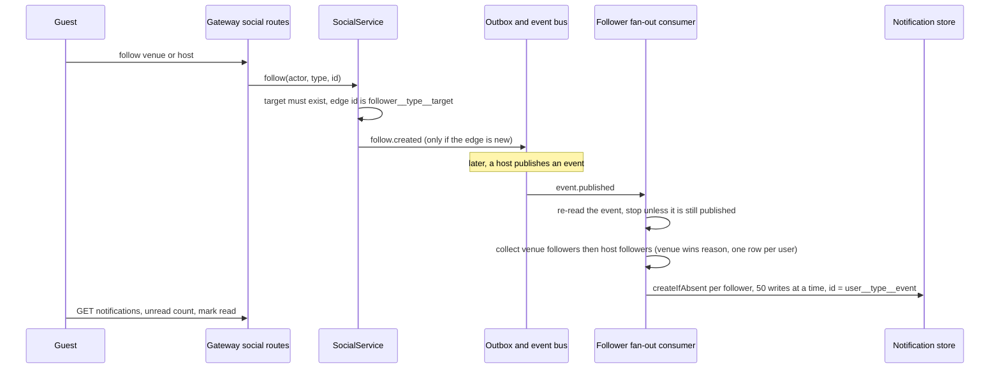
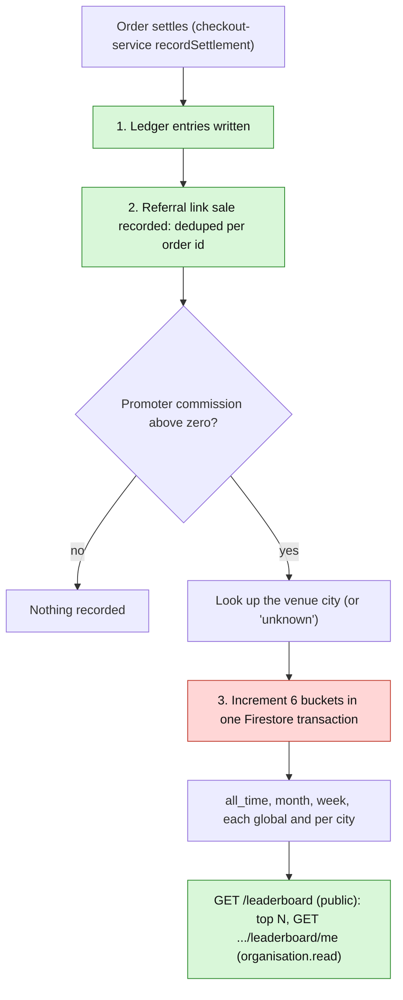
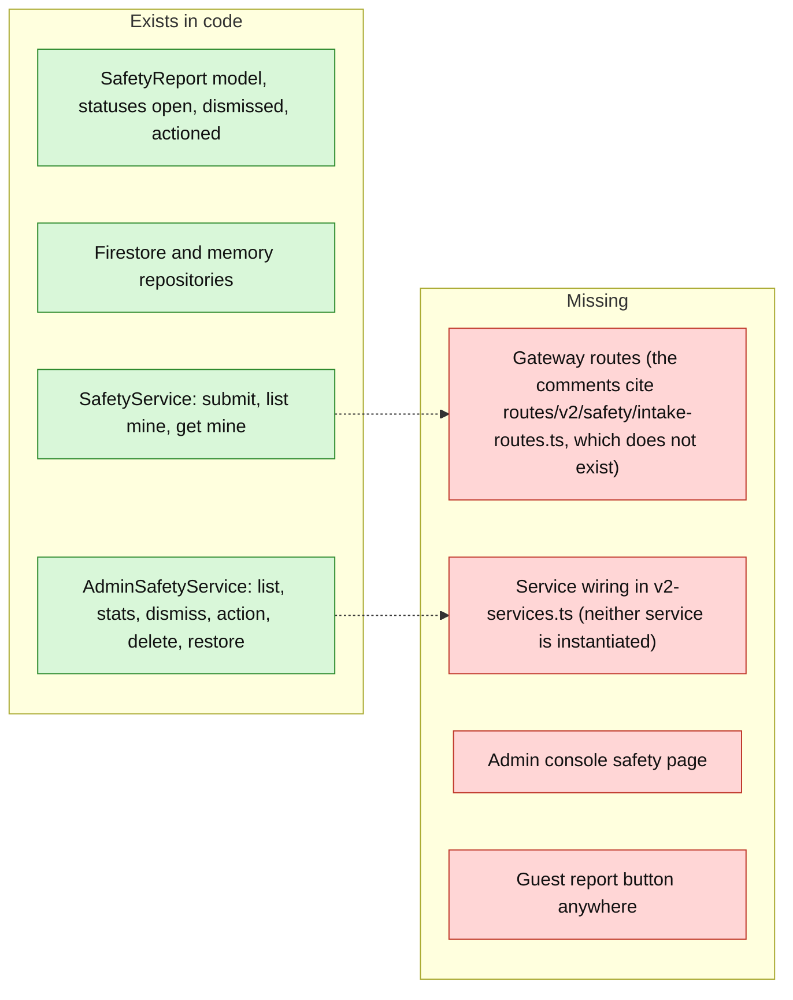

# Deep dive: social graph, safety reports, leaderboard and guest profile

These four backend areas had only a paragraph each. Sources read 2026-10-24: `application/social/*`, `application/safety/*`, `application/finance/leaderboard-service.ts`, `application/guest-profile/*`, the matching `domain/models/*`, `routes/v2/finance/leaderboard-routes.ts`, `routes/v2/social/social-routes.ts` (outline), `lib/v2-services.ts` wiring, `application/checkout/checkout-service.ts` (settlement). Status at a glance:
| Area | Model | Service | Routes | Wired into the app | Used by a frontend |
|---|---|---|---|---|---|
| Social (follows, guest notifications) | yes | yes | yes | yes (`event.published` consumer subscribed) | **no** |
| Guest profile | yes | yes | yes (`GET/PUT /profile/me`) | yes | read only, no save |
| Leaderboard | yes | yes | yes (public + per organisation) | yes (written at settlement) | **no** |
| Safety reports | yes | yes (guest intake and admin desk) | **none** | **no: never instantiated** | no |

## 1. Social graph and guest notifications
**Explain it as:** a guest can follow a venue or a host (an organisation). When a followed venue or host publishes an event, every follower gets an in-app notification pointing to `/event/<slug>`.

**How it is built**
- One edge document per (follower, target) with a deterministic id, so follow is idempotent by construction and re-follow returns the existing edge; unfollow of a non-edge is a silent no-op.
- The service only **publishes** events (`follow.created`, `follow.removed`, audited); notifications are made by a bus subscriber, so a new reaction (push, email) plugs in as another subscriber.
- Delivery is at-least-once, so the consumer is idempotent: it re-reads the event (a cancelled event notifies nobody), uses deterministic ids with `createIfAbsent`, and takes `createdAt` from the event's `occurredAt`. A `resumeSales` re-publish, or a guest following both venue and host, still yields one row.
- Only one notification type exists: `event.new_from_followed`.
**Limits and findings (reported from code)**
- Follow targets are checked only for existence: `host` accepts **any organisation id** (including a promoter or an organisation that is not publicly listed), while the public host endpoint only shows active organisations.
- The fan-out loads **every follower id into one in-memory map** before writing; a host with a very large audience makes the consumer slow and memory-heavy, and one failure retries the whole fan-out (safe because of idempotent ids, but repeated).
- Unfollowing does not delete past notifications; there is no mute, block or per-type preference; notification rows have no expiry or retention rule.
- `followStatus` runs a follower **count** query per call.
- No frontend or BFF uses any of this (guest-portal doc `05-…`).

## 2. Guest profile
**Explain it as:** the onboarding record of a guest: preferred name, date of birth, city, tastes, intents. One document per user id; session-scoped (a guest belongs to no organisation).
- `upsertMine` creates or updates (version bumped on update).
- **The 18+ rule lives in the model** (`assertAdult`) so every writer enforces it identically; the date must be `YYYY-MM-DD`.
- Findings: `assertAdult` reads the **real clock** (`new Date()`), not the injected `config.clock` the rest of the services use, so tests and time-travel cannot control it; age is computed in UTC, so a birthday near midnight IST can be off by one day; the model accepts absurd years (a 1800 birth date passes) because it only rejects under 18; `tastes` and `intents` are copied as given, so any size limit depends on the contract schema (not verified here). The date of birth is stored in plain text (see `SECURITY-AND-PRIVACY.md`).
- The guest portal reads this profile but its form never saves (portal doc `05-…`).

## 3. Promoter leaderboard
**Explain it as:** a public ranking of promoters by total commission earned, by period (all time, month, week) and city, plus a "my standing" view for a promoter's own organisation.

**How it is built:** a read model (not a state machine). `periodBucketsFor(now, city)` yields 6 buckets; document id `promoterId_periodType_periodValue_city`; month is `YYYY-MM`, week is the ISO week `YYYY-Www` (Thursday-anchored), both computed in **UTC**; city is lower-cased and trimmed, `global` is the all-cities bucket and `unknown` is the fallback. The public read has no pagination beyond `limit` and defaults the period to "now".
**Findings (reported from code unless stated)**
1. **The comments overclaim atomicity.** The model says buckets are written "in the same transaction as the ledger entries"; in code the six buckets are one transaction, but the **ledger write, the referral-link write and the leaderboard write are three separate calls**. A crash between them leaves the ledger and the leaderboard disagreeing.
2. **The leaderboard increment is not idempotent.** It uses `FieldValue.increment` with no per-order record, while the referral-link write is deduped per order id. If settlement runs twice for an order (a retry after a partial failure, or the repair job re-settling), commission is **counted twice** on the leaderboard.
3. **No reversal path was found:** the port exposes increment, top and read, and nothing subtracts, so a refunded or charged-back order's commission stays on the leaderboard.
4. **Public exposure:** `GET /leaderboard` needs no login and returns the promoter organisation id and the exact commission in paise for each ranked promoter; the route comment calls rankings "not commercially sensitive", which contradicts the partner rule that promoter profiles never show revenue. Names are not included, but ids can be resolved through other public endpoints.
5. **Tiering uses orders, not tickets:** the commission tier is chosen from the sum of link `conversions`, named `ticketsSold` in the code, but conversions increase by **1 per order**, so a four-ticket order counts once. The list that feeds it is capped at 1000 links.
6. UTC week and month boundaries start at 05:30 IST, not midnight, for an Indian audience.
7. No frontend or partner-dashboard screen calls either leaderboard endpoint.

## 4. Safety reports (built but not wired)
**Explain it as:** a designed trust-and-safety flow where a signed-in guest reports a user, event, venue or organisation, and a platform admin reviews, dismisses or records an action. **None of it is reachable today.**

**Design (what the code intends)**
- Categories: harassment, spam, inappropriate, safety, other. Priority `critical` for `safety`, else `normal`. Targets: user, event, venue, organization. Optional context: event id, message id.
- A real review promise: `reviewDueAt` is 24 hours after creation; "overdue" is meant to be derived at read time. A real metric: `resolutionRate` = resolved ÷ total from live counts (replacing v1's invented "Safety Rating 99.9%").
- Guest side is scoped to the reporter: another person's report is a 404.
- Admin side: every desk verb is **TIER1** (any admin) and always audited (`SAFETY_REPORT_DISMISS|ACTION|DELETE|RESTORE`, before/after state, IP and user agent). Dismiss needs a reason; action needs a reason and a stated discipline (`type` and `ref`); delete is soft with attribution; `action()` only **records** that a ban was applied, it never issues the ban (that is the separate TIER2 `USER_BAN`).
- Resolved reports cannot be changed again (`already resolved`); deleted reports cannot be changed.
**Findings:** the whole feature is dead code until routes and wiring exist; target ids are not checked for existence (only non-empty), so reports can name nothing real; the model references a `messageId` although no chat or messaging exists; `restoreSafetyReport` takes an admin id it never uses; `details` and free text have no length limit in the model; reporter email and free text are personal data with no retention rule. **Effort to finish:** two route files (guest intake and admin desk), service construction in `v2-services.ts`, contracts, an admin page and a guest report entry point.

## 5. Where to document next
Add these four to the owner's product decisions list: (a) do guests follow hosts and venues in v1 launch, (b) is the leaderboard public and what does it reveal, (c) is safety reporting required at launch, (d) is a guest date of birth really needed. The answers decide whether the work here is finished, deleted or built out.
