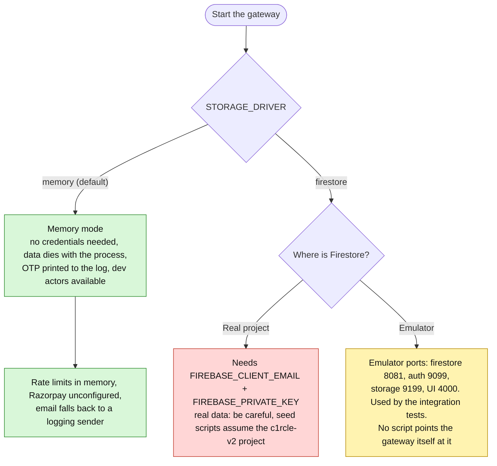
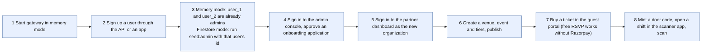

# Getting started (local development)

Everything an engineer needs to run C1RCLE locally and tell which mode they are in. Sources: root `README.md`, both `package.json` files, `.nvmrc`, `apps/api-gateway/src/config/index.ts`, `firebase.json`, the scripts in `apps/api-gateway/src/scripts/`. Names only: never put secret values in files you commit.

## 1. Prerequisites
| Item | Backend (`C1RCLE-BACKEND`) | Frontend (`C1RCLE-FRONTEND`) |
|---|---|---|
| Node | `.nvmrc` = 24 (engines `^22.13 \|\| >=24`; Docker image `node:24-slim`) | `.nvmrc` = 22.22.2 (same engines range) |
| pnpm | 11.26.0 (`packageManager`) | 10.33.0 |
| Java 21+ | only for the Firestore emulator (CI uses `firebase-tools@15.34.0`) | not needed |
| Other | contract-parity script needs Node ≥ 22.15 | Expo tooling for the scanner app |
The two repos use **different Node and pnpm versions**: run `nvm use` inside each folder. Each is its own pnpm workspace with its own lockfile. **Never run `pnpm install` at the umbrella root**; use `pnpm run install:all`. (The umbrella `package.json` also carries an unexplained `render` dependency that nothing uses.)

## 2. Commands from the umbrella root
`pnpm run install:all` · `pnpm run dev:backend` (turbo → gateway `tsx watch --env-file-if-exists=.env.local src/server.ts`) · `pnpm run dev:frontend` (turbo `dev` across apps) · `pnpm run build|lint|typecheck|test` · `pnpm run check` (backend `check` then frontend `check`).
Backend `pnpm check` = format, lint, typecheck, boundaries, nginx config, security pins, Firestore indexes, tests, build. Frontend `pnpm check` = format, lint, typecheck, boundaries, tests, build. **Not** in `check`: backend `test:scenarios` and `test:coverage`, frontend `test:e2e` (Playwright), `expo install --check`, and `contract-parity` (needs both repos side by side).

## 3. Which mode am I in?

### Memory mode (recommended first run)
No Firestore, Redis, Razorpay or Resend. Defaults: port 8080, `PUBLIC_API_URL` and `BETTER_AUTH_URL` = `http://localhost:8080`, CORS allows `http://localhost:3000`, `3001`, `3002`, `BETTER_AUTH_SECRET` = `dev-only-change-me` (production refuses it). Email OTP is only logged (`dev_email_otp`).
**Dev actors (memory mode only):** at boot the gateway seeds two platform admins `user_1` and `user_2` (role `super`, emails `user_1@c1rcle.test`, `user_2@c1rcle.test`), so dual control can be exercised with two identities. When a request has no session, the gateway **fabricates an actor** from the headers `x-user-id` (default `user_1`) and `x-organization-id` (role defaults to `owner`). This only happens when `NODE_ENV != production`, the driver is `memory` and no actor exists: header spoofing is possible by design in memory mode and must never be reachable from a shared network.
### Firestore mode
`STORAGE_DRIVER=firestore` requires `FIREBASE_CLIENT_EMAIL` and `FIREBASE_PRIVATE_KEY` (a PEM that may contain literal `\n`). `FIRESTORE_PROJECT_ID` defaults to `c1rcle-staging`, while `.firebaserc` and the seed scripts assume `c1rcle-v2`. All data is in `v2_*` collections; v1 collections are never touched. Needs a Storage bucket (`FIREBASE_STORAGE_BUCKET`, default `<project>.firebasestorage.app`) with CORS configured (see the script below), Identity Platform phone auth for partner onboarding, and indexes deployed from `firestore.indexes.json`.
### Emulator
`firebase.json`: firestore 8081, auth 9099, storage 9199, UI 4000. Integration tests under `packages/core/src/infrastructure/firestore/*` are skipped unless `FIRESTORE_EMULATOR_HOST` is set and use project `demo-c1rcle`. CI command: `npx --yes firebase-tools@15.34.0 emulators:exec --only firestore --project demo-c1rcle "pnpm --filter @c1rcle/core exec vitest run src/infrastructure/firestore"`. Turbo strips the variable, so run vitest directly. Test comments mention port 8089, which does not match `firebase.json` (8081): trust `firebase.json`.

## 4. Env files
Backend: `apps/api-gateway/.env.example` is tracked; `.env.local` (gitignored) is what `dev` and every script load. The example's header says "copy to `.env.development`", which is stale. The example omits `ALLOWED_ORIGINS`, `TRUSTED_PROXY_CIDRS`, `PUBLIC_API_URL`, `ENCRYPTION_SALT`, `BUILD_SHA` and `APP_VERSION`. Frontend: each Next app has `.env.example` → `.env.local`; the scanner app copies its example to `.env`. Full matrix: `ENV-MATRIX.md`.

## 5. Running the frontends
| App | Command | Port | Notes |
|---|---|---|---|
| guest-portal | `pnpm --filter @c1rcle/app-guest-portal dev` | 3000 | Turbopack |
| partner-dashboard | `pnpm --filter @c1rcle/app-partner-dashboard dev` | 3001 | `dev` Turbopack, `build` webpack |
| admin-console | `pnpm --filter @c1rcle/app-admin-console dev` | 3002 | |
| scanner-app | `expo start` or `dev:web` | Expo | SDK 55 |
Point the web apps at the local backend with `NEXT_PUBLIC_API_BASE_URL=http://localhost:8080` (the `.env.example` default). The scanner uses `EXPO_PUBLIC_API_BASE_URL`; its example points at the **Render staging URL**, not localhost, and a physical handset needs your machine's LAN IP (undocumented elsewhere). Backend CORS only allows the three dev ports unless `CORS_ALLOWED_ORIGINS` or `ALLOWED_ORIGINS` is set. The CSRF cookie name is namespaced by `NEXT_PUBLIC_APP_ID` so apps on different dev ports do not collide.
Playwright e2e specs **mock every backend call**; there is no end-to-end suite against a real gateway.

## 6. Seed and operations scripts (`apps/api-gateway/src/scripts/`)
Run from the backend repo root. Package scripts exist for four; others use `pnpm --filter api-gateway exec tsx --env-file-if-exists=.env.local src/scripts/<file>.ts`.
| Script | Command | What it does and cautions |
|---|---|---|
| `seed-platform-admin.ts` | `pnpm --filter api-gateway seed:admin -- --user-id <authUserId> --email <email>` | Creates the first admin. `--role` defaults to `super`; `--force` needed when an active admin exists; the user id must be an existing Better Auth user. The **only** way to create the first super admin (API provisioning is dual control). |
| `repair-fulfilment.ts` | `pnpm --filter api-gateway repair:fulfilment [-- --apply --hours 48 --settle-minutes 10 --max 500]` | Report-only by default; Firestore only; idempotent. |
| `backfill-analytics.ts` | `pnpm --filter api-gateway backfill:analytics` | Rebuilds the analytics read model; refuses the memory driver; safe to re-run. |
| `configure-storage-cors.ts` | `pnpm --filter api-gateway configure:storage-cors` | Run once per bucket; **replaces** the bucket CORS policy. Allowed origins are **hard-coded** (localhost 4000/3001/3000 and `https://thec1rcle.com`); staging and Vercel origins are not included. Without it, KYC and poster browser uploads fail at preflight. |
| `seed-scanner-e2e.ts` | `pnpm --filter api-gateway exec tsx src/scripts/seed-scanner-e2e.ts` | Needs the gateway already running at the hard-coded `http://localhost:8080`; creates an owner through real signup plus organisation, venue, event, tier, door codes and a wallet (prefix `seed_e2e_`). Owner email and **password are hard-coded** in the file; requires Firestore and its comment says it writes to the real `c1rcle-v2` project. |
| `e2e-scanner-check.ts`, `e2e-double-tap-check.ts` | `tsx <file> <fullDoorCode> <chargeDoorCode> <walletId>` | HTTP scanner E2E and an idempotency double-tap check; hard-code gateway URL, org id, event id and the seed credentials; need the seed first. |
| `create-scanner-event.ts` | via `exec tsx` | One-off: hard-coded owner id, org name match, date 2026-10-03: not reusable as written. |
| `verify-scanner-event.ts` | via `exec tsx` | Read-only; hard-coded ids; refuses to run unless the resolved project is `c1rcle-v2`. |
| `migrate-and-seed-v1-sample.ts` | via `exec tsx` | Copies the 10 richest v1 hosts/venues/events into v2 and seeds downstream records (`seed_*` ids). Needs read-only v1 credentials from a **sibling repo path an external team will not have**. |
**Hygiene:** several scripts embed a real-looking owner id, a development password and assume the `c1rcle-v2` project. Treat them as internal tooling; never run them against production without reading them first.

## 7. Seeding a working local system (suggested order)

## 8. Third-party setup
- **Razorpay:** there is **no test/live switch**; mode follows the key pair in `RAZORPAY_KEY_ID`/`RAZORPAY_KEY_SECRET`. If any one of the three Razorpay variables is set, readiness reports the payment check (a partial set fails it). Webhook `POST /api/v2/webhooks/payments/razorpay` verifies HMAC-SHA256 from `x-razorpay-signature` using `RAZORPAY_WEBHOOK_SECRET` and answers 503 when the secret is unset. Without keys an "unconfigured" provider is used. Local webhook testing needs a tunnel (undocumented).
- **Resend:** set `RESEND_API_KEY` (send-only). Without it dev logs the OTP and production throws "Email provider not configured" (OTP route 500). `PARTNER_DASHBOARD_URL` builds staff-invite links. Sending-domain and from-address setup is undocumented.
- **Firebase:** a Firestore database; a service account; Storage bucket with CORS; Identity Platform phone auth. Frontend onboarding needs `NEXT_PUBLIC_FIREBASE_API_KEY`, `_AUTH_DOMAIN`, `_PROJECT_ID`; a test phone number must be registered in the Firebase console (Authentication → Phone → Test phone numbers) for `NEXT_PUBLIC_FIREBASE_TEST_PHONE`. The backend verifies the ID token with firebase-admin, so its service account must belong to the **same** GCP project. The partner example says `FIREBASE_PROJECT_ID`, the backend name is `FIRESTORE_PROJECT_ID`.
- **Redis:** optional; only with `RATE_LIMIT_STORE=redis`; tests use `ioredis-mock` and `REDIS_TEST_URL`.
- **Health:** `GET /api/v2/internal/health`, `/version`, `/readiness`.

## 9. Common pitfalls
1. Wrong Node or pnpm version for the repo you are in. 2. `.env.local` vs the stale `.env.development` instruction. 3. Expecting the scanner app to reach `localhost` from a phone. 4. Running seed scripts against the real project. 5. Forgetting the storage CORS script (uploads fail). 6. Assuming emulator port 8089. 7. Assuming Playwright proves integration (it mocks the backend). 8. Using `contract-parity` without both repos side by side (exit 2). 9. Header-based dev actors left enabled on a reachable host.
