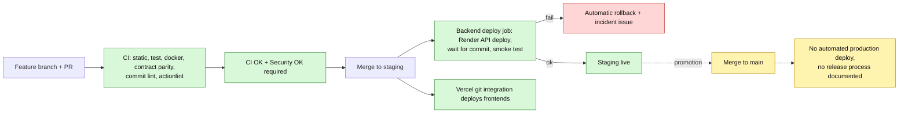

# Operations and delivery

Branching, CI/CD, conventions, release, observability, load testing and the gaps. Sources: `.github/workflows/*` in both repos, `docs/ci-cd.md`, `render.yaml`, `renovate.json`, `commitlint.config.mjs`, `scripts/ci/*`, `deploy/staging/*`. Infra topology: `../11-infrastructure-and-cicd/README.md`; edge: `../00-system-overview/NGINX-DREAM-ARCHITECTURE.md`.

## Branching and promotion
`feature branch → staging (integration; deploy target for the backend and the Vercel apps) → main`. Backend branch protection should require exactly `CI OK` and `Security OK`; the frontend requires `CI OK`. **There is no documented formal release or promotion procedure, no tagging, no changelog.** Backend deploy is automatic on a `staging` push; the `staging → main` merge triggers **no** production deploy (no `main`-tracking service exists; `RENDER_SERVICE_ID` is "future").

## Backend CI (`BE/.github/workflows/`)
- **`ci.yml`** (PR, push to main/staging, merge queue, manual with `skip_docker`): `changes`; `static` (format, lint, typecheck, boundaries, nginx config, security pins, Firestore indexes, no `it.only`); `test` (build, vitest with coverage, coverage ratchet: floor from `coverage-baseline.json`, a drop of at most 0.5 points allowed, PR comment); `scenario` (merge only); `firestore-emulator` (Java 21); `docker` (build, Trivy fail on HIGH/CRITICAL, smoke-boot, refuse-to-boot assertions); `contract-parity` (on by default); `actionlint`; `commit-lint` (commits and PR title); `ci-ok` (the required check); `deploy` (staging pushes only: waits for `Security OK`, triggers the Render API, waits for the commit via `/internal/version`, six black-box smoke assertions, rolls back on failure and files an incident issue).
- **`security.yml`** (PR, push, Mondays 06:15 UTC): CodeQL, dependency review, `scan` (audit, TruffleHog, Trivy), OSSF Scorecard, aggregated `Security OK`.
- **`maintenance.yml`** (daily 20:30 UTC = 02:00 IST): production health smoke (opens or closes a `production-incident` issue), lockfile integrity, stale issues (30+14 days; exempt `production-incident`, `security`, `pinned`).
- Also: composite action `.github/actions/setup`, `actionlint.yaml`, `CODEOWNERS` (one owner for `/.github/`, `/Dockerfile`, `/scripts/`, `/packages/contracts/`), PR template, `renovate.json`, husky hooks.

## Frontend CI (`FE/.github/workflows/ci.yml`)
PR `gate` (format, lint, typecheck, boundaries, `test:coverage`, `expo install --check`, build; each step `if: always()` so one run reports every failure), `contract-parity` (against the backend branch the PR targets), `ci-ok`; push-only Playwright (chromium and webkit for the three Next apps; **all backend calls mocked**) and `post-deploy-smoke` (staging; waits 90 s then HTTP-checks three hard-coded `*.vercel.app` URLs, not the real hostnames). **No** security workflow, maintenance workflow, CodeQL, dependency review, Renovate, CODEOWNERS, PR template, commitlint or husky.

## Conventions
- **Commits (backend):** Conventional Commits (`commitlint.config.mjs`); types feat, fix, perf, refactor, revert, **recover** (repo-specific), docs, test, build, ci, chore; kebab-case scope; header ≤ 100 characters; enforced by `.husky/commit-msg` and again on the **PR title** in CI (squash merge uses the title).
- **Hooks (backend):** pre-commit `lint-staged` (prettier and `eslint --max-warnings=0`); pre-push typecheck, boundaries, `check:security-pins`, test.
- **Architecture guards (`scripts/check-boundaries.mjs`):** no `process.env` outside the config module; `fetch(` only in gateway lib/plugins; no database SDK imports in domain or application; no `.collection(`/`.doc(` in routes. Frontend equivalent: `pnpm boundaries` (apps are leaves, public API equals the exports map, no cycles, single owners for HTTP, env, tokens and icons).
- **Frontend rules (`FE/CLAUDE.md`):** Expo native dependencies are pinned to SDK 55 and changed only with `npx expo install <pkg>`; `react-native-screens` stays `~4.23.0`; re-add `pnpm-lock.yaml` after installs; a Windows-local `expo export` codegen failure is environmental.
- **Renovate (backend only):** targets `staging`, timezone Asia/Kolkata, Mondays 06:00; patch and minor grouped and auto-merged after `CI OK` and `Security OK`; majors never auto-merged; pnpm bumps and the `@types/node` major held back; Actions SHA pins and Docker base updates auto-merge. (`ci-cd.md` mentions Dependabot once; the repo uses Renovate.)
- **Security pins:** `governance/security-pins.json` plus `check-security-pins.mjs`: brace-expansion, fast-uri (v3 and v4), nanoid 3.x, uuid (exactly 11.1.1, since uuid@12 is ESM-only and breaks the CJS firebase-admin chain), js-yaml, tar, `@grpc/grpc-js`, `@fastify/busboy`, source-map-js; the Dockerfile also patches OS packages and bundled `tar`.
- **Stale in repo:** the backend PR template says "`main` auto-deploys to api.example.com" (verified): the live service tracks `staging` with CI-gated deploys.

## Observability
Existing: `GET /api/v2/internal/health|version|readiness` (readiness is token-gated at nginx; checks configuration, gateway, optional redis, optional payment provider, storage); nginx JSON access logs; the CI smoke; the daily production health job; the admin console health page via a token-holding BFF. **Specified but not built:** `docs/operations/staging-observability.md` lists required signals (request rate, 4xx/429/5xx, 502/503/504, p50/p95/p99, upstream latency, connections, certificate expiry) with **no provider chosen**. **Absent:** alerting, an error tracker, tracing, an uptime monitor beyond the daily job, any Sentry/APM SDK. Background sweeps (every 5 minutes) and the outbox drain (every second) log failures but nothing alerts on them. The Render free plan spins down when idle (about 40 s first request) with no keep-alive.

## Load and failure testing
Assets exist in `deploy/staging/`: `load-baseline.sh` and `.mjs` (health, authenticated GET, burst expecting 429, keep-alive, optional mutation behind `STAGING_LOAD_ALLOW_MUTATION` and `STAGING_LOAD_CONFIRM`), `failure-tests.sh`, `security-tests.sh`, `smoke-staging.sh`, `preflight-staging.sh`; all need staging env values. **`deploy/staging/baselines/` is empty: no baseline numbers exist anywhere.** `docs/scanner-app/07-storage-sizing-caching.md` has sizing estimates only.

## Backup, restore, rollback
Nothing documented for data. `docs/operations/rollback.md` covers the artifact rollback only (nginx-oriented); `scripts/ci/render-rollback.mjs` rolls the service back automatically on a failed smoke. A branch `chore/reencrypt-bank-accounts` implies a key-rotation migration path exists.

## Gaps summary
No release process or tagging; no production deploy path; no alerting or error tracking; no backups/DR doc; no baselines; no secret rotation runbook; frontend lacks the security and hygiene workflows; the frontend smoke does not test real hostnames; the Docker integration test for nginx is not in CI; seed scripts are unsafe to hand out (hard-coded credentials and a real project id).
