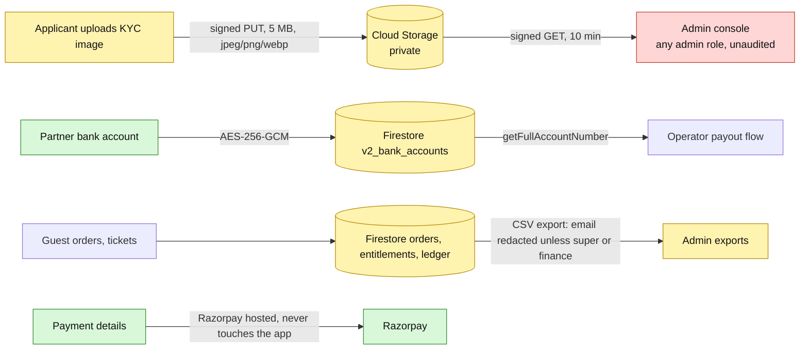

# Security, privacy and data inventory

A cross-cutting view. Sources: models and repositories under `packages/core`, route and plugin code, `docs/architecture/scanner-threat-model.md`, `docs/admin-dashboard/*`, `render.yaml`, and the per-area findings in this package. **No authoritative data-classification, retention, erasure or privacy document exists in the repos**; this page is derived from the code and states where policy is missing. Not legal advice.

## 1. Where personal data lives
| Store | Personal data held | Notes |
|---|---|---|
| `v2_auth_users` (Better Auth; read-only to admin routes) | email, name, password hash, sessions | sessions in `v2_auth_sessions`; accounts in `v2_auth_accounts` |
| `v2_email_otps` | OTP HMAC hashes tied to emails (key `EMAIL_OTP_SECRET`) | 60 s resend cooldown, 5-attempt lockout |
| `v2_guest_profiles` | display name, **date of birth**, city, tastes, intents | 18+ rule in the model |
| `v2_onboarding_requests` | legal name, contact person, phone, city, website, instagram, registration number, **KYC document labels with storage paths** | images live in Cloud Storage |
| **Storage bucket** (`FIREBASE_STORAGE_BUCKET`) | **KYC images** (private ACL, signed PUT URLs bound to content type and size; signed GET for admins, 10-minute TTL); event posters (public-read, separate path) | **no retention rule or lifecycle policy documented**; highest-risk store |
| `v2_verification_attempts` | user id, document type, outcome, provider, time | **verified:** no document number is stored here |
| `v2_bank_accounts` | holder, bank name, IFSC, `last4` (plain), **full account number encrypted** (AES-256-GCM, scrypt key from `ENCRYPTION_KEY`, organisation id as AAD) | `verified` never set; legacy rows decrypt with published constants until re-encrypted (PR #120) |
| `v2_orders`, `v2_entitlements` | buyer id, **contact name/email/phone** (placeholder `guest@example.com` when none sent), holder names, scan counts | retention "indefinite" per scanner doc |
| `v2_scan_ledger` | guest name, email, phone, device, operator, scan history | indefinite |
| `v2_door_sales` | guest name, phone, age, gender, email, table, payment reference, operator name | |
| `v2_cover_wallets`, `v2_cover_wallet_txns` | user id, balances, transactions | |
| `v2_follows`, `v2_social_notifications`, `v2_notifications` | social graph, inbox | |
| `v2_support_tickets`, `v2_safety_reports`, `v2_user_bans` | requester and target identifiers, free text, trust-and-safety data | support DTO leaks internal notes to the requester (guest portal doc) |
| `v2_admins`, `v2_admin_audit_logs`, `v2_proposed_actions` | admin identities, before/after payloads, IP and user agent (not on the wire) | audit rows are append-only by convention |
| `v2_staff_credentials` | staff credential state (temporary-password rotation flag) | invitation emails contain a plaintext temporary password |
| `v2_provider_*` | payment ids, event ids, payload **hash** | raw webhook bodies deliberately not stored |
Aadhaar and PAN: only a **format check** exists (no real KYC provider; D-018 labels it a format check); the numbers are verification input and not persisted in the attempt log; `OnboardingProfile` has no Aadhaar or PAN field. Phone verification uses Firebase Identity Platform.

## 2. Data flow of the most sensitive items

## 3. Controls that exist
- **Transport and boundaries:** nginx edge (host allow-list, rate limits, 1 MB body cap, header washing, optional origin lock), strict CORS (exact origins, no wildcards), double-submit CSRF in the Next BFFs, httpOnly session cookies, no secrets in frontends.
- **AuthN/Z:** Better Auth sessions; org RBAC with ABAC path check; separate platform-admin authority with three tiers and dual control; scanner two-credential model; rate limits per class; idempotency on mutations; optimistic locking.
- **Data protection:** AES-256-GCM for bank accounts; private KYC bucket with short-lived signed URLs; pino redaction of authorization, cookie, `x-api-key`, `x-scanner-session-token`, `*.razorpay_signature`, `*.razorpay_payment_id`, `*.secret`, `*.card`, `*.contact`, `*.vpa`, `*idToken*`, `*refreshToken*`; nginx logs omit query strings and bodies; CSV exports escape formula injection and redact emails by role; public venue profiles exclude contact info; Razorpay hosted payment (the logger also redacts card and VPA fields defensively).
- **Supply chain:** CodeQL, dependency review (fails on high; denies GPL-2.0/3.0, AGPL-1.0/3.0, LGPL-2.0/2.1/3.0, SSPL-1.0), `pnpm audit --audit-level=high`, TruffleHog, Trivy (HIGH/CRITICAL blocking), OSSF Scorecard, security pins file, SHA-pinned Actions. The frontend repo has none of these workflows.

## 4. Secrets and rotation
| Secret | Where it lives | Rotation effect (documented?) |
|---|---|---|
| `BETTER_AUTH_SECRET` | Render dashboard | effect on sessions undocumented |
| `MAGIC_TICKET_SECRET` | Render dashboard | invalidates every QR, wallet QR, couple token, offline manifest and derived key at once (undocumented in repo) |
| `ENCRYPTION_KEY` (+ `ENCRYPTION_SALT`) | Render dashboard | legacy-default records stay readable; losing the key makes new records unreadable; needs an off-platform backup (only implied by a `render.yaml` comment) |
| `EMAIL_OTP_SECRET` | Render dashboard | invalidates outstanding OTP hashes |
| Razorpay key id/secret/webhook secret | Render dashboard | provider-side rotation procedure undocumented |
| `NGINX_READINESS_TOKEN` | Render, GitHub secret, and frontend `GATEWAY_READINESS_TOKEN` | must be kept in sync across three places |
| `NGINX_ORIGIN_VERIFY_SECRET` | Render dashboard and Cloudflare rule | one accepted value: rotation causes a short 403 window |
| `RENDER_API_KEY`, `FRONTEND_REPO_TOKEN`, `BACKEND_REPO_TOKEN`, `TURBO_TOKEN` | GitHub secrets | |
Every secret is `sync: false` in `render.yaml` (held only in the dashboard). **There is no rotation runbook.**

## 5. Findings (verified unless marked reported)
| # | Sev | Finding |
|---|---|---|
| SP-1 | High | No data retention, erasure (DPDP Act or GDPR), consent, data-subject-request or lawful-basis documentation; no PII inventory existed before this page |
| SP-2 | High | No backup, restore or disaster-recovery documentation (Firestore backups or point-in-time recovery, bucket versioning, secret backups, region choice) |
| SP-3 | High | KYC images have no documented retention or lifecycle rule; signed-read URL minting is unaudited and open to every admin role (admin console doc) |
| SP-4 | High | Guest support DTO leaks internal notes, assignee, timeline and SLA to the requester |
| SP-5 | Med | Memory-driver dev actors: when `NODE_ENV != production`, the driver is memory and no session exists, the gateway fabricates an actor from `x-user-id`/`x-organization-id` headers (default `user_1`, role `owner`); safe only on a private machine |
| SP-6 | Med | Seed scripts embed a development password and owner email and assume the real `c1rcle-v2` project (`seed-scanner-e2e.ts`, verified); `configure-storage-cors.ts` hard-codes allowed origins (localhost 4000/3001/3000 and `https://thec1rcle.com`, **not** staging or Vercel hosts, verified) |
| SP-7 | Med | No error tracker, APM, tracing or alerting: `NEXT_PUBLIC_SENTRY_DSN` is declared but **no Sentry SDK exists** in any `package.json` (verified) |
| SP-8 | Med | Frontend repo has no CodeQL, dependency review, audit, secret scan, Renovate, CODEOWNERS or PR template |
| SP-9 | Med | `BE/.mcp.json` and `FE/.mcp.json` are tracked; the backend one contains an absolute Windows path of a named developer machine; `.claude/worktrees/*` full repo copies exist locally (gitignored) |
| SP-10 | Low–Med | Invitation emails carry a plaintext temporary password (forced rotation on first login) |
| SP-11 | Low | No licence file or NOTICE in either repo root; `package.json` files are `private` with no licence field |
| SP-12 | Info | Secret rotation effects for `BETTER_AUTH_SECRET` and `MAGIC_TICKET_SECRET` undocumented |
| SP-13 | Info | `bank-account.ts` comment says AES-256-CBC while the code is GCM (verified); `GuestProfileRepository` is declared twice in `repositories.ts` (lines 1406 and 1466, verified; TypeScript merges them) |
Per-area findings: partner (`06-partner-dashboard/13-…`), admin (`07-admin-console/14-…`), scanner (`09-scanner-app/11-…`), guest (`08-guest-portal/07-…`), payments (`10-payments-and-finance/09-…`), edge (`00-system-overview/NGINX-DREAM-ARCHITECTURE.md`).

## 6. Suggested policy documents to write
Data classification and PII inventory (start from section 1); retention and erasure policy (KYC images first; scan ledger and entitlements are "indefinite" today); backup and DR plan; secret rotation runbooks; incident response; a privacy notice and terms (the guest portal pages are stubs); access review for platform admins (any admin can read everything, including KYC links).
