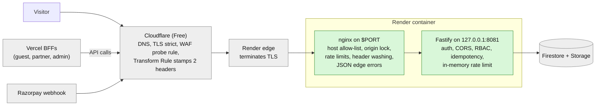
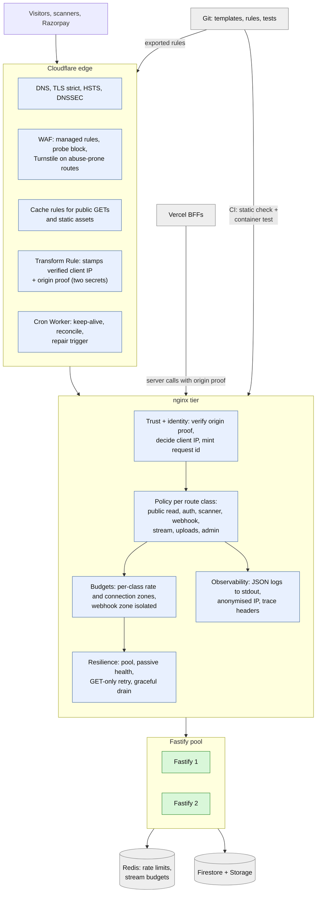
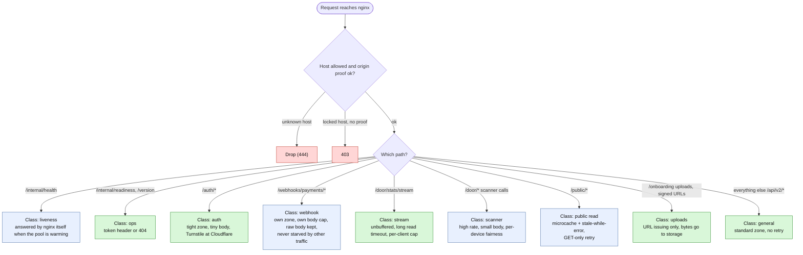
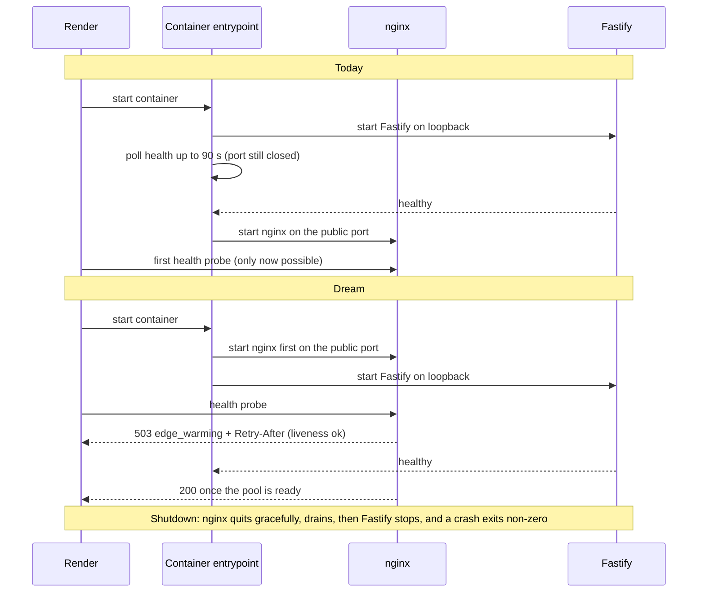
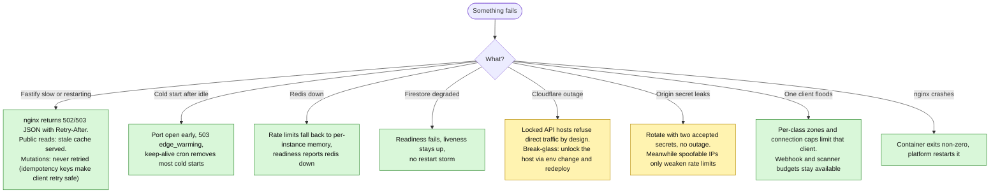
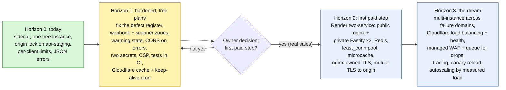

# nginx: the dream architecture

**What this document is.** A design proposal for the edge layer of C1RCLE: what nginx should be in the ideal end state, how far today's setup is from it, and the staged path between them. It is written for the Expert Labs team and for the owners who must decide how much to spend.
**What it is not.** It is not a record of decisions. The "dream" parts are **proposals**; nothing in the Horizon 1–3 sections is built unless this page says so. Where a claim describes the live system it is marked **built**; where it comes from the repo's own plan it is marked **planned**.
**Snapshot:** 2026-10-24, based on backend `origin/staging` (tip `5790235`, PR #142) plus the unmerged anonymised-logging branch (#143). The backend branch used for most of this package is behind staging and lacks PRs #140–#142; this page describes staging.

Related: `ARCHITECTURE.md` (system overview), `../11-infrastructure-and-cicd/README.md` (infra and CI), repo docs `docs/nginx/*`, staging-only `docs/operations/cloudflare-edge.md`, and root `cloudflare_plan.md`.

## Contents
1 Constraints · 2 What exists today · 3 Design principles · 4 The dream, in one picture · 5 Who owns what · 6 The dream nginx in detail · 7 Resilience and failure modes · 8 Three horizons · 9 Current defects (register) · 10 Decisions the owners must make · 11 Stale docs

---

## 1. Constraints that shape every choice
| Constraint | Source | Effect on the design |
|---|---|---|
| Everything on **free plans** for now (no Workers Paid, Waiting Room, Argo, Load Balancing) | owner decision 2026-10-18 | Horizon 1 must work with one free Render instance and the free Cloudflare plan |
| **Compute stays on Vercel (Next apps) and Render (Fastify)**; Cloudflare is the edge | same | nginx fronts the **API only**; the BFFs stay on Vercel |
| **Offline door scanning is required** | same | the edge must carry manifest and sync traffic reliably and never become a single shared bottleneck at door opening |
| Render **free** plan: one instance, sleeps when idle (about 30–40 s cold start), no private services | `render.yaml`, plan | the sidecar topology (nginx and Fastify in one container) is the only option today |
| Cloudflare free: **5 custom WAF rules, one rate-limit rule** (already used by the leaked-credential check), Bot Fight Mode cannot be skipped, Workers 100k requests/day and 10 ms CPU | `cloudflare_plan.md` | nginx must carry per-route rate limiting; Workers cannot sit on the request path |
| Payments and KYC are regulated flows | repo docs | the webhook and upload paths need explicit, protected policy |

## 2. What exists today (built)

What nginx does today (**built**, staging): host allow-list (unknown host → connection dropped with 444), optional origin lock (a locked host returns 403 unless Cloudflare's secret header is present), trusts the visitor IP only when that secret verifies, overwrites `X-Forwarded-*`/`X-Real-IP`/`X-Request-Id` and blanks identity-spoofing headers, rate limits (`c1rcle_edge_general` 10 r/s burst 20, `c1rcle_edge_auth` 5 r/s burst 10, 100 connections per client, all keyed on the verified client address), 1 MB body cap, 10 s header / 15 s body timeouts, 5/30/30 s proxy timeouts, JSON error envelopes for 413/429/502/503/504 with request id, token-gated readiness and version, an unbuffered SSE location with a 20-minute read timeout for the door stats stream, structured JSON access logs (no query strings) tailed to the container output.
What it deliberately does **not** do: no auth decisions, no CORS (that lives in Fastify), no caching (`proxy_cache off`, and it hides the upstream `Cache-Control`, forcing `no-store` on API responses), no retries (`proxy_next_upstream off`), no load balancing (one upstream).
Planned and partly applied on the Cloudflare side: strict TLS, HSTS (1 day), tiered cache, probe-blocking rule, origin lock on `api-staging` (applied to staging only; production is untouched).

## 3. Design principles for the dream
1. **nginx is the only public listener for the API and is not an application.** It enforces transport, shape and volume; it never decides who a user is or what they may do. (Existing SOTA-1/2 and "not a second application layer".)
2. **Trust is established once, at the outermost layer you control, and everything inside inherits it.** Client identity is *decided* at the edge (verified), carried in a single header nginx writes, and never invented downstream. (SOTA-6.)
3. **No single noisy client can starve another, and nothing can starve the money path.** Webhooks, auth, scanner traffic and public reads get separate budgets.
4. **Every failure produces a readable, correlated answer.** Edge errors carry the request id **and** the CORS headers a browser needs to read them.
5. **Never retry what is not safe to retry.** Mutations are never replayed by the proxy; only provably idempotent public reads may be.
6. **Config is code.** Every rule is in git, rendered from templates, statically checked **and** exercised by a container test in CI; nothing lives only in a dashboard.
7. **Degrade, don't die.** Cold start, a restarting backend and a lost cache must produce a short, honest "warming up" answer, not a closed port.
8. **One cache owner per path.** Either Cloudflare or nginx caches a given route, never both.
9. **Cost-aware.** The dream must have a version that runs on the free plans, a version unlocked by a first paid step, and a full version; each stage is useful on its own.

## 4. The dream, in one picture


## 5. Who owns what (the contract between layers)
| Concern | Cloudflare | nginx | Fastify | Vercel BFF |
|---|---|---|---|---|
| TLS and certificates | terminates for visitors; strict to origin | terminates only in the production profile; otherwise trusts the platform | none | none |
| DDoS, bots, known-bad paths | **owns** (WAF, Bot Fight, probe rule) | backstop only | none | none |
| Client identity (IP) | **stamps** the verified address | **decides** (trusts it only with valid proof) and forwards one clean value | consumes it (`trustProxy` limited to nginx) | forwards the visitor IP to the API |
| Origin proof | sends a secret header (later mutual TLS) | **verifies**, locks hosts | none | sends its own proof on server calls |
| Rate limiting | one free rule (taken); more on paid | **owns per-route budgets** | per-user and per-org business limits; Redis when scaled | none |
| Caching | **owns** public GETs and static assets | optional microcache only to stop stampedes, never the same route | sets correct `Cache-Control` | owns HTML cache |
| CORS and cookies | none | none (but must add CORS headers to its own error pages) | **owns CORS** | owns cookies and CSRF |
| Request id and tracing | none | **mints** id and trace header | accepts only from the trusted proxy | passes through |
| AuthN, AuthZ, tenancy, idempotency | none | none | **owns** | none |
| Observability | analytics, WAF events | structured logs, stdout | structured logs, audit | app logs |

## 6. The dream nginx in detail
Snippets below are **illustrative design sketches, not applied config**. Names follow the existing templates (`c1rcle_*` zones, `$c1rcle_client_ip`).

### 6.1 Trust and identity
- **Two accepted origin secrets** (current and next) so rotation never causes an outage. Built shape: the map already supports it; the entrypoint, the validator and the Cloudflare rule need a second variable. Today one value is rendered, so rotation means a 403 window.
- **Real IP validation:** accept `X-C1-Client-IP` only if it parses as an IPv4 or IPv6 address (the current pattern accepts any 2–45 characters of hex, colon and dot, so a verified but garbage value would become a rate-limit key).
- **Horizon 3:** replace the shared-secret header with **Cloudflare Authenticated Origin Pulls (mutual TLS)** once nginx owns TLS (production profile, requires the first paid step). Keep the header for the client IP only.
- **BFF calls:** the Vercel BFFs call the API with their own proof and the visitor IP forwarded (plan item B3.3, open), so server-to-server traffic bypasses Bot Fight Mode on a DNS-only hostname while staying locked.
- Always blank every identity header on ingress and mint `X-Request-Id` (already built; keep).

### 6.2 Route classes (one policy per class)

Today only auth, stream, readiness/version, health and a catch-all exist. The **new** classes are the gap:
- **Webhook class:** today `POST /api/v2/webhooks/payments/razorpay` falls into the general location, sharing the general rate zone and a 1 MB cap. A busy period or a shared key can 429 the provider. The dream gives it its own zone (so it cannot be starved), its own small body cap, raw-body pass-through (signature verification needs the exact bytes), a tighter timeout, and **no** CORS or cookie handling.
```nginx
# illustrative, not applied
limit_req_zone "razorpay" zone=c1rcle_edge_webhook:1m rate=50r/s;
location = /api/v2/webhooks/payments/razorpay {
  limit_req zone=c1rcle_edge_webhook burst=100 nodelay;
  client_max_body_size 256k;
  proxy_request_buffering on;          # keep the raw body intact
  include /etc/nginx/snippets/c1rcle/proxy-common.conf;
  proxy_pass http://c1rcle_fastify;
}
```
- **Scanner class (`/door/*`):** door opening can send hundreds of calls from few IPs (one venue, one Wi-Fi). Today they share the general 10 r/s zone per client address. The dream keys scanner budgets on the **scanner session or device** (from a header nginx can see) as well as IP, so a venue behind one NAT does not throttle itself while an attacker is still limited.
- **Public read class:** see 6.4.
- **Liveness vs readiness split:** liveness is answered by nginx locally (so the platform never kills a healthy edge because Firestore is slow); readiness proxies to Fastify.

### 6.3 Budgets and fairness
| Zone | Today (built) | Dream |
|---|---|---|
| general | 10 r/s, burst 20, keyed on verified client IP | same, but per route class, with burst sized to a page load |
| auth | 5 r/s, burst 10 | same plus Cloudflare Turnstile before OTP send and login |
| webhook | shares general | **separate**, provider-sized |
| scanner | shares general | **separate**, keyed on device/session + IP |
| stream | shares general, 100 connections per client | per-client stream cap in nginx **and** a Redis-backed global budget in Fastify (today in-memory and per instance) |
| connections | 100 per client | per class |
The legacy `circle-v2-backend.onrender.com` hostname (not origin-locked) still keys on the platform hop, so every visitor shares one bucket. The dream removes that hostname (plan item B4.3).

### 6.4 Caching (one owner per route)
- **Cloudflare owns** `/_next/static/*`-style assets and `GET /api/v2/public/*` with a short edge TTL (plan phase C1, **planned**, not built), bypassing when `Authorization` or a session cookie is present.
- **nginx owns nothing by default.** Optional **microcache** (1–5 s) only on the public read class to absorb stampedes when Cloudflare misses, with `proxy_cache_lock` so a thundering herd becomes one upstream request, and `proxy_cache_use_stale error timeout updating http_502 http_503` so a restarting backend still serves the last good page.
```nginx
# illustrative, not applied (Horizon 2)
proxy_cache_path /var/cache/nginx/c1rcle levels=1:2 keys_zone=c1rcle_public:10m max_size=100m inactive=10m use_temp_path=off;
location ^~ /api/v2/public/ {
  proxy_cache c1rcle_public;
  proxy_cache_key "$host$request_uri";
  proxy_cache_valid 200 5s;
  proxy_cache_lock on;
  proxy_cache_use_stale error timeout updating http_502 http_503;
  proxy_cache_bypass $http_authorization $http_cookie;
  proxy_no_cache $http_authorization $http_cookie;
  proxy_next_upstream error timeout http_502 http_503;   # GET only location
  proxy_next_upstream_tries 2;
  proxy_pass http://c1rcle_fastify;
}
```
- Stop forcing `no-store` on everything: today `proxy_hide_header Cache-Control` plus a server-level `Cache-Control: no-store` stamps every API response. The dream lets Fastify declare cacheability per route and nginx only enforces `no-store` on authenticated classes.
- Availability and anything user-specific are **never** cached at nginx.

### 6.5 Upstream pool and retries
```nginx
# illustrative, not applied (Horizon 2, needs more than one Fastify instance)
upstream c1rcle_fastify {
  zone c1rcle_fastify 64k;
  least_conn;
  server fastify-1:8080 max_fails=2 fail_timeout=10s;
  server fastify-2:8080 max_fails=2 fail_timeout=10s;
  keepalive 32;
}
```
- Keep `proxy_next_upstream off` everywhere except the GET-only public location. nginx treats PUT and DELETE as retryable and this API uses both (venue menu, settings, bank accounts), so a blanket retry setting would be unsafe.
- Passive health only (`max_fails`, `fail_timeout`); active probing needs a commercial module and is not required.
- SSE and the scanner do not need session stickiness (state lives in Firestore and Redis), but each stream still pins to one instance for its 15-minute lifetime.
- Preconditions before a second instance (from the repo's own load-balancing doc): measured need (p99 or CPU), Redis proven for rate limits, Firestore-backed idempotency (already true), health probing.

### 6.6 Errors, CORS and correlation
- Edge error pages (413, 429, 502, 503, 504) already return a JSON envelope with `requestId`. The dream adds **CORS headers to those pages** (rendered from the same allow-list as `ALLOWED_ORIGINS`) so a browser reads a real 429 instead of an opaque CORS failure; today they carry none because CORS lives only in Fastify.
- Add a `Retry-After` on 502/503/504 and a distinct `edge_warming` code for the cold-start window (see 6.7).
- Propagate a W3C `traceparent` derived from `$request_id`; Fastify logs it; the Vercel BFF forwards it.

### 6.7 Cold start and lifecycle

- Today the public port is closed for up to **90 s** on a cold boot (observed about 34 s) and the sidecar shell exits **0** after `wait -n`, hiding crashes from the platform. The dream starts nginx first, answers `503 edge_warming` while the backend boots, uses a graceful `nginx -s quit` on SIGTERM, and propagates the failing child's exit code.
- Pin `worker_processes` to a small fixed number (today `auto`, which can over-spawn on a shared free CPU).
- Supervise the log tails (today unsupervised, no rotation) or send logs straight to stdout/stderr.

### 6.8 Security headers and TLS
- API-only CSP `default-src 'none'; frame-ancestors 'none'`, `X-Frame-Options: DENY`, `Permissions-Policy` empty, `Cross-Origin-Resource-Policy: same-site`. Today only `nosniff`, `no-referrer`, `no-store` are set.
- Production profile (when nginx owns TLS, Horizon 2+): add `ssl_ciphers`/`ssl_prefer_server_ciphers off`, OCSP stapling, HTTP/2, HSTS with `includeSubDomains` once all subdomains are HTTPS. HTTP/3 stays at Cloudflare.
- Validate the readiness token's characters (today unvalidated and interpolated into a quoted `map` key: a quote or semicolon would break or inject config; the origin secret is already strictly validated).

### 6.9 Observability
- Structured JSON access logs (built), **anonymised client address** (#143 is open: IPv4 to /24, IPv6 to /48; note `peerIp` is still logged in full), request id, route class, upstream timings, `originVerified`.
- Ship logs to a searchable sink with alerts on 5xx rate, 429 rate per class, cold-start duration, and origin-lock 403 spikes; a dashboard per route class.
- Log retention and privacy policy documented (the access log omits query strings today, which protects tokens).

### 6.10 Config as code and testing
- Every template change passes: the static checker (built, in CI), **and** the Docker integration script (built, **not in CI today**), extended with the missing cases: the SSE location, the webhook class, the 504 path, rotation with two secrets, the CORS-on-error pages, the warming state.
- Export Cloudflare rules to the repo (plan E2) so the dashboard is never the source of truth.
- Include `NGINX_ORIGIN_VERIFY_SECRET`, `NGINX_ORIGIN_LOCKED_SERVER_NAMES` and `NGINX_ADDITIONAL_SERVER_NAMES` in `render.yaml` as declared (secret ones `sync:false`); today they live only in the dashboard, so the repo cannot show whether staging is locked.
- Remove the dead `NGINX_READINESS_ALLOWLIST_LINES` variable.

### 6.11 The full-edge question
The repo documents a "full-edge" topology where nginx also fronts the three Next.js BFFs (`guest.`, `partner.`, `admin.`) and the apps move off Vercel. **This dream does not include it.** It conflicts with the owner decision that compute stays on Vercel; the full-edge templates have also drifted (no multi-host support, no origin lock, no rate limits on BFF locations, not in the sidecar image, not exercised by the container test), so adopting them would silently lose protections. Recommendation: keep nginx **API-only**; revisit only if Vercel is abandoned, and then rebuild the full-edge templates on the same shared snippets with the same tests.

## 7. Resilience and failure modes

Single points of failure that remain even in Horizon 1: one container (nginx and Fastify restart together), one Render region (Singapore), one Firestore project. Horizons 2 and 3 address the first two.

## 8. Three horizons


### Horizon 1: inside today's constraints (free plans, one container)
| Item | What | Effort | Depends on |
|---|---|---|---|
| H1-1 | Two accepted origin secrets (rotation without outage) | small | entrypoint, validator, Cloudflare rule |
| H1-2 | Webhook class: own zone, body cap, raw body | small | none |
| H1-3 | Scanner class keyed on device/session plus IP | medium | decide header to key on |
| H1-4 | Start nginx first, `edge_warming` 503, graceful quit, propagate exit code, fixed workers | medium | sidecar entrypoint |
| H1-5 | CORS headers on edge error pages | small | render allow-list into config |
| H1-6 | API-only CSP and extra security headers | small | none |
| H1-7 | Stricter client-IP and readiness-token validation | small | none |
| H1-8 | Merge #143 anonymised logs; decide on `peerIp` | small | privacy decision |
| H1-9 | Declare origin and extra-host env in `render.yaml`; delete the dead variable | small | none |
| H1-10 | Run the Docker integration test in CI; add the missing cases | medium | CI runner with Docker |
| H1-11 | Cloudflare cache rules for public GETs and static assets; keep-alive cron Worker | medium | plan phase C |
| H1-12 | Disable the legacy `onrender.com` host and forward the visitor IP from the BFFs (B3.3, B4.3) | medium | frontend change |
| H1-13 | Export Cloudflare rules to the repo | small | plan E2 |
Exit check: a direct hit without proof returns 403; two secrets accepted during rotation; the webhook survives a general-zone flood in a test; a cold boot opens the port within seconds and shows `edge_warming`; CI fails if any template or test regresses.

### Horizon 2: the first paid step (owner decision)
Needs a paid Render plan (private services, more than one instance). Moves to the documented **two-service** topology: a public nginx web service and a private Fastify service with two or more instances; Redis for rate limits and the stream budget; `least_conn` pool with passive health; the public-read microcache; nginx-owned TLS (the production profile) enabling **Authenticated Origin Pulls**; per-environment network isolation. Preconditions are the repo's own load-balancing checklist. Exit check: kill one Fastify instance under load and see no user-visible errors beyond in-flight requests.

### Horizon 3: the dream
Active redundancy across failure domains (second region or provider), Cloudflare load balancing with health checks (paid), managed WAF rule sets and a queue for hot ticket drops (the free-plan Durable Object design is **planned** with a stated ceiling of tens of thousands of queued visitors per day), tracing end to end, canary config reloads with automatic rollback, autoscaling on measured load, and payment-grade audit of every edge decision. Gate: sustained real traffic and the legal, tax and provider approvals that already block turning payouts on.

## 9. Current defects (register)
| ID | Sev | Finding | Evidence |
|---|---|---|---|
| N-1 | High | Legacy `onrender.com` host is not origin-locked: all visitors share one rate-limit bucket (the platform hop), so one noisy client can 429 everyone | staging `client-ip.conf.template`; plan B4.3 open |
| N-2 | High | Razorpay webhook has no dedicated location: it shares the general zone (10 r/s, burst 20) and 1 MB cap | `api-locations.conf` has no webhook location (verified) |
| N-3 | Med | Edge error pages (413, 429, 502–504) carry no CORS headers, so browsers see opaque failures | CORS only in Fastify |
| N-4 | Med | Cold start: the public port is closed until Fastify is healthy (up to 90 s, observed about 34 s) | `sidecar-entrypoint.sh` (verified) |
| N-5 | Med | Sidecar exits 0 after `wait -n`, hiding crashes; nginx stops with a fast TERM; log tails unsupervised and never rotated | entrypoint (reported) |
| N-6 | Med | Origin secret has a single accepted value: rotation causes a 403 window | `cloudflare-edge.md` |
| N-7 | Med | Verified client IP is only charset/length checked | `client-ip.conf.template` (reported) |
| N-8 | Med | Readiness token is not charset-validated and is interpolated into a quoted map key | entrypoint (reported) |
| N-9 | Low–Med | No CSP, frame, permissions or CORP headers on the API; production TLS block lacks cipher policy, OCSP stapling and HTTP/2 | templates (reported) |
| N-10 | Low–Med | `proxy_hide_header Cache-Control` plus server-level `no-store` forces `no-store` on all API responses | `proxy-common.conf` (verified) |
| N-11 | Low | `worker_processes auto` on a small shared CPU | `nginx.conf` (verified) |
| N-12 | Low | Anonymised logging (#143) still logs `peerIp` in full | #143 branch (reported) |
| N-13 | Med | Full-edge templates drifted: no multi-host, no origin lock, no BFF rate limits, not in the sidecar image, untested | templates (reported) |
| N-14 | Low | `NGINX_READINESS_ALLOWLIST_LINES` in `render.yaml` is dead; origin and extra-host variables are not declared in the repo | `render.yaml` (reported) |
| N-15 | Med | The Docker integration test (the only check of real nginx behaviour) is not in CI; the SSE location, webhook path and 504 path have no coverage | CI config (reported) |
| N-16 | Info | Per-instance in-memory rate limits and stream budgets; `RATE_LIMIT_STORE=memory` is correct only while there is one instance | `render.yaml` |

## 10. Decisions the owners must make
1. **When is the first paid step?** (Horizon 2 is blocked on it.) Suggested trigger from the plan: when real sales begin.
2. **Keep BFFs on Vercel?** This design says yes (API-only nginx). Confirm, or decide to move compute and accept rebuilding the full-edge templates.
3. **Scanner rate-limit key:** device header, session header, or IP only. Needs a product call on shared venue networks.
4. **Cache owner for public reads:** Cloudflare (recommended) versus nginx microcache.
5. **Break-glass policy** if Cloudflare is down (who may unlock a host, how it is audited).
6. **Log privacy:** keep or drop full `peerIp`; retention period.
7. **Write the ADR.** No ADR records the sidecar topology or the origin-lock model; the decision lives in a topology doc. This page can be the seed.

## 11. Stale documentation to know about
`docs/nginx/issues-and-gaps.md` and `architecture.md` still call the live topology single-service (the sidecar is live); several nginx docs say readiness is IP-gated (it is token-gated); rate-limit keys documented as `$binary_remote_addr` (staging keys on the verified client IP); Redis and Firestore idempotency are described as missing (both exist; Redis is simply not provisioned); the `_freshness.json` source list omits `proxy-wash-headers.conf` and `client-ip.conf.template`; `cloudflare_plan.md` is headed "PLAN ONLY" though phases B1–B5 are applied on staging; `Dockerfile.sidecar` has a comment saying the master needs root while the image runs as a non-root user; `render.yaml` still names `circle-v2-backend.onrender.com` for `PUBLIC_API_URL` and `NGINX_SERVER_NAME`. Live Render and Cloudflare state could not be inspected in this review (the Render MCP server was unreachable), so anything about the live dashboards is unverified.
