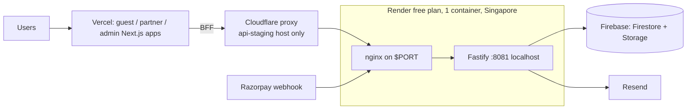

# 11. Infrastructure and CI/CD

## Topology (live, staging)

- **Backend:** one Render web service, Docker image `deploy/docker/Dockerfile.sidecar` (nginx + Fastify in one `node:24-slim` container, non-root uid 1001). Free plan, 1 instance, **sleeps when idle (about 30–40 s cold start)**, branch `staging`, `autoDeploy: false`. Health path in repo: `/api/v2/internal/health` (the live service's health check path was empty as of 2026-10-18; set in the dashboard).
- **Frontends:** three Vercel projects, each built with `cd ../.. && pnpm turbo run build --filter=@c1rcle/app-<name>`; Vercel git integration deploys (no GitHub deploy job). Guest portal and admin console production branch `main`; partner dashboard production branch `staging`. Dev subdomains (`guest.`, `admin.`, `staging.` on thec1rcle.com) are bound to Preview deployments and sit behind Vercel SSO. Dockerfiles for the three Next apps exist (`node:22.22.2-alpine`, `turbo prune`) but it is **not confirmed they are used**.
- **Scanner:** Expo; `expo export` web target only; no store config.
- **Data:** Firebase project (Firestore, Storage); Redis optional.

## nginx edge (`C1RCLE-BACKEND/deploy/nginx`)
> Target architecture, gaps and the staged path (Horizons 1-3): `../00-system-overview/NGINX-DREAM-ARCHITECTURE.md`.

Templates `staging`, `production`, `staging-edge`, `production-edge` rendered by `envsubst` in `nginx-entrypoint.sh`. Host allowlist (444 unknown), HTTPS redirect + TLS 1.2/1.3 (production profile), body cap 1 MB, `limit_conn` 100, rate zones `c1rcle_edge_general` 10 r/s and `c1rcle_edge_auth` 5 r/s (burst 10 on `/api/v2/auth/`), JSON error envelopes for 413/429/502/503/504, `/internal/readiness` and `/internal/version` need `X-Readiness-Token` (404 without; token-based because IP allowlists fail behind Render's edge), `/door/stats/stream` unbuffered with 20 min read timeout. Origin lock: client IP trusted only when a Cloudflare-stamped secret header is valid; direct hits get 403. Docs: `docs/nginx/sidecar-deployment.md`. Env names: `NGINX_PROFILE`, `NGINX_SERVER_NAME`, `NGINX_ADDITIONAL_SERVER_NAMES`, `NGINX_ORIGIN_LOCKED_SERVER_NAMES`, `NGINX_FORWARDED_PROTO`, `NGINX_READINESS_TOKEN`, `NGINX_READINESS_ALLOWLIST_LINES`, `NGINX_ORIGIN_VERIFY_SECRET`, `SIDECAR_FASTIFY_PORT`.

## Cloudflare (free plans only; offline scanning required)
Compute stays on Vercel and Render; Cloudflare is the edge.

| Item | State |
|---|---|
| B1 zone hardening (Full strict, Always HTTPS, min TLS 1.2, HSTS 1 day, tiered cache) | Applied 2026-10-22 |
| B2 `api-staging.thec1rcle.com` as Render custom domain, proxied | Applied (staging only) |
| B3/B4 origin lock (Transform Rule stamps verify + client-IP headers; nginx rejects direct hits) | Applied on staging (backend PRs #140–#143) |
| B5 WAF probe-block rule | Applied; the single free rate-limit slot is used by a leaked-credential check |
| DNSSEC | Pending (DS record at registrar) |
| Frontend forwards visitor IP; disable `onrender.com` hostname; webhook on DNS-only host | Pending |
| B6/B7 Access, moving apps/auth/CORS under new hosts | Pending, risky (auth cookies) |
| Phase C–E: keep-alive cron, caching, Turnstile, analytics, R2 posters, DMARC tightening, CI hostnames, prod cutover | Planned |

**The edge as a whole is not live; production is untouched.** Bot Fight Mode cannot be skipped on Free and may challenge server-to-server traffic (Razorpay webhooks, BFF to API), so those should use a DNS-only hostname.

## CI/CD
**Backend `.github/workflows/ci.yml`** (PRs and pushes to `main`, `staging`): `changes`, `static` (format, lint, typecheck, boundaries, nginx config, security pins, Firestore indexes, no-focused-tests), `test` (build, suite, coverage ratchet), `scenario` (merge only), `firestore-emulator` (Java 21, project `demo-c1rcle`), `docker` (build, Trivy, boot test, refuses-to-boot-when-misconfigured), `contract-parity`, `actionlint`, `commit-lint` (conventional commits incl. PR title), `ci-ok` (single required check). **`deploy`** (staging pushes only): waits for `CI OK` + `Security OK`, triggers Render deploy through its API, `wait-for-deploy.mjs` polls `/internal/version` until commit == `GITHUB_SHA`, `smoke.mjs` (6 black-box assertions), on failure `render-rollback.mjs` + opens an issue.
**`security.yml`** (PRs, pushes, Mondays 06:15 UTC): CodeQL, dependency review (fails on high, denies copyleft), `pnpm audit --audit-level=high`, TruffleHog, Trivy, OSSF Scorecard, aggregated `Security OK`. **`maintenance.yml`** (daily 20:30 UTC): production health smoke (opens/closes `production-incident` issue), lockfile integrity, stale issues. Husky: pre-commit lint-staged; pre-push typecheck, boundaries, security-pins, test. `governance/security-pins.json` + `check-security-pins.mjs` pin packages only to clear advisories. Renovate, CODEOWNERS.
**Frontend `ci.yml`**: PRs: `gate` (format, lint, typecheck, boundaries, `test:coverage`, `expo install --check`, build; steps run `if: always()` so one run reports every failure), `contract-parity`, `ci-ok`. Pushes: Playwright e2e (chromium + webkit; guest, partner, admin; **all backend calls mocked**), `post-deploy-smoke` (staging; waits 90 s then HTTP-checks three hard-coded `*.vercel.app` URLs, not the real hostnames).
Turborepo remote cache enabled with signatures. Full backend detail: `docs/ci-cd.md`.

## Environment variable NAMES (values live only in the Render/Vercel dashboards)
Backend: `NODE_ENV`, `PORT`, `HOST`, `LOG_LEVEL`, `STORAGE_DRIVER`, `ALLOW_MEMORY_STORAGE_IN_PRODUCTION`, `FIRESTORE_PROJECT_ID`, `FIREBASE_CLIENT_EMAIL`, `FIREBASE_PRIVATE_KEY`, `FIREBASE_STORAGE_BUCKET`, `BETTER_AUTH_SECRET|URL|TRUSTED_ORIGINS`, `ALLOWED_ORIGINS`, `CORS_ALLOWED_ORIGINS`, `PUBLIC_API_URL`, `PARTNER_DASHBOARD_URL`, `TRUSTED_PROXY_CIDRS`, `MAGIC_TICKET_SECRET`, `ENCRYPTION_KEY`, `ENCRYPTION_SALT`, `EMAIL_OTP_SECRET`, `RESEND_API_KEY`, `RAZORPAY_*`, `PAYOUTS_ENABLED`, `REDIS_URL`, `RATE_LIMIT_STORE`, `APP_VERSION`, `BUILD_SHA`, `RENDER_GIT_COMMIT`, `NGINX_*`. CI: `RENDER_API_KEY`, `BACKEND_REPO_TOKEN`, vars `BACKEND_REPO|REF`, `TURBO_TOKEN|TEAM`.
Frontend: see `../06-partner-dashboard` (client/server env) and `../09-scanner-app`.

## Drift between repo and reality
- `render.yaml`: **on `staging` it matches the live service** (PR #128 merged 2026-10-18: `plan: free`, `branch: staging`, sidecar Dockerfile, health check path set, verified); **on `main` it is still the old blueprint** (`plan: starter`, `branch: main`, standalone `Dockerfile`, verified). On both it still names `circle-v2-backend.onrender.com` for `PUBLIC_API_URL` and `NGINX_SERVER_NAME`, carries the dead `NGINX_READINESS_ALLOWLIST_LINES`, and does not declare `NGINX_ORIGIN_VERIFY_SECRET`, `NGINX_ORIGIN_LOCKED_SERVER_NAMES` or `NGINX_ADDITIONAL_SERVER_NAMES` (they live only in the dashboard).
- `docs/operations/render-staging.md` describes a two-service design (nginx edge + private Fastify) that is **not** the live topology (single sidecar). `deployment.md` calls the service "Production".
- `docs/operations/cloudflare-edge.md` and `offline-scanning.md` exist on `origin/staging` (and some nginx branches) but not on `main` or the backend checkout used for this review.
- Rate limiter and cache are in-memory; correct only while there is a single instance.
